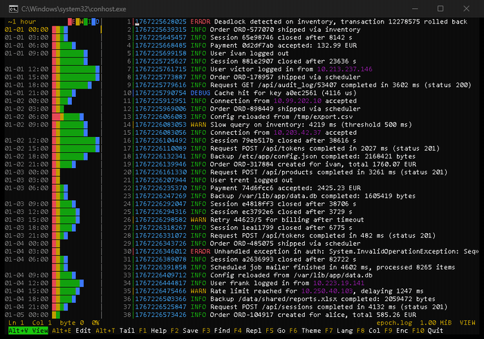
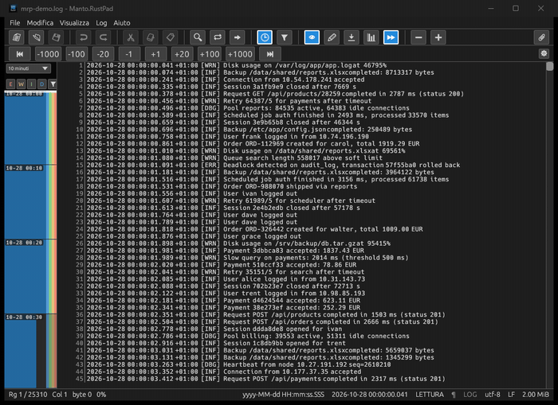

<table>
  <tr>
    <td valign="middle">
      <h1>Manto.RustPad</h1>
      <h3>Un visualizzatore di log per file che non stanno in RAM</h3>
      <p>
        
        
        
        
        
      </p>
      <p>
        <a href="https://github.com/heavymanto/Manto.RustPad/actions/workflows/ci.yml"></a>
        
        
        
        
        
        
      </p>
      <p>
        <a href="docs/BENCHMARKS.md"></a>
        <a href="#quickstart"></a>
        <a href="README.md"></a>
      </p>
    </td>
  </tr>
</table>

---

## Abstract

**Apri un log da 100 GB in pochi secondi, utilizzando pochi mega di RAM. Scorri la sua cronologia con una timeline visuale. Individua immediatamente dove si addensano le criticita', in un solo colpo d'occhio. Usa filtri avanzati per concentrarti solo su quello che interessa. Modifica il contenuto anche con la modalita' a colonne avanzata.**

<p align="justify">
L'idea nasce da un fastidio che conosco bene: esaminare log di grandi dimensioni senza saturare la RAM, cercare i punti di interesse e, all'occorrenza, fare piccole modifiche. L'idea era di sfruttare la gestione della memoria di Rust che, essendo senza GC (Garbage Collector), e' incredibilmente parsimoniosa. Scommessa vinta! Fino ad oggi ho provato piu' tool: alcuni gestiscono bene la memoria ma sono viewer limitatissimi, altri hanno funzioni avanzate ma usano molta RAM, gli editor fanno ancora molta fatica. In nessun caso ho mai visto timeline visuali che mi dessero il colpo d'occhio sia sulla cronologia degli eventi che sulla densita' degli stessi: in un file enorme, come faccio a vedere dove si sono verificati maggiormente gli errori? Cosi' ho deciso di creare il mio tool 5 in 1: apre file enormi, usa poca RAM, e' velocissimo, da' un colpo di colore per focalizzarsi su quello che serve, scorre la cronologia degli eventi e individua subito dove stanno i problemi. Tutto questo sia in modalita' terminale che GUI, e su ben 3 OS. Il design e' minimale: qui si va al sodo.
</p>

**Manto.RustPad** apre il file memory-mappato e in sola lettura, costruisce un indice sparso delle righe in background, e appena premi *Modifica* lo stesso file diventa editabile: nessun ricaricamento, nessuna copia. Le modifiche vivono in una piccola piece table accanto all'originale intatto; il salvataggio scrive in streaming un file nuovo e lo scambia in modo atomico.
## I cinque pilastri

Cinque idee ben note, applicate fino in fondo:

1. **Il file sta su disco, non in RAM.** E' memory-mappato in sola lettura: il kernel consegna le pagine che l'editor chiede, quando le chiede (come `less`). L'indice delle righe si costruisce in background e si mette in pausa quando l'utente salta, per non contendere il disco. Su un file da 100 GB l'editor occupa decine di MiB.

2. **Il salvataggio e' atomico, la sessione e' un diario delle modifiche.** Il file nuovo viene scritto accanto al vecchio, scaricato su disco e scambiato con un rename: lo stesso protocollo dei commit di SQLite. La sessione registra solo le modifiche, quindi dopo un crash, o dopo aver chiuso senza salvare, schede, cursori e modifiche non salvate tornano al loro posto. La piece table e' la struttura descritta da Crowley per gli editor di testo nel 1998 e adottata da VS Code nel 2018.

3. **I livelli si vedono prima di leggerli.** ERROR rosso, WARN giallo, INFO verde, date e orari colorati: il colore preattentivo viene processato dall'occhio prima della lettura della riga (il lavoro di Healey sul preattentive processing). Un picco di errori in un log di milioni di righe si nota appena entra nello schermo.

4. **La timeline e' una mappa proporzionale del file.** Una colonna di periodi (minuto, dieci minuti, ora, giorno), ognuno alto quanto il suo volume di righe e diviso per livello: le zone dense si vedono prima di arrivarci con lo scroll. I periodi si trovano per ricerca binaria, senza leggere il file.

5. **Multi uso, multi piattaforma.** Si usa in un terminale (per esempio in SSH) senza bisogno dell'interfaccia grafica, oppure in finestra sul desktop. Gira su Windows, Linux e macOS.
## POC con i tool noti

Un file da 6,0 GB (60 milioni di righe), una macchina, un hard disk. Il metodo per intero in [docs/BENCHMARKS.md](docs/BENCHMARKS.md):

| | Memoria | Apertura | Cosa succede |
|---|---:|---|---|
| L'editor che tutti usano | 6.288 MiB | 7 s a caldo / 26–30 s a freddo | tiene tutto in RAM |
| Quello del sistema operativo | 4.100 MiB | 2,8 s | **trunca a 4 GiB — perde 1,7 GB al salvataggio** |
| Il visualizzatore in streaming | 43 MiB | UI 0,5 s | scansione completa in background, ~86 s |
| Quello commerciale | 19 MiB | 7,5 s | scrive una copia temporanea di 5,7 GB; `Ctrl+Fine` rilegge il file |
| **Manto.RustPad** | **13–35 MiB** | **all'istante** | esatto, nessun troncamento, nessuna copia; l'indice si costruisce in background |

---

## Due frontend, un motore

Il motore e' uno, `mrp-core` (documenti, schede, ricerca, modifiche, sessioni), con due interfacce: **`mrp-tui`** per il terminale, pensato per i server e per SSH; **`mrp-gui`** per il desktop, con menu', barra degli strumenti, finestre di dialogo, appunti di sistema e drag-and-drop. Una funzionalita' aggiunta al motore arriva in entrambe.

| `mrp-tui` — nel terminale | `mrp-gui` — in una finestra |
|:---:|:---:|
| <a href="#due-frontend-un-motore"></a> | <a href="#due-frontend-un-motore"></a> |

| | `mrp-tui` | `mrp-gui` |
| --- | --- | --- |
| **Si avvia** | `mrp-tui file...` | `mrp-gui file...` |
| **Look** | sei temi da terminale | Blu (stile Total Commander), Debian, Scuro, Chiaro — o Automatico, che segue il sistema |
| **Timeline** | `Alt+B`, una colonna accanto al testo | lo stesso, o una barra accanto alla scrollbar |
| **Menu'** | i tasti funzione | menu' veri, barra strumenti, barra di stato, scrollbar |

## In azione

`mrp-tui` su un log: apertura, scroll, timeline accesa con `Alt+B` (ogni periodo alto quanto il suo volume di righe, diviso per livello ERROR, WARN, INFO, DEBUG) e colori dei livelli con `Alt+L`:

<a href="#in-azione"></a>

`mrp-gui`, lo stesso motore in una finestra: apertura, scroll, colori:

<a href="#in-azione"></a>

## Cosa fa

- Apre file di qualunque taglia all'istante e li scorre con rotella, scrollbar e salti di pagina (`Alt+PgSu/PgGiu'`: 10 pagine, con Shift 100, con Ctrl 1000). I numeri di riga arrivano dall'indice in background, che si mette in pausa quando l'utente salta. Si puo' andare a una riga (`Ctrl+G`) o a un orario, seguire la coda del file come `tail -f` (`Alt+T`), filtrare le righe come `grep` (`Alt+G`), colorare i livelli (`Alt+L`).
- Timeline del file: una colonna di periodi (minuto, dieci minuti, ora, giorno), ognuno alto quanto il suo volume di righe e diviso per livello. Il tratto che si sta leggendo e' marcato; un click o un trascinamento porta al punto. I periodi si trovano per ricerca binaria, senza leggere il file.
- Modifica: `F4` rende editabile lo stesso file, senza ricaricarlo e senza copie. Con la modalita' colonna (`F8`, o `Alt`+trascinamento col mouse) digitare, `Tab`, copia, taglia e incolla agiscono su tutte le righe del blocco, su file di qualunque taglia.
- La memoria non dipende dalla taglia del file: decine di MiB in ogni caso.
- Offset a 64 bit ovunque, test su file oltre i 4 GiB, errore esplicito invece del troncamento silenzioso, salvataggio a prova di crash.
- Piu' schede insieme; la sessione ripristina schede, cursori e modifiche non salvate alla riapertura. Visto che il diario contiene solo le modifiche, su un file da 100 GB con poche correzioni la sessione pesa pochi KB.
- Trova e sostituisci (`Ctrl+F` / `Ctrl+H`) su testo, glob e regex, con preview prima di applicare e un solo `Ctrl+Z` che annulla tutto.
- Codifiche: UTF-8/16/32, 53 tabelle a byte singolo, le multi-byte dell'Asia orientale, anche su file piu' grandi della RAM.

Non e' un analizzatore di log (gli aiuti alla lettura sono quelli che servono a un visualizzatore) e non e' una piattaforma di plugin o un IDE.

## Download

Versione attuale: **0.1.4** (novembre 2026).

Niente installazione: estrai il pacchetto ed esegui. Entrambi i programmi funzionano subito in modalita' portabile (inglese incorporato, le altre sei lingue in `lang/` accanto ai programmi). Se li vuoi come comandi da qualunque cartella, c'e' `install.ps1` su Windows e `install.sh` su Linux e macOS. Su Windows, `install.ps1 -Associa` aggiunge mrp-gui all'elenco "Apri con" di `.txt` e `.log` e a Impostazioni > App predefinite, solo per l'utente corrente e senza admin: il default resta una scelta che firma Windows. Su Linux, `./install.sh --associa` imposta il default per i file di testo.

<div align="center">
<details>
<summary><h3>💚 ⬇️ DOWNLOAD ⬇️ 💚</h3></summary>
<br/>
<p align="center">
  <a href="#scaricalo"></a>
  <br/><br/>
  <b>Noi ti doniamo il software. Tu donaci una stella.</b> ⭐<br/>
  <i>Le stelle fanno sognare — e per un progetto giovane sono la prova<br/>
  che serve. Sono il carburante di cio' che verra'.</i>
  <br/><br/>
  <a href="https://github.com/heavymanto/Manto.RustPad"></a>
  <br/>
  <a href="https://github.com/heavymanto/Manto.RustPad/stargazers"></a>
  <a href="https://github.com/heavymanto/Manto.RustPad/releases"></a>
  <br/><br/>
  <a href="https://github.com/heavymanto/Manto.RustPad/releases/download/v0.1.4/manto-rustpad-0.1.4-win-x64.zip"></a>
  <a href="https://github.com/heavymanto/Manto.RustPad/releases/download/v0.1.4/manto-rustpad-0.1.4-linux-x64.tar.gz"></a>
  <a href="https://github.com/heavymanto/Manto.RustPad/releases/download/v0.1.4/manto-rustpad-0.1.4-macos-aarch64.tar.gz"></a>
</p>
</details>
</div>

Puoi anche compilarlo dai sorgenti: due comandi, nel [Quickstart](#quickstart).

## Quickstart

Serve [Rust](https://rustup.rs) e un clone di questo repository.

```sh
cd rust
cargo build --release                 # mrp-tui e mrp-gui in target/release/
./target/release/mrp-tui tuofile.txt      # F1 = aiuto, F4 = modifica, F10 = esci
./target/release/mrp-gui tuofile.txt     # lo stesso, in una finestra
```

Nessun log sottomano? Creane uno, della taglia che vuoi, stessi byte su ogni macchina:

```sh
./target/release/mrp-loggen --size 2M --scenario bursts demo.log
```

## Limiti noti

- Windows prima: sviluppato e testato principalmente su Windows. L'editor da terminale e il core girano anche su Linux (Debian, WSL); le release sono compilate in automatico dalla CI.
- Regex, glob e ignore-case funzionano solo su documenti UTF-8; la ricerca di testo semplice funziona in ogni codifica.
- Le misure vengono da una macchina sola e un hard disk solo: [docs/BENCHMARKS.md](docs/BENCHMARKS.md).
## Sviluppo

```sh
cd rust
cargo test --workspace
cargo fmt --all --check
cargo clippy --workspace --all-targets -- -D warnings
```

## Struttura del repository

| Percorso | Contenuto |
|---|---|
| `rust/crates/mrp-core` | il motore: `FileSource`, `LineIndex`, `PieceTable`/`Document`, ricerca, sessioni, codifiche, lingue |
| `rust/crates/mrp-tui` | l'editor da terminale (ratatui) |
| `rust/crates/mrp-gui` | la finestra del desktop (egui) |
| `rust/crates/mrp-loggen` | log sintetici di qualunque taglia, stessi byte a parita' di seme |
| `docs/` | `MANUAL.md` (il manuale), `BENCHMARKS.md` (misure, metodo) |
| `bench/` | script riproducibili e risultati grezzi |

## Documentazione

- [docs/MANUAL.md](docs/MANUAL.md) — il manuale delle funzionalita' in dettaglio
- [CHANGELOG.md](CHANGELOG.md) — cosa e' cambiato
- [SECURITY.md](SECURITY.md) — come segnalare una vulnerabilita' in privato

## Contribuire

Vedi [CONTRIBUTING.md](CONTRIBUTING.md). In breve: gli offset sono a 64 bit, il file intero non entra mai in memoria, e ogni numero nei documenti e' stato misurato davvero. E' un progetto hobby — tutto viene letto, ma nessun tempo di risposta e' promesso.

## Licenza

Copyright (C) 2026 Francesco Mantovanelli.

Questo programma e' software libero: puoi ridistribuirlo e/o modificarlo nei
termini della **GNU Affero General Public License v3.0** come pubblicata dalla
Free Software Foundation — vedi [LICENSE](LICENSE). La licenza commerciale e'
disponibile su richiesta per prodotti che non possono viaggiare in AGPL.

---

<div align="center">

**Autore** — Francesco Mantovanelli · **Progetto** — Manto.RustPad

</div>
