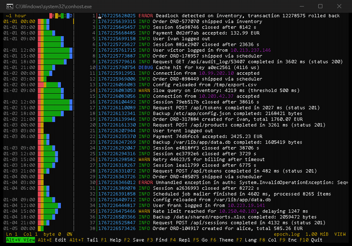
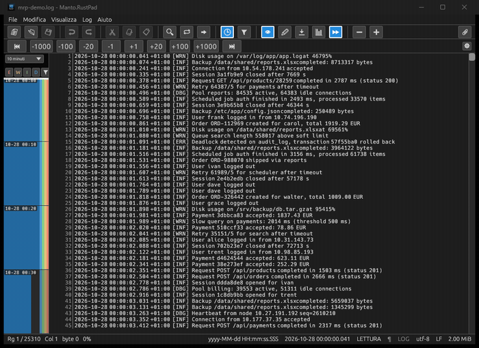
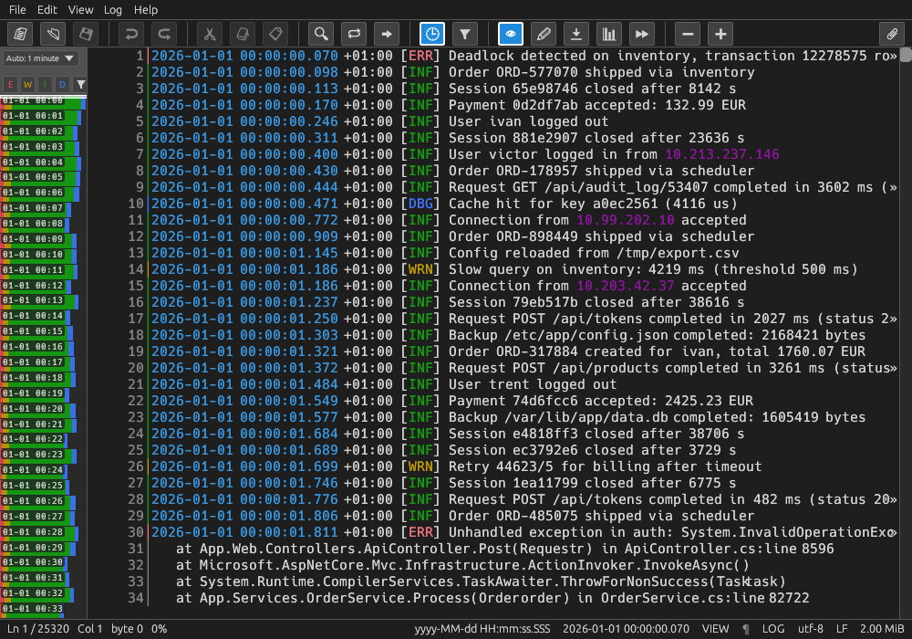
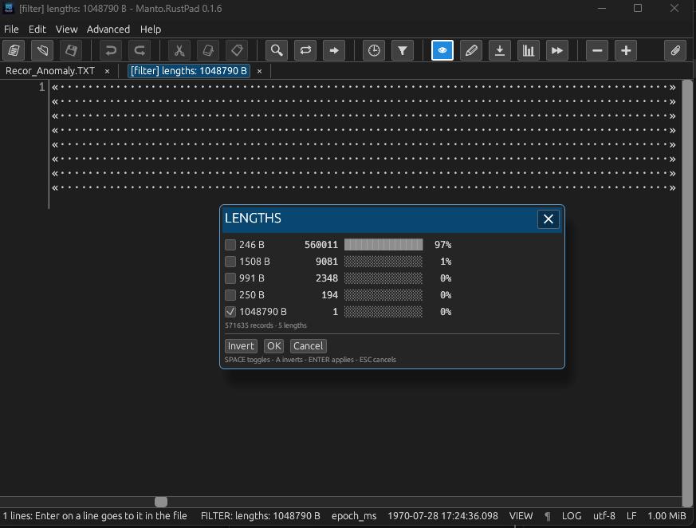

<table>
  <tr>
    <td valign="middle">
      <h1>Manto.RustPad</h1>
      <h3>A log viewer for files that don't fit in RAM</h3>
      <p>
        
        
        
        
        
      </p>
      <p>
        <a href="https://github.com/heavymanto/Manto.RustPad/actions/workflows/ci.yml"></a>
        <a href="https://github.com/heavymanto/Manto.RustPad/releases"></a>
        
        
        
        
        
      </p>
      <p>
        <a href="#quickstart"></a>
        <a href="README.it.md"></a>
      </p>
    </td>
  </tr>
</table>

---

## Abstract

**Open logs and record files of 100 GB in seconds, using a few dozen MB of RAM.**

An ultra-fast viewer and editor written in Rust — available both in the terminal (**TUI**) and on the desktop (**GUI**), for Windows, Linux and macOS.

| `mrp-tui` — in the terminal | `mrp-gui` — in a window |
|:---:|:---:|
| <a href="#two-frontends-one-engine"></a> | <a href="#two-frontends-one-engine"></a> |

## Why it exists

This project was born from a daily annoyance: analysing huge logs without saturating the system's memory, or scanning large fixed-record files to fix small anomalies on the fly.

Until today you had to juggle `less`, `grep`, hex editors and custom scripts — awkward solutions that do not help you spot the problems at a glance.

**Manto.RustPad** brings it all together in an essential interface, no frills: open the file instantly, isolate the anomalies visually and, when needed, edit in place.

## Under the hood (Architecture)

To guarantee high performance and data safety even on gigantic files, **Manto.RustPad** rests on precise architectural choices:

1. **Memory-mapped I/O and non-blocking indexing.** The file stays on disk, read-only; the kernel loads only the pages the screen asks for. The line index builds in the background and pauses automatically while the user navigates, so it never competes for the disk.
2. **Atomic saving and piece table.** The edits live in a *piece table* (the same data structure VS Code uses). On save, the new file is written next to the original, flushed to disk and swapped in with an atomic `rename` — the SQLite-style protocol — to prevent corruption.
3. **Binary search on the timeline.** The time intervals of the timeline are found by binary search directly on the file, without scanning it linearly.
4. **64-bit offsets.** Past the limits, the tool returns explicit errors instead of silently truncating the data.
5. **Natively cross-platform (TUI + GUI).** Written in Rust without a garbage collector: it runs in a window on the desktop or over SSH, straight in the terminal.

## Main features

### Instant navigation and exploration

- **Zero waiting on huge files:** immediate opening whatever the size (tested above 4 GiB and up to hundreds of GB).
- **Fast movement:** smooth scrolling, scalable page jumps (`Alt+PgUp/PgDn`: 10 pages, `Shift` 100, `Ctrl` 1000) and a direct jump to a line number (`Ctrl+G`) or a time.
- **Live monitoring:** `tail -f`-style *follow* mode (`Alt+T`) to keep up with logs in real time.
- **Several tabs and persistent sessions:** many files at once; after a crash or an accidental close, tabs, cursors and unsaved edits are restored (on a 100 GB file the session weighs a few KB).

### Visual analysis at a glance

- **Preattentive colours (`Alt+L`):** `ERROR`, `WARN`, `INFO`, `DEBUG` levels, dates and times coloured to be caught by the eye before the line is even read.
- **Proportional timeline (`Alt+B`):** a side map split into time periods (minute, ten minutes, hour, day). The height of each block reflects the volume of lines and the distribution of the levels: error spikes show up before you reach them by scrolling.
- **Record length check (`Alt+H`):** counts the bytes of every line (line ending excluded) and builds an interactive histogram with percentages. The dominant formats sit on top, the out-of-size lines at the bottom: tick the lengths you want and the view filters instantly. Ideal for spotting corrupted records in fixed-format files.
- **`grep`-style filters (`Alt+G`):** quickly isolate only the lines you care about.

<p align="center">
  
</p>
<p align="center"><em>The proportional timeline (<code>Alt+B</code>): each period is as tall as its volume of lines, split by level.</em></p>

<p align="center">
  
</p>
<p align="center"><em>The record length check (<code>Alt+H</code>): the checkable histogram of lengths with percentages — the out-of-size lines at the bottom, where the eye catches them.</em></p>

### Advanced editing (without reloading)

- **In-place editing (`F4`):** from read-only to editing without reloading the file and without copies.
- **Column mode (`F8` or `Alt`+drag):** select vertical blocks to type, tab, copy, cut or paste on many rows at once.
- **Find and replace (`Ctrl+F` / `Ctrl+H`):** plain text, *glob* and *regex* with a preview of the changes and **global undo** (one `Ctrl+Z` undoes the whole replacement).
- **Extended encoding support:** UTF-8, UTF-16, UTF-32, 53 single-byte code pages and the East-Asian multi-byte sets, also on files larger than RAM.

Every feature has a card in the manual — entry, expected response, what it must never do: [docs/MANUAL.md](docs/MANUAL.md).

## What it is NOT

To keep the tool fast and focused, some choices are deliberate:

- **It is not a full log analyser:** it offers visual aids for reading and quick debugging, not query engines or aggregation dashboards.
- **It is not an IDE or a plugin platform:** no third-party extensions or endless configuration; it is a tool ready to use.

## Two frontends, one engine

The engine is one, `mrp-core` (documents, tabs, search, edits, sessions), with two interfaces: **`mrp-tui`** for the terminal, made for servers and SSH; **`mrp-gui`** for the desktop, with menus, toolbar, dialogs, system clipboard and drag-and-drop. A feature added to the engine is in both.

| | `mrp-tui` | `mrp-gui` |
| --- | --- | --- |
| **Start it** | `mrp-tui file...` | `mrp-gui file...` |
| **Look** | six terminal themes | Blue (Total Commander style), Debian, Dark, Light — or Automatic, which follows the system |
| **Timeline** | `Alt+B`, a column next to the text | the same, or a bar next to the scrollbar |
| **Menus** | the function keys | real menus, toolbar, status bar, scrollbar |

## Measurements

A 6.0 GB file (60 million lines), one machine, one hard disk:

| | Memory | Open | What happens |
|---|---:|---|---|
| The editor everyone uses | 6,288 MiB | 7 s warm / 26–30 s cold | holds everything in RAM |
| The one from the OS | 4,100 MiB | 2.8 s | **truncates at 4 GiB — loses 1.7 GB on save** |
| The streaming viewer | 43 MiB | UI 0.5 s | full scan in the background, ~86 s |
| The commercial one | 19 MiB | 7.5 s | writes a 5.7 GB temp copy; `Ctrl+End` re-reads the file |
| **Manto.RustPad** | **13–35 MiB** | **instantly** | exact, no truncation, no copy; the index builds in the background |

---

## Get it

Current release: **0.1.6** (November 2026).

Nothing to install: extract and run. Both programs work right away in portable mode (English embedded, the other six languages in `lang/` next to the programs). If you want them as commands from any folder, each package carries `install.ps1` (Windows) or `install.sh` (Linux, macOS). On Windows, `install.ps1 -Associate` adds mrp-gui to the "Open with" list of `.txt` and `.log` and to Settings > Default apps, for the current user only and without admin: the default itself stays a choice Windows signs. On Linux, `./install.sh --associa` sets the default for text files.

<div align="center">
<details>
<summary><h3>💚 ⬇️ DOWNLOAD ⬇️ 💚</h3></summary>
<br/>
<p align="center">
  <a href="#get-it"></a>
  <br/><br/>
  <b>We give you the software. You give us a star.</b> ⭐<br/>
  <i>Stars make dreams — and for a young project they are the proof<br/>
  it matters. They fuel what comes next.</i>
  <br/><br/>
  <a href="https://github.com/heavymanto/Manto.RustPad"></a>
  <br/>
  <a href="https://github.com/heavymanto/Manto.RustPad/stargazers"></a>
  <a href="https://github.com/heavymanto/Manto.RustPad/releases"></a>
  <br/><br/>
  <a href="https://github.com/heavymanto/Manto.RustPad/releases/download/v0.1.6/manto-rustpad-0.1.6-win-x64.zip"></a>
  <a href="https://github.com/heavymanto/Manto.RustPad/releases/download/v0.1.6/manto-rustpad-0.1.6-linux-x64.tar.gz"></a>
  <a href="https://github.com/heavymanto/Manto.RustPad/releases/download/v0.1.6/manto-rustpad-0.1.6-macos-aarch64.tar.gz"></a>
</p>
</details>
</div>

You can also build it from source: two commands, in the [Quickstart](#quickstart).

## Quickstart

You need [Rust](https://rustup.rs) and a clone of this repository.

```sh
cd rust
cargo build --release                 # mrp-tui and mrp-gui in target/release/
./target/release/mrp-tui yourfile.txt     # F1 = help, F4 = edit, F10 = quit
./target/release/mrp-gui yourfile.txt    # the same, in a window
```

No log at hand? Make one, any size, same bytes on every machine:

```sh
./target/release/mrp-loggen --size 2M --scenario bursts demo.log
```

## Known limitations

- Early development: 1,674 automated tests, but not yet long sessions of real use. Keep a backup of anything precious.
- Windows first. The terminal editor and the core also run on Linux (Debian, WSL); the CI runs the whole suite on all three systems at every push.
- The window (`mrp-gui`) has been checked with automated tests and screenshots, not yet with long real keyboard and mouse use.
- Regex, glob and ignore-case work on UTF-8 documents only; plain-text search works in every encoding.

## Development

```sh
cd rust
cargo test --workspace
cargo fmt --all --check
cargo clippy --workspace --all-targets -- -D warnings
```

## Repository layout

| Path | Contents |
|---|---|
| `rust/crates/mrp-core` | the engine: `FileSource`, `LineIndex`, `PieceTable`/`Document`, search, sessions, encodings, languages |
| `rust/crates/mrp-tui` | the terminal editor (ratatui) |
| `rust/crates/mrp-gui` | the desktop window (egui) |
| `rust/crates/mrp-loggen` | synthetic logs of any size, same bytes for the same seed |
| `bench/` | reproducible scripts and raw results |

## Documentation

- [docs/MANUAL.md](docs/MANUAL.md) — the feature manual in detail
- [CHANGELOG.md](CHANGELOG.md) — what changed
- [SECURITY.md](SECURITY.md) — how to report a vulnerability privately

## Contributing

See [CONTRIBUTING.md](CONTRIBUTING.md). The short version: offsets are 64-bit, the whole file is never held in memory, and every number in the docs was really measured. This is a hobby project — everything gets read, but no response times are promised.

## Related projects

- [Manto.FreeDisk](https://github.com/heavymanto/Manto.FreeDisk) — "Where did my disk space go?": the Rust disk-space analyzer whose core/frontend split this repository is built on

## License

Copyright (C) 2026 Francesco Mantovanelli.

This program is free software: you can redistribute it and/or modify it under
the terms of the **GNU Affero General Public License v3.0** as published by the
Free Software Foundation — see [LICENSE](LICENSE). Commercial licensing is
available on request for products that cannot ship under the AGPL.

---

<div align="center">

**Author** — Francesco Mantovanelli · **Project** — Manto.RustPad

</div>
