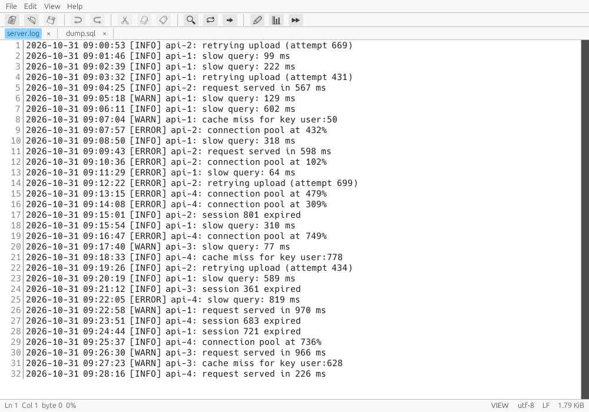
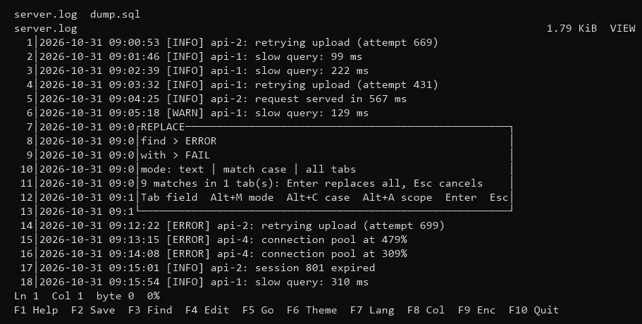
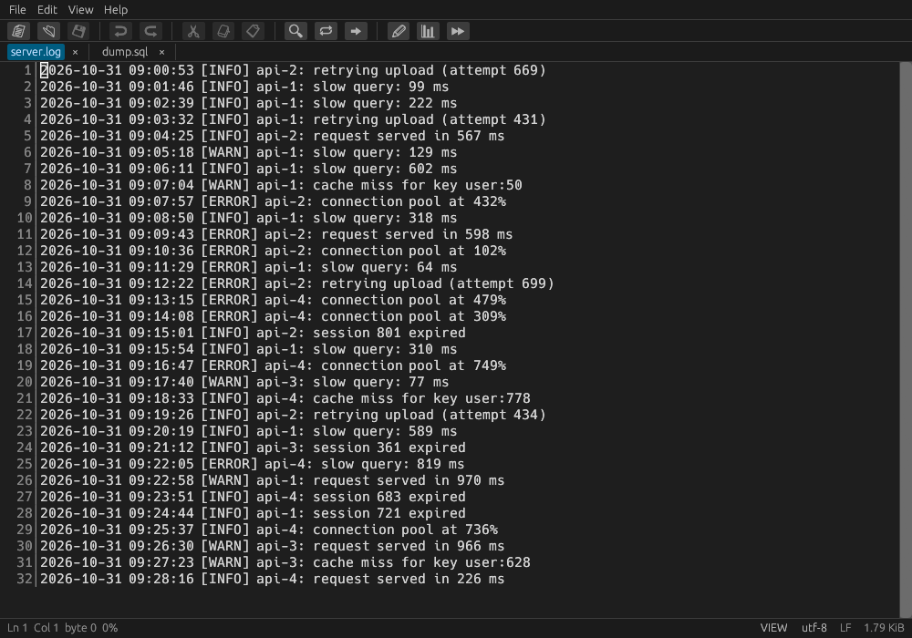
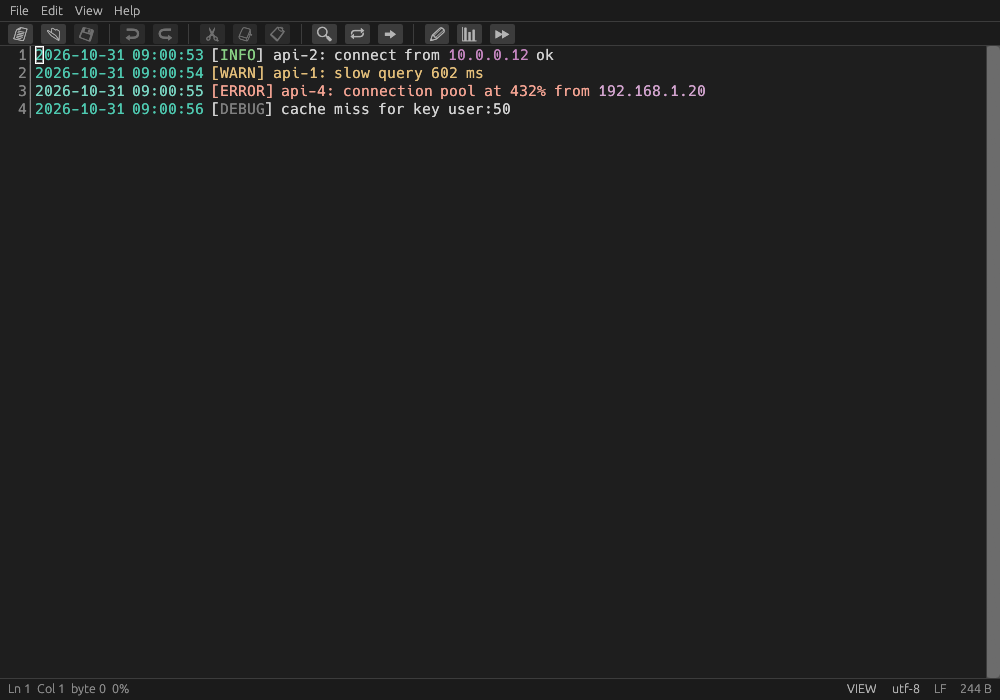
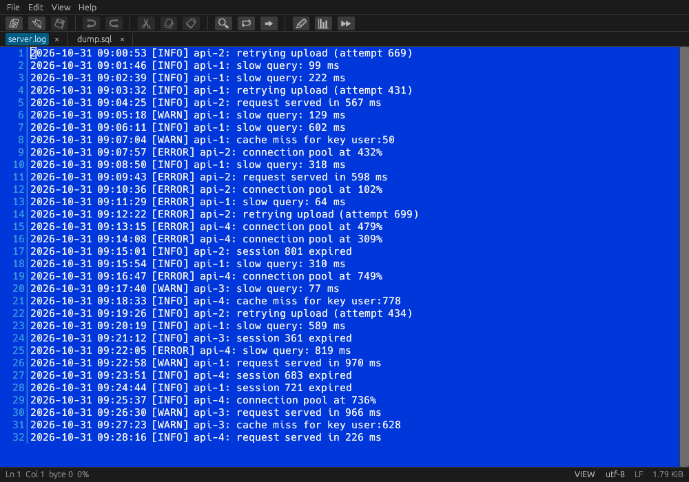
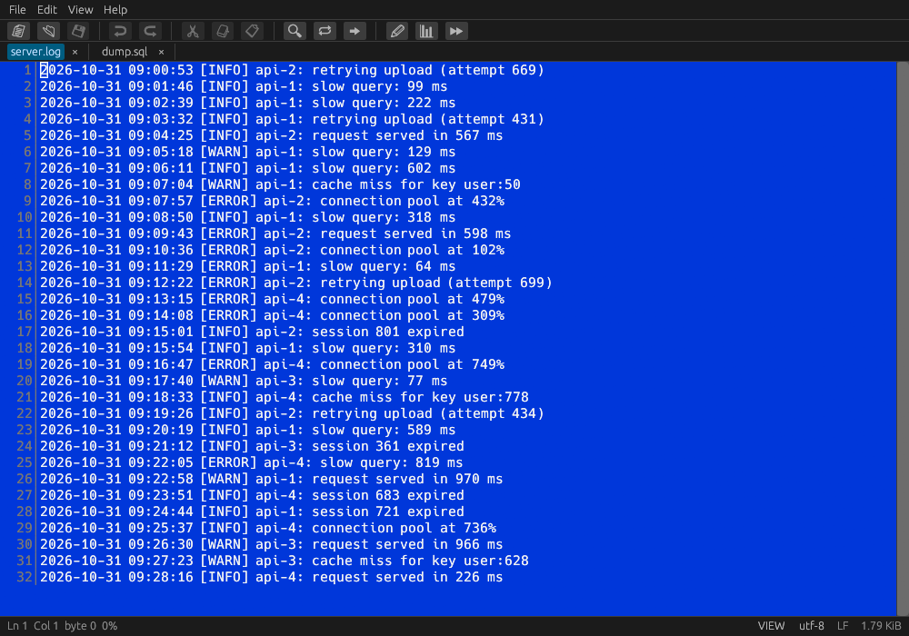
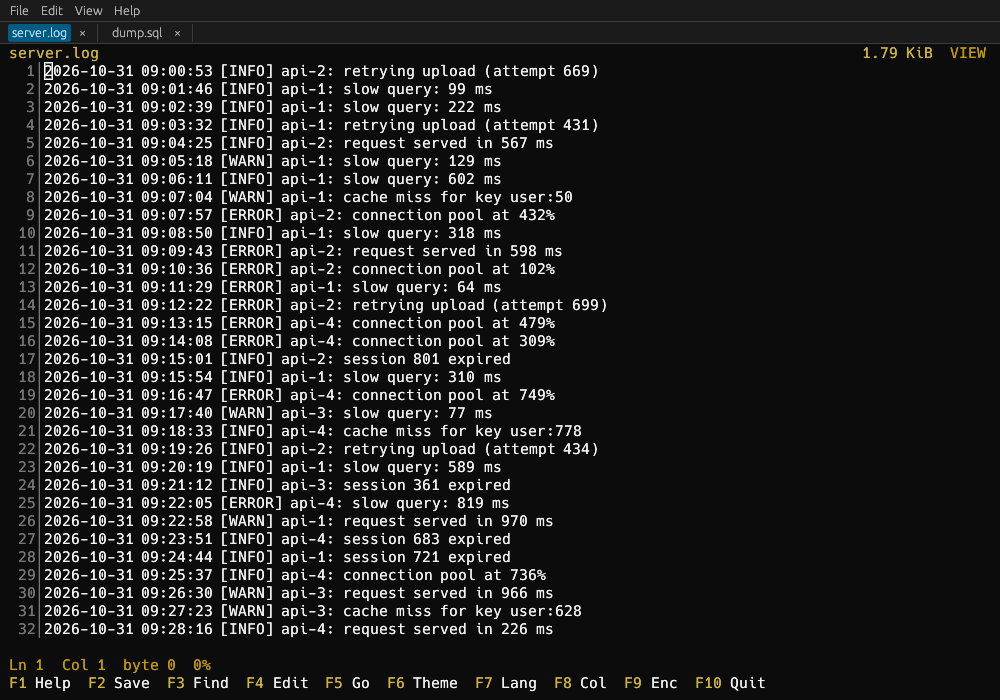
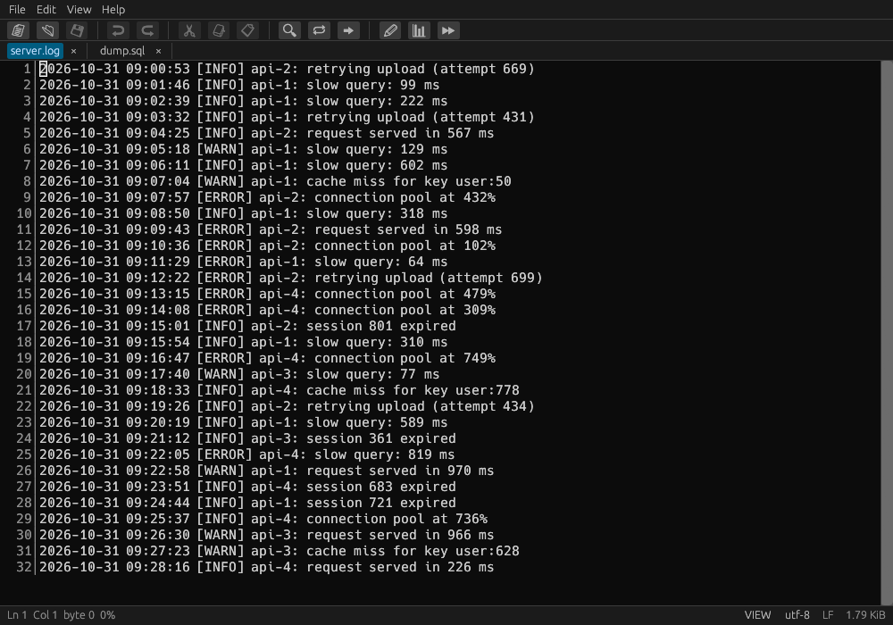

<table>
  <tr>
    <td valign="middle">
      <h1>Manto.RustPad</h1>
      <h3>The editor for files that don't fit in RAM</h3>
      <p><strong><em>A familiar, non-modal text editor in Rust whose memory use does not depend on file size, that never silently truncates your data, and that opens a multi-gigabyte file like a viewer and becomes editable on demand.</em></strong></p>
      <p>
        
        
        
      </p>
      <p>
        <a href="https://github.com/heavymanto/Manto.RustPad/actions/workflows/ci.yml"></a>
        
        
        
        
        
      </p>
      <p><sub>📖 <a href="docs/BENCHMARKS.md"><b>The measurements</b></a> · 🔧 <a href="#quickstart"><b>Quickstart</b></a> · 🇮🇹 <a href="README.it.md"><b>Leggilo in italiano</b></a></sub></p>
    </td>
  </tr>
</table>

<div align="center">

<br /><sub><b>mrp-gui</b> — the desktop window: menu, toolbar, tabs, status bar and scrollbar, with a log and a SQL dump open in two tabs.</sub>
</div>

---

## The idea

Large text files — logs, SQL dumps, CSV exports, XML — are routine, and the tools around them fall into two camps:

- **Editors that load everything into RAM.** Fast and simple, but the file must fit in memory. We measured
  **Notepad++ at 6.3 GB of RAM** for a 6 GB file, and **Microsoft Edit silently truncating a 6 GB file to 4 GiB — saving it
  destroyed 1.7 GB of data with no warning.**
- **Viewers and streaming editors.** Tiny memory, but the cost moves elsewhere: **LTFViewer** (43 MiB resident) scans the
  entire file at open (≈ 86 s, CPU-bound); **UltraEdit** (19 MiB) writes a full temporary copy of the file and re-reads all of it
  for every jump to the end. Terminal log viewers (lnav, logana, bvr, klogg) are excellent but **read-only**.

We did not want to build "yet another tool that already exists". We looked for one that is light on memory, cheap to
navigate **and** editable — and did not find it ([survey](docs/MARKET.md)). So this is it: **Manto.RustPad** opens the file
memory-mapped and read-only, builds a sparse line index in the background, and the moment you press *Edit* the same file
becomes editable — no reload, no copy. Your edits live in a small piece table next to the untouched original; saving streams a
new file next to it and swaps it in atomically.

## Measured on a 6.0 GB file (60 M lines)

| | Memory | Open | Notes |
|---|---|---|---|
| Microsoft Edit 1.2.1 | 4,100 MiB | 2.8 s | **truncates at 4 GiB, loses 1.7 GB on save** |
| Notepad++ 8.8.1 | 6,288 MiB | 7 s warm / 26–30 s cold | holds everything in RAM |
| LTFViewer 5.2u | 43 MiB | UI 0.5 s | full scan in the background, ~86 s |
| UltraEdit-32 10.20.3 | 19 MiB | 7.5 s | writes a 5.7 GB temp copy; `Ctrl+End` re-reads the file (21.6 s) |
| **Manto.RustPad core** (library only) | 19–28 MiB | whole-file line index in 38 s cold / 1.3 s warm | exact, no truncation, no copy; the cold time equals the disk's sequential speed |

The editor itself opens a 6 GB file at once and keeps about 13–35 MiB of private memory, even while saving. Memory grows slowly
with the file (about 3.7 MB per GB: ~410 MiB on a 100 GiB sparse file, whose working set stays under 20 MiB).
**One machine, one HDD, a handful of runs** — method, scripts and caveats in [docs/BENCHMARKS.md](docs/BENCHMARKS.md).

## Get it

Nothing to install: extract and run. Both programs work right away, in *portable* mode — English is embedded, and the other
six languages are found in `lang/` next to the programs; settings and the saved session stay in that same folder. Want them as commands that work from any folder? Each package carries `install.ps1` (Windows) or `install.sh` (Linux, macOS): it copies `mrp-tui` and `mrp-gui` to `~/.local/bin` (adding it to your user PATH on Windows) and the languages to your profile.

[](../../releases/latest)
[](../../releases/latest)
[](../../releases/latest)

The packages (a ZIP for Windows, a tar.gz for Linux and macOS, each with its SHA256) are built by the
[release workflow](.github/workflows/release.yml) when a version tag is pushed. Until the first release is out, build it from source
— it is two commands: see the [Quickstart](#quickstart).

---

## Two front ends, one engine

| `mrp-tui` — in the terminal | `mrp-gui` — in a window |
|:---:|:---:|
|  |  |

| | `mrp-tui` | `mrp-gui` |
| --- | --- | --- |
| **What it is** | a full-screen editor for any terminal (ratatui), made for servers and SSH | a desktop application (egui): real menus, toolbar, status bar, scrollbar and dialogs, the system clipboard, CJK fonts and drag-and-drop |
| **Start it** | `mrp-tui file...` | `mrp-gui file...` (without a file it restores the last session, or opens an empty "Untitled 1") |
| **Menus** | the function keys, shown in the footer (`F1` = help) | a menu bar (File, Edit, View, Help), a toolbar with icons, a right-click menu and the native open / save dialogs |
| **Tabs** | a bar on the first row, one tab per file | a strip with a close button per tab |
| **Look** | four terminal themes | six themes; follows the system light / dark setting until you pick one |
| **The mouse** | positions the cursor, selects (double click: word, triple click: row), picks a tab | the same, and middle-click closes a tab |

Both share **one engine**: the editor's logic (documents, tabs, search, edits, sessions) lives in one place; `mrp-gui` draws the text as the same cell grid but wraps it in its own native controls. A feature added to the engine is in both.

## What it does

- **Opens like a viewer, edits when you ask.** Instant, memory-mapped, read-only navigation; press `F4` and the same file becomes editable.
- **Memory independent of file size.** Tens of MiB, whatever the file. Never the whole file in memory.
- **Never loses data.** 64-bit offsets throughout, tests on files above 4 GiB, loud failure instead of silent truncation, crash-safe save.
- **Tabs.** Several files at once, each with its own search, edit history and cursor. `Ctrl+O` opens (a file already open just comes
  forward), `Ctrl+W` closes (it asks if there are changes), `Ctrl+PgUp/PgDn`, `Ctrl+Tab` / `Ctrl+Shift+Tab` and `Alt+←/→` switch, `Alt+1..9` jump.
- **Closing the editor loses nothing.** Quit with `F10`, `Ctrl+Q` or the window's close button *without being asked*: next time the tabs, the cursors
  and the **unsaved changes** are back. Only the changes are saved — never a copy of the file — so on a 100 GB file with a few edits the session is a few KB.
  If the file changed on disk in the meantime, the tab opens clean, says so, and keeps your copy aside.
- **Find and Replace with glob and regex.** `Ctrl+F` / `F3` search; `Ctrl+H` replaces. Three modes — plain **text**, **glob** (`*`, `?`, `[abc]`)
  and **regex** (with `$1` and `${name}` in the replacement) — plus match case and a scope: this tab or **all open tabs**.
  `Enter` first shows a **preview** (*"9 matches in 2 tab(s)"*, nothing touched), a second `Enter` applies it, and one `Ctrl+Z` undoes the whole thing.
- **Column (block) mode**, a first-class selection type in the core (`F8`), also with the mouse: `Alt`+drag draws the block (and turns the mode on); with the mode on, a plain drag is enough.
- **Log colouring** (`Alt+L`, off by default): the level of a line (ERROR/FATAL in red, WARN in yellow, INFO in green, DEBUG in grey), dates and times, and IPv4 addresses get their own colours in every theme; error and warning lines are tinted whole. Found by hand-written scanning of the visible text, so it costs nothing on a huge file. 
- **Follow the end of a file** (`Alt+F`, like `tail -f`): a log that keeps growing is followed to its new end twice a second, without re-reading anything (the file is remapped and the line numbers are extended counting only the new bytes). Going up with a key or the wheel stops it; it does not combine with editing.
- **Visible whitespace** (`Alt+W`): spaces as `·`, tabs as `→`, line ends as `¶`, control characters as `¤`; columns and mouse positions do not move. Saved with your settings.
- **Honest about encodings.** UTF-8, UTF-16 and UTF-32 (little and big endian, surrogate pairs included), 52 single-byte code pages
  (Windows-125x and 874, ISO-8859-x, DOS 437/850/855/…, KOI8, the Mac sets, US-ASCII) and the East-Asian multi-byte encodings (Shift_JIS, EUC-JP,
  GBK, GB18030, Big5, EUC-KR) — on files larger than RAM. Chosen with `F9` or `--encoding`, or recognised at open (the multi-byte ones are never guessed: pick them by hand).
- **Six themes and seven languages** (English, Deutsch, Español, Italiano, 日本語, Português do Brasil, 简体中文), changed on the fly with `F6` / `F7`.

Non-goals: a log analyser (use lnav, logana, klogg) and a plugin/IDE platform.

### The themes

| | |
|:---:|:---:|
|  |  |
| `night` | `debian` |
|  |  |
| `console` (the default in the terminal) | `minimal` |
|  |  |
| `dark` | `light` |

The terminal picture in *Two front ends* is Replace showing its preview before anything changes (`Ctrl+H`, then `Alt+M` for the mode, `Alt+C` for case, `Alt+A` for the scope).
<sub>It is rendered from the editor's own `--dump` text output, so it has no colours; the real terminal uses the theme's.</sub>

---

## Quickstart

You need [Rust](https://rustup.rs) (`cargo --version`) and a clone of this repository.

```sh
cd rust
cargo build --release                 # mrp-tui and mrp-gui in target/release/
./target/release/mrp-tui yourfile.txt     # F1 = help, F4 = edit, F10 = quit
./target/release/mrp-gui yourfile.txt    # the same, in a window
```

Windows (PowerShell): `.\install.ps1` in `rust\` is optional — it copies `mrp-tui.exe` to `%USERPROFILE%\.local\bin` and the language files to
`%APPDATA%\mrp\lang`; it never touches your `PATH` or your saved settings. `.\portable.ps1` (after the build) makes a folder with the programs and `lang\`:
copy it anywhere, and as long as `lang` is next to the programs, the languages, the settings (`settings.txt`) and the session stay in that folder and nothing is written to your profile.

Try the multi-file features: `mrp-tui a.txt b.txt c.txt`, then `Ctrl+H`, type a pattern, `Tab`, type a replacement, `Alt+A` (all tabs), `Enter`.

## Known limitations

- **Early development.** The editor works and is covered by 1062 automated tests (plus 3 on 6 GB files beyond 4 GiB, run on demand), but it has not been
  used for long by many people. Keep a backup of anything precious.
- **Windows first.** It has been used mostly on Windows. The terminal editor and the whole core (and their tests) were also run on **Linux** (Debian, under WSL);
  the Linux/macOS desktop window (`mrp-gui`) and macOS in general are untried. The CI runs the test suite on all three systems at every push.
- **The window (`mrp-gui`)** has been checked with automated tests and screenshots, not yet with long sessions of real keyboard and mouse use.
- **Regex, glob and ignore-case work on UTF-8 documents only** (they are matched line by line, like grep: a match never crosses a line). Plain-text search works in every encoding.
  In "all tabs" a tab that cannot use a regex is skipped, and the dialog says so.
- A single Replace handles up to **2,000,000** matches; a line longer than 16 MiB is read in pieces, so a match straddling the cut can be missed.
- **Closing without asking is always on** when a profile or portable folder exists (there is no switch to turn it off yet).
- Measurements are from **one machine and one HDD**: see [docs/BENCHMARKS.md](docs/BENCHMARKS.md).

## Development

```sh
cd rust
cargo test --workspace
cargo fmt --all --check
cargo clippy --workspace --all-targets -- -D warnings
```

## Repository layout

| Path | Contents |
|---|---|
| `rust/crates/mrp-core` | The engine (Rust): `FileSource`, `LineIndex`, `PieceTable`/`Document` (edit, undo, save), search and replace (`pattern`), session records (`session`), encodings, languages |
| `rust/crates/mrp-tui` | The terminal editor `mrp-tui` (ratatui): `App` (one document), `Workspace` (the tabs and the session), screen, themes, settings, command line |
| `rust/crates/mrp-gui` | The desktop window `mrp-gui` (egui): the menu bar, the tab strip and the cell grid of the terminal editor |
| `rust/install.ps1`, `rust/portable.ps1` | Local install on Windows; a portable folder |
| `docs/` | `MARKET.md` (the landscape of existing tools, with sources), `BENCHMARKS.md` (measurements, method, limitations) |
| `bench/` | Reproducible scripts (Windows, Python 3.12, no dependencies) and raw results |
| `.github/workflows/` | `ci.yml` (tests on three systems, format, clippy) and `release.yml` (the packages) |

## Documentation

- [docs/MARKET.md](docs/MARKET.md) — the landscape of existing tools, with sources
- [docs/BENCHMARKS.md](docs/BENCHMARKS.md) — measurements, method, limitations
- [CHANGELOG.md](CHANGELOG.md) — what changed
- [SECURITY.md](SECURITY.md) — how to report a vulnerability privately

## Contributing

See [CONTRIBUTING.md](CONTRIBUTING.md). The short version: offsets are 64-bit, the whole file is never held in memory, and every number in the
docs was really measured. Issues are open — three templates (bug, question, feature) carry the context. A note on expectations: this is a hobby
project — everything gets read, but no response times are promised.

## Sibling project

[Manto.FreeDisk](https://github.com/heavymanto/Manto.FreeDisk) — a Rust disk-space analyzer; the core/CLI/TUI split used there is the model for this repository.

## License

Copyright (C) 2026 Francesco Mantovanelli.

This program is free software: you can redistribute it and/or modify it under
the terms of the **GNU Affero General Public License v3.0** as published by the
Free Software Foundation — see [LICENSE](LICENSE). Commercial licensing is
available on request for products that cannot ship under the AGPL.

---

<div align="center">

**Author** — Francesco Mantovanelli · **Project** — Manto.RustPad

</div>
