# Manto.RustPad — Manuale

[English](MANUAL.md) · **Italiano**

I tasti sono scritti uguali per Windows, Linux e macOS (`Ctrl`, `Alt`). Nel terminale, `Alt+lettera` richiede un terminale che invii
Alt come prefisso di escape (la maggior parte lo fa).

## Indice

- [Il prodotto in una pagina](#il-prodotto-in-una-pagina)
- **[Parte prima — Il terminale (TUI)](#parte-prima--il-terminale-tui)**
  - [Apertura e navigazione](#apertura-e-navigazione)
  - [Modi, modifica e salvataggio](#modi-modifica-e-salvataggio)
  - [Tempo, timeline e filtri](#tempo-timeline-e-filtri)
  - [Codifiche e fine riga](#codifiche-e-fine-riga)
- **[Parte seconda — La finestra (GUI)](#parte-seconda--la-finestra-gui)**
  - [Apertura e navigazione](#apertura-e-navigazione-1)
  - [Modi, modifica e salvataggio](#modi-modifica-e-salvataggio-1)
  - [Tempo, timeline e filtri](#tempo-timeline-e-filtri-1)
  - [Codifiche e fine riga](#codifiche-e-fine-riga-1)
- [Sotto il cofano](#sotto-il-cofano)

## Il prodotto in una pagina

**Tre modi di usare un file.** Si escludono a vicenda: esattamente uno e' acceso.

| Modo | Tasti | Cos'e' |
|---|---|---|
| **VIEW** | `Alt+V` | Sola lettura. Il predefinito. |
| **EDIT** | `Alt+E` | Modifica il file. Niente tocca il disco finche' non salvi. |
| **TAIL** | `Alt+T` | Sola lettura, e la vista segue la fine del file mentre cresce (`tail -f`). |

Il modo corrente e' sempre l'ultima parola della riga di stato (`VIEW`, `EDIT`, `TAIL`, con `COL` dopo in modalita' colonna) ed e'
acceso nel footer. Un click sulla parola, o `Alt+M`, apre un piccolo menu' dei tre modi.

**Tasti standard, gli stessi nel terminale e nella finestra:** `F1` aiuto, `F2` salva, `F3` cerca (`Shift+F3` precedente), `F4`
sostituisci, `F5` vai a, `F6` tema, `F7` lingua, `F8` modalita' colonna, `F9` codifica, `F10` esci, `Esc` chiude una finestra.
`Ctrl+Z`/`Ctrl+Y` annulla/ripeti, `Ctrl+C`/`X`/`V` appunti, `Ctrl+A` seleziona tutto, `Ctrl+O` apri, `Ctrl+N` nuovo, `Ctrl+W` chiudi scheda.
L'aiuto ha due tab nella finestra (Tasti, e *Info* con la versione, la licenza e l'indirizzo GitHub come link vero) e, nel
terminale, le stesse tre righe chiudono la tabella dei tasti: versione, AGPL-3.0, codice.

---

## Parte prima — Il terminale (TUI)

**Lo schermo del terminale**, dall'alto in basso:

1. *(solo con piu' di una scheda)* la barra delle schede;
2. il testo, con il margine dei numeri di riga a sinistra;
3. la **riga di stato**: posizione (`Ln 12  Col 3  byte 1234  7%`) o un messaggio a sinistra; a destra il lavoro in corso
   (`indexing 45%`), il nome del file (` *` dopo quando e' modificato), la dimensione, la codifica se non e' UTF-8, il fine riga se
   non e' LF, e il modo;
4. il **footer**: `Alt+V View  Alt+E Edit  Alt+T Tail  F1 Help  F2 Save  F3 Find  F4 Repl  F5 Go ...  F10 Quit`. Su un terminale
   stretto i tasti F meno usati cedono per primi (F6, F7, F8, F9, poi F5); i tre modi mai.

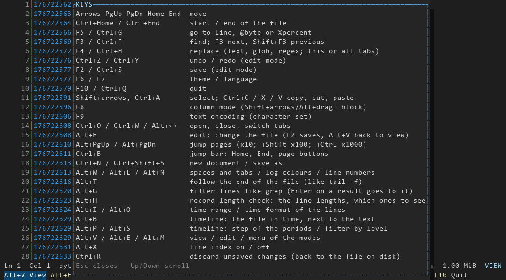

### Apertura e navigazione

#### N-01 Aprire un file dalla riga di comando

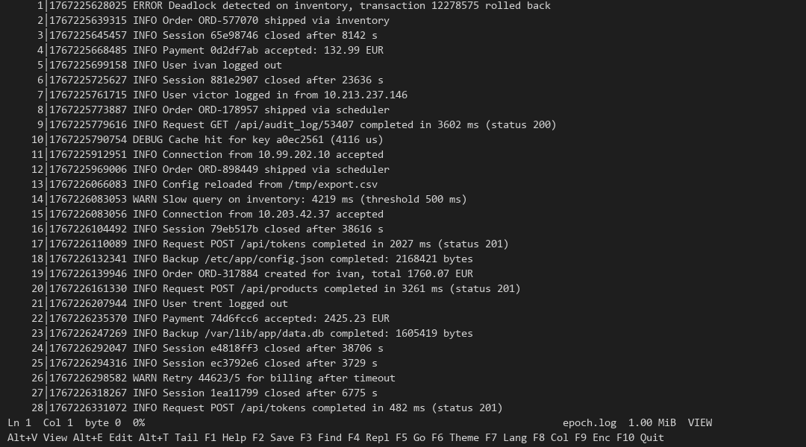
- **Tasti:** `mrp-tui FILE`. Senza file, torna l'ultima sessione (vedi *Salvataggio automatico e sessione*); senza sessione, un "Untitled 1" vuoto.
- **Cosa succede:** prima schermata immediata, modo `VIEW`, posizione `Ln 1  Col 1  byte 0  0%`, nome e dimensione del file a destra.
  Mentre l'indice si costruisce: `indexing N%` a destra, `Ln ?` a sinistra, e il margine dei numeri di riga vuoto.
- **Cosa non deve mai succedere:** caricare il file intero; bloccare lo schermo durante l'indicizzazione; chiedere alcunche'.
- **Limiti:** **su Windows, mentre un file e' aperto qui, altri programmi possono aggiungerci dati, rinominarlo o cancellarlo, ma non troncarlo** (aprirlo in scrittura con troncamento, o accorciarlo, fallisce con un errore di sistema: il file e' memory-mappato). Un servizio che azzera il suo log ricevera' quell'errore mentre qualcuno lo sta guardando; aggiungere, ruotare con un rename e cancellare vanno bene (testato). Un file mancante da' un errore e nessuna finestra; un file vuoto si apre con 0 righe; un file che e' una sola
  riga enorme scorre lo stesso (le righe si tagliano a 128 KiB); un file di 64 MiB o piu' mostra una barra di avanzamento dopo 2 s (N-08).

#### N-02 Aprire un altro file, documento nuovo

- **Tasti:** `Ctrl+O`: un prompt "percorso del file da aprire", Invio conferma, Esc annulla.
  `Ctrl+N` apre un documento vuoto in una scheda nuova, in modalita' EDIT.
- **Cosa succede:** compare una scheda nuova ed e' attiva; aprire un file gia' aperto non lo duplica.
- **Cosa non deve mai succedere:** sostituire una scheda che ha modifiche non salvate.
- **Limiti:** aprire mentre la scheda attiva ha modifiche non salvate conserva quelle modifiche (si usa una scheda nuova).

#### N-03 Muoversi
- **Tasti:** frecce, `PgSu`/`PgGiu`, `Home`/`Fine`, `Ctrl+Home`/`Ctrl+Fine`, rotella del mouse.
- **Cosa succede:** la posizione nella riga di stato segue; la vista scorre quando il cursore esce dallo schermo.
- **Cosa non deve mai succedere:** leggere il file intero per muoversi; bloccarsi su una riga lunghissima.
- **La barra orizzontale (aggiunta l'11/11/2026):** una riga piu' larga della finestra mostra una barra sotto il testo (una riga,
  solo quando serve: una riga piu' larga della finestra, o gia' scorreta) col pollice che dice dov'e' la finestra sulla riga piu'
  larga visibile — prima, l'unico modo di scorrere era camminarci col cursore. Clicca o trascina il pollice (segue il puntatore
  per come lo si e' afferrato; un clic sulla pista lo centra li'): la finestra si muove e il cursore resta dov'e' (il prossimo
  movimento del cursore riporta la vista su di lui). `«` e `»`
  segnalano ancora i lati tagliati di una riga; per una riga oltre il limite di lettura il mondo della barra e' un limite
  inferiore onesto che cresce scorrendo.
- **Limiti:** su un file ancora in indicizzazione, i salti funzionano per byte e percentuale, non per riga (N-04); saltare
  mette in pausa le letture su disco dell'indicizzatore per 400 ms (*Indice delle righe*).

#### N-04 Vai a (`F5` / `Ctrl+G`)

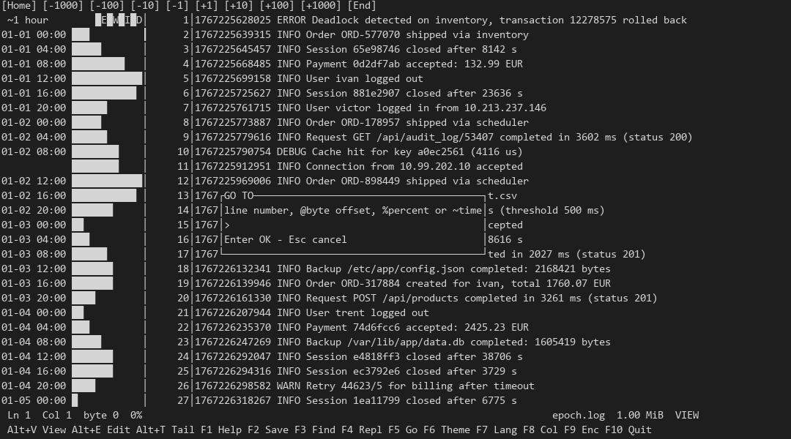
- **Tasti:** `F5` o `Ctrl+G`. Un prompt: "numero di riga, @byte, %percentuale o ~orario".
- **Cosa succede:** il cursore va li' e il bersaglio sta verso il mezzo dello schermo *(osservato: `500` -> `Ln 500`,
  `%50` -> `49%`, `@1000000` -> `byte 1000000`)*. `0` -> "not a valid position: 0"; una riga oltre la fine -> "line N is beyond the end (M lines)".
- **Cosa non deve mai succedere:** muovere il cursore su un bersaglio non valido; fermarsi dentro un carattere multibyte (torna al suo inizio).
- **Limiti:** la `@` di `@byte` si digita con AltGr su molte tastiere (italiana, tedesca, spagnola, francese...): funziona
  anche nel terminale su Windows (vedi M-03). Per riga serve l'indice (mentre si costruisce: un messaggio dice di aspettare e niente si muove);
  `@` e `%` non serve l'indice; `~orario` serve un formato del tempo riconosciuto (vedi *Tempo*).

#### N-05 Salti di pagine e barra dei salti

- **Tasti:** `Alt+PgSu`/`Alt+PgGiu` saltano 10 pagine (`Maiusc` x100, `Ctrl` x1000); `Ctrl+B` mostra una barra con *Home*, *Fine* e i pulsanti
  dei passi di pagina.
- **Cosa succede:** la vista arriva dove il passo dice; la riga di stato mostra la nuova posizione.
- **Cosa non deve mai succedere:** bloccarsi su un file enorme.

#### N-06 Numeri di riga e indice delle righe
- **Tasti:** `Alt+N` mostra/nasconde i numeri di riga; `Alt+X` accende/spegne l'indice delle righe.
- **Cosa succede:** spegnere l'indice chiede prima "SPEGNERE L'INDICE DELLE RIGHE?", elencando cosa si perde (numeri di riga, vai a una riga,
  il totale delle righe, i salti veloci di pagina, il conteggio delle righe di una selezione) e cosa continua a funzionare; Invio conferma e i numeri
  spariscono (`Ln ?`), Esc annulla. Riaccenderlo fa ripartire il conteggio da zero senza chiedere.
- **Cosa non deve mai succedere:** cambiare il file.

#### N-07 Schede
- **Tasti:** `Ctrl+PgGiu`/`Ctrl+PgSu`, `Alt+←`/`Alt+→`, `Alt+1`..`9`, `Ctrl+W` chiude.
- **Cosa succede:** la scheda attiva cambia subito; chiudere una scheda con modifiche non salvate chiede prima.
- **Cosa non deve mai succedere:** chiudere in silenzio una scheda modificata senza sessione (con la sessione le modifiche restano, vedi *Salvataggio automatico e sessione*).

#### N-08 Avanzamento dei lavori lunghi sui file grandi
- **Tasti:** nessuno: parte da solo per indicizzazione, ricerca e salvataggio.
- **Cosa succede:** da 60 colonne `indexing 61% #######.....`; da 90 anche `0:01 left`; da 140 anche
  `3.45 GiB / 5.59 GiB  1.67 GiB/s`. Sotto i 2 s, o sotto i 64 MiB, solo la percentuale. La barra e' a spettro
  (temi a colori) *(osservato nei codici di escape)*.
- **Cosa non deve mai succedere:** bloccare lo schermo; mostrare una stima assurda (resta in silenzio quando il lavoro e' in pausa o non ha ancora una velocita').
- **Limiti:** il tempo che resta si nasconde sopra le 99 ore.

### Modi, modifica e salvataggio

#### M-01 I tre modi
- **Tasti:** `Alt+V` VIEW, `Alt+E` EDIT, `Alt+T` TAIL; `F4` *non* e' un modo (e' Sostituisci).

- **Cosa succede:** l'ultima parola della riga di stato cambia; il footer accende quella corrente; un messaggio spiega il cambio
  ("edit mode: the file is not touched until you save", "TAIL: following the end of the file", "view mode").
- **Cosa non deve mai succedere:** stare in due modi insieme; avviare TAIL su un documento modificato (vedi M-08).

#### M-02 Il menu dei modi

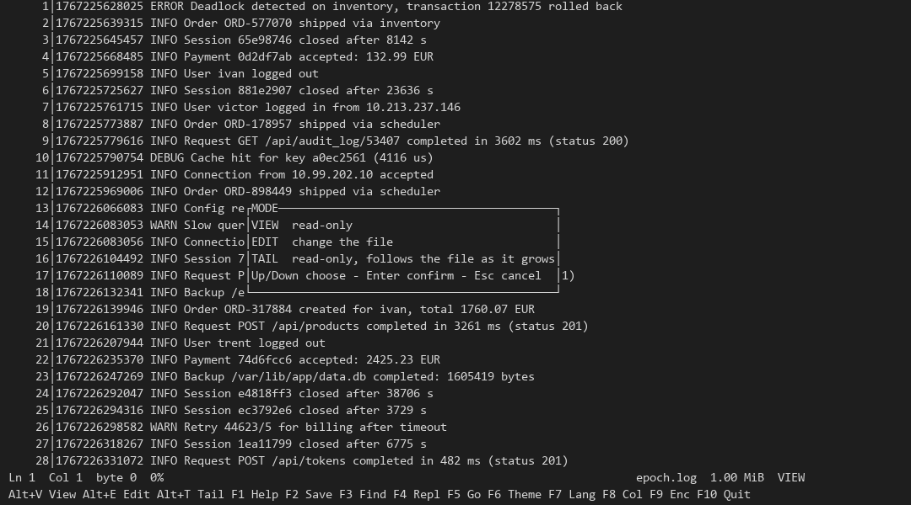
- **Tasti:** `Alt+M`, o un clic sulla parola del modo nella riga di stato.
- **Cosa succede:** Su/Giu muovono, Invio sceglie, Esc chiude.
- **Cosa non deve mai succedere:** cambiare modo senza Invio.

#### M-03 Digitare e modificare
- **Tasti:** in EDIT: caratteri, `Invio`, `Tab`, `Backspace`, `Canc`; selezione con `Maiusc`+frecce o il mouse; `Ctrl+C`/`X`/`V`.
- **Cosa succede:** la riga di stato mostra ` *` dopo il nome del file; il testo cambia subito.
- **AltGr (Windows, corretto l'8/11/2026):** sulle tastiere che usano AltGr (italiana, tedesca, spagnola, francese, portoghese...) i caratteri
  `@ [ ] { } ~ # \` \\ |` ed `€` arrivano al terminale come Ctrl+Alt+carattere; il programma li riporta in testo piano (Ctrl+Alt+lettera o cifra,
  Alt+tasto e Ctrl+tasto restano scorciatoie). Funziona in ogni campo di testo (modifica, Cerca, Sostituisci, Filtri, Vai a `@byte`). Prima della correzione
  venivano scartati: `a@b{c}[d]` dava `abcd`.
- **Cosa non deve mai succedere:** toccare il file su disco prima di un salvataggio. In VIEW, digitare e' rifiutato col suggerimento **"read-only: press Alt+E to edit"**.

#### M-04 Annulla e ripeti
- **Tasti:** `Ctrl+Z`, `Ctrl+Y` (`Ctrl+Maiusc+Z`).
- **Cosa succede:** il testo torna/avanza a passi interi.
- **Cosa non deve mai succedere:** funzionare in VIEW (rifiutato col suggerimento di digitare, "read-only: press Alt+E to edit"); sopravvivere a un salvataggio (dopo un salvataggio la storia e' vuota).
- **Limiti:** la storia non si tiene nella sessione: una scheda ripristinata si puo' salvare ma non annullare (*Salvataggio automatico e sessione*).

#### M-05 Salva e Salva con nome
- **Tasti:** `F2` / `Ctrl+S`; `Ctrl+Maiusc+S` Salva con nome (chiede il nome, poi la codifica). Entrambi funzionano anche in VIEW quando ci sono modifiche.
- **Cosa succede:** il messaggio "saved: NOME" e nessun ` *`. Su un file grande un dialogo con barra di avanzamento, Esc annulla *(osservato: `saved: ux_copy.log`)*.
- **Cosa non deve mai succedere:** lasciare un file scritto a meta', mai, qualunque l'interruzione; sovrascrivere un file che un altro programma ha cambiato da quando l'hai aperto.
- **Limiti:** niente da salvare -> il messaggio "nothing to save"; file cambiato su disco -> rifiutato col motivo, le modifiche restano;
  cartella di sola lettura o disco pieno -> un errore, l'originale intatto, nessun temporaneo lasciato.

#### M-06 Scarta le modifiche (`Ctrl+R`)
- **Tasti:** `Ctrl+R` (o `Alt+R`).
- **Cosa succede:** una domanda che nomina il file; Invio/S/Y conferma e la scheda si riapre in VIEW vicino alla vecchia posizione; Esc/N tiene le modifiche.
- **Cosa non deve mai succedere:** toccare il file su disco. Con niente da scartare: il messaggio **"no unsaved changes to discard"** e nessun dialogo.

#### M-07 Uscire con modifiche non salvate
- **Tasti:** `F10` / `Ctrl+Q`.
- **Cosa succede (senza sessione):** una finestra "UNSAVED CHANGES": `S` Salva ed esci, `D` Scarta le modifiche, `C` Annulla.
  "Salva ed esci" esce solo se il salvataggio e' riuscito.
- **Cosa non deve mai succedere:** perdere modifiche in silenzio.

#### M-08 Tail (segue la fine)

- **Tasti:** `Alt+T`.
- **Cosa succede:** `TAIL` nella riga di stato e "TAIL: following the end of the file".
- **Cosa non deve mai succedere:** partire su un documento con modifiche non salvate: resta dov'e' e dice **"save or discard the changes (F2, Ctrl+R) before TAIL"**.
- **Limiti:** da EDIT senza modifiche passa direttamente a TAIL; un file che si accorcia smette di seguire, con un messaggio.

### Tempo, timeline e filtri

#### T-01 Formato dell'orario delle righe (`Alt+O`)

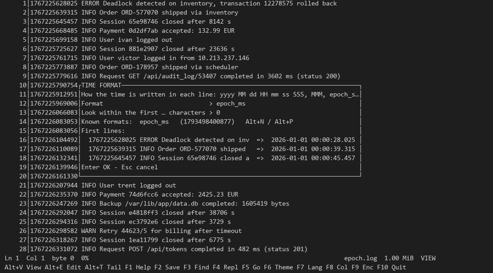
- **Tasti:** `Alt+O`; automatico al primo uso.
- **Cosa succede:** una finestra "TIME FORMAT" col formato, entro quanti caratteri dall'inizio cercare, i formati
  noti con un esempio, e un'anteprima delle prime righe come `testo => 2026-01-01 00:00:28`. Tutto cio' che dipende
  dal tempo (orario in riga di stato, timeline, vai a un orario, intervallo, colori) segue il formato scelto.
- **Cosa non deve mai succedere:** leggere il file intero (il rilevamento usa al piu' 64 KiB di testa e 64 KiB di coda); cambiare il file.
  Un token sbagliato (`yyyyy`) dà un errore "bad token" e lascia il formato com'era.
- **Limiti:** i file UTF-16/UTF-32 non vengono mai riconosciuti, quindi non hanno funzioni del tempo. Le maschere senza anno (syslog)
  usano l'anno 2000. Orari che tornano indietro rompono l'assunzione dietro le ricerche (vedi *Tempo*).

#### T-02 Vai a un orario (`F5`, poi `~orario`)
- **Tasti:** il prompt di vai a con un `~` davanti all'orario: `~03:20`, `~2026-10-31 05:00:00`.
- **Cosa succede:** il cursore e la vista arrivano li' *(osservato: `~03:20` su un log con orari dalle 00:00 arriva alla riga delle 03:22:55, `Ln 283`)*.
  Un bersaglio prima di tutto resta sulla prima riga.
- **Cosa non deve mai succedere:** leggere il file linearmente; fermarsi su una riga con un orario piu' piccolo.
- **Limiti:** serve un formato riconosciuto e orari che non tornano mai indietro; le righe senza orario si saltano.

#### T-03 Intervallo di tempo (`Alt+I`)

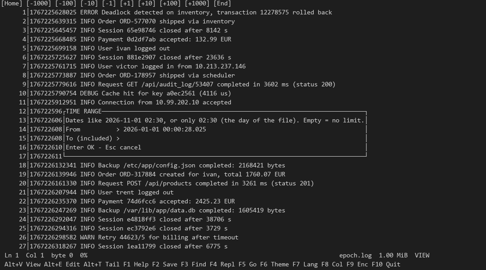
- **Tasti:** `Alt+I`.
- **Cosa succede:** le righe fuori non si vedono; la riga di stato dice l'intervallo; la timeline lo mostra.
- **Cosa non deve mai succedere:** cambiare il file; confondersi con la finestra di tempo della scheda (sono due cose: quella e' un filtro, questa limita la vista della scheda).
- **Limiti:** un intervallo scritto a mano con orari che il file non copre viene rifiutato dicendo il primo e l'ultimo orario
  del file.

#### T-04 Timeline (`Alt+B`)

- **Tasti:** `Alt+B` (la scelta si ricorda).
- **Cosa non deve mai succedere:** leggere il file intero per ogni periodo (galoppa in avanti e bisetta); bloccare lo schermo (si costruisce in un thread in background
  che apre una sua copia del file); lavorare su un documento modificato (dice "unavailable").
- **Limiti:** servono almeno 40 colonne di testo; al piu' 20.000 periodi (forzare 1 minuto su un log di piu' giorni dà
  "too many buckets" col conteggio, in rosso e grassetto); i documenti UTF-16/32 non hanno timeline. Su un file senza orari la timeline
  si spegne da sola e la riga di stato dice perche', col suo consiglio (scegli un formato a mano): la preferenza non si tocca, il prossimo
  file con orari la riapre com'era.

#### T-05 Passo della timeline (`Alt+P`)
- **Tasti:** `Alt+P`, o un clic sull'intestazione della timeline (solo mentre e' accesa).
- **Cosa succede:** un menu' "TIMELINE: PERIOD": *Auto (scelto dalla durata del log)*, 1 minuto, 10 minuti, 1 ora, 1 giorno.
  Auto prende il piu' lungo fra giorno / ora / 10 minuti che dà ancora almeno 12 periodi, altrimenti il minuto.
- **La scelta e' della scheda, non un'abitudine:** non si ricorda fra i file — ogni file parte da Auto, e cambiare il formato
  dell'orario riporta ad Auto pure lui (le estremita' del file cambiano con quello). Un passo fine rimasto salvato rompeva i file piu' lunghi.
- **Cosa non deve mai succedere:** cambiare il file o l'intervallo.

#### T-06 Filtro dei livelli (`Alt+S`)
- **Tasti:** `Alt+S` (timeline accesa).
- **Cosa succede:** un menu' "TIMELINE: SHOW ONLY": *Tutte le righe*, *Solo gli errori*, *Errori e avvisi*, *Errori, avvisi e informazioni*.
  La scelta apre una scheda nuova di sola lettura col nome dei livelli.
- **Cosa non deve mai succedere:** cambiare il file o la scheda originali. Il confronto e' la parola intera del livello, maiuscole esatte.
- **Limiti:** rifiutato sui documenti non UTF-8, con un messaggio.

#### T-07 Colori dei log (`Alt+L`)

- **Tasti:** `Alt+L`.
- **Cosa succede:** i colori compaiono subito e seguono il tema; gli orari sono colorati solo dove il formato corrente li legge.
- **Cosa non deve mai succedere:** rallentare lo scroll; colorare dentro una parola (il livello deve essere una parola intera).

#### F-01 Cerca (`F3` / `Ctrl+F`)

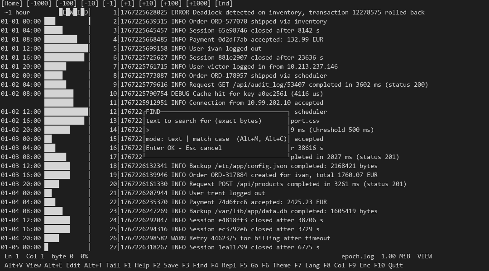
- **Tasti:** `Ctrl+F` apre il prompt (precompilato col testo dell'ultima volta); `F3` ripete in avanti, `Maiusc+F3` indietro (o apre il prompt se non c'e' ancora una ricerca).
  Con una selezione, `F3` cerca la selezione stessa, letterale e distinguendo le maiuscole, senza prompt; la selezione che e' la corrispondenza appena trovata
  non conta — `F3` continua la ricerca precedente (una regex, una senza maiuscole) come prima.
- **Cosa succede:** un prompt "text to search for (exact bytes)" con `mode: text | match case  (Alt+M, Alt+C)`; il cursore
  va alla prossima corrispondenza; oltre la fine ricomincia da capo con un avviso. Su un file grande una barra dopo 2 s ed `Esc` annulla ("cancelled", cursore fermo).
- **Cosa non deve mai succedere:** bloccarsi su un file enorme; impallarsi su qualunque espressione regolare (il motore non ha backtracking e un limite di 8 MiB).
- **Limiti:** i modelli confrontano per riga (mai attraverso un a-capo); glob, regex e senza-maiuscole servono un documento UTF-8
  (altrimenti un messaggio lo dice); il testo semplice in una code page il cui ago non si puo' codificare e' semplicemente "not found"; le corrispondenze
  nelle codifiche asiatiche multibyte contano solo all'inizio di un carattere.

#### F-02 Sostituisci (`F4` / `Ctrl+H`)

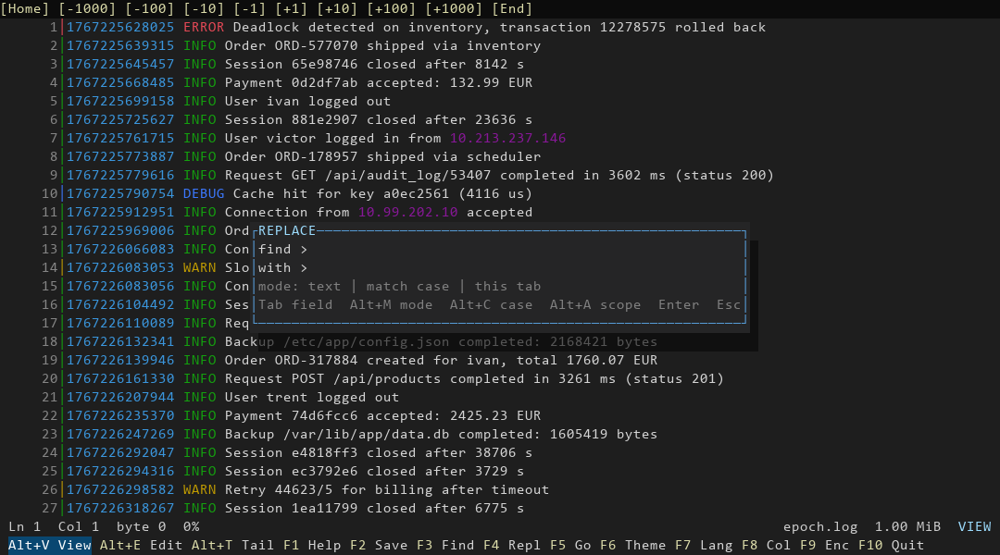
- **Tasti:** `F4` o `Ctrl+H`.
- **Cosa succede:** digitare qualsiasi cosa azzera l'anteprima; dopo l'applicazione, la scheda e' modificata e **un** `Ctrl+Z` annulla
  tutta la corsa.
- **Cosa non deve mai succedere:** toccare i file su disco; applicare alcche' quando si annulla con `Esc`, o oltre le 2.000.000 di occorrenze ("too many").
- **Limiti:** tutte-le-schede salta le schede che non lo permettono (non UTF-8 con una regex, per esempio) e dice quante; le schede non si possono
  aprire o chiudere mentre gira.

#### F-03 Filtro per righe (`Alt+G`)

- **Tasti:** `Alt+G`. Nel prompt, `Alt+I` inverte (nasconde le righe che corrispondono).
- **Cosa succede:** la scheda nuova con le righe trovate e un messaggio come `297 lines: Enter on a line goes to it in the file`;
  `Invio` su una riga porta avanti il file originale (riaprendolo se chiuso) col cursore su quella riga precisa.
- **Cosa non deve mai succedere:** modificare l'originale. Modificare nella vista e' rifiutato ("a filtered view is read-only: edit the original file"). Senza corrispondenze:
  "no line matches", nessuna scheda e nessun temporaneo lasciato.
- **Limiti:** al piu' 20.000.000 righe per vista (si ferma e dice che e' stata tagliata); il file temporaneo `mrp-filter-<pid>-<n>.log` sta nella
  cartella temporanea di sistema e si cancella quando la scheda si chiude o il programma esce.

#### F-04 Check dei tracciati (`Alt+H`)

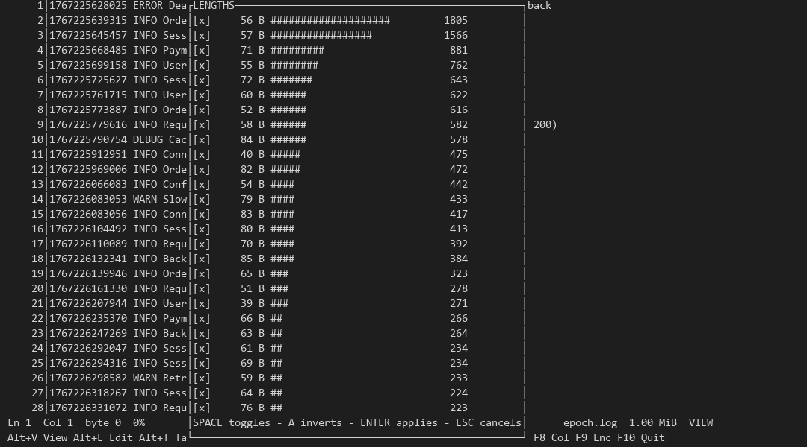
- **Tasti:** `Alt+H`. Nell'istogramma `SPAZIO` spunta la lunghezza sotto il cursore, `A` inverte tutta la selezione, `Invio` applica, `Esc` annulla.
- **Cosa succede:** mentre la passata conta il dialogo dice la percentuale; poi la lista, scorrevole, risponde subito a `SPAZIO`/`A`: ogni riga dice conteggio, barra e percentuale sul totale, e in fondo il totale (`2,202 records · 3 lengths`); `Invio` apre la vista con un messaggio come
  `2 lines: Enter on a line goes to it in the file` (e `Invio` su una riga della vista porta a quella riga nell'originale, come in F-03).
- **Cosa non deve mai succedere:** modificare l'originale. Con niente spuntato: "no line matches", nessuna scheda. Senza righe: "nothing to count". `Esc` lascia tutto com'era, e la selezione abortita non si ricorda.
- **Limiti:** le lunghezze sono byte di contenuto: le righe CRLF contano senza il `\r`, l'ultima riga senza a-capo e' una riga, una riga vuota ha lunghezza 0. La passata vede le modifiche non salvate (legge la fotografia) e si annulla chiudendo (riparte alla prossima apertura). Nella finestra le caselle sono cliccabili e Inverti / OK / Annulla sono pulsanti.

### Codifiche e fine riga

#### E-01 Codifica: rilevamento e cambio (`F9`)

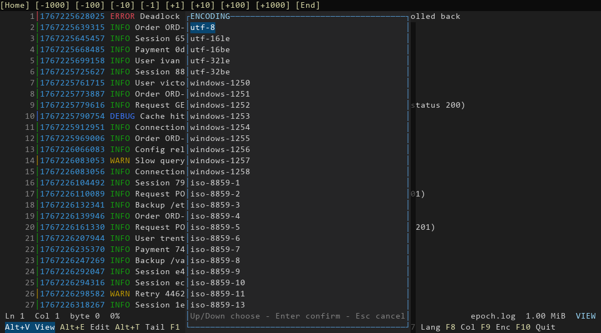
- **Tasti:** `F9` apre l'elenco delle 64 codifiche con quella corrente evidenziata; sulla riga di comando `--encoding NOME`. Il rilevamento e' automatico all'apertura.
- **Cosa succede:** il testo si rilegge senza muoversi e la riga di stato nomina la codifica (niente per UTF-8 semplice). Osservato su 28 file di prova (UTF-8 con e senza
  BOM, UTF-16/32 in entrambi gli ordini, 14 code page a byte singolo, 7 pagine DOS e Mac, Shift-JIS, EUC-JP, GBK, GB18030, Big5, EUC-KR): con `--encoding` tutti e 28 letti
  esatti; col rilevamento, gli Unicode con BOM, UTF-8, UTF-16 senza BOM e windows-1252/ISO-8859-1 sono giusti, ogni altro file a 8 bit o asiatico si apre come
  windows-1252 (leggibile ma sbagliato, intatto), e **scegliere la codifica giusta in `F9` sistema il testo in tutti i 21 casi provati**.
- **Cosa non deve mai succedere:** cambiare il file; perdere o nascondere un byte non valido (compare un carattere di sostituzione per byte e si riscrive uguale).
- **Limiti:** il passaggio fra UTF-16/32 e le altre codifiche e' rifiutato mentre il documento e' modificato ("save before switching to/from UTF-16/32").
  La riga di stato non dice che la codifica e' stata *indovinata*.

#### E-02 Salva con nome in un'altra codifica (`Ctrl+Maiusc+S`)
- **Tasti:** `Ctrl+Maiusc+S`: prima il percorso, poi un elenco di codifiche (quella corrente evidenziata, `Tab` = scrivi un BOM, `Invio` salva).
- **Cosa succede:** "Saved NAME as ENCODING"; il documento diventa il file nuovo. Osservato: 17 conversioni da UTF-8 (UTF-16/32 in entrambi gli ordini con e senza
  BOM, code page ISO e Windows, KOI8-R, CP866, Shift-JIS, EUC-JP, GBK, Big5, EUC-KR) hanno dato **file esatti al byte** col BOM giusto e si rileggono corrette;
  cp1251 → UTF-8 → cp1251 ha dato il file identico. Un carattere che il bersaglio non puo' contenere ferma il salvataggio con un messaggio preciso
  ("Cannot write U+1F600 in windows-1252 (at byte 5): nothing was saved") e nessun file viene creato.
- **Cosa non deve mai succedere:** scrivere un file parziale; toccare la sorgente.
- **Limiti:** il campo del percorso e' precompilato con la cartella del file: scrivi solo il nome nuovo (scrivere un percorso intero ci si aggiunge e fallisce
  con l'errore grezzo di sistema 123).

#### E-03 La modifica mantiene la codifica e il fine riga
- **Tasti:** nessuno: e' automatico.
- **Cosa succede:** osservato: digitare `é`, `ж`, `あ`, `好`, `가` in file windows-1252, windows-1251, UTF-16, Shift-JIS, GBK ed EUC-KR e salvare ha dato esattamente i byte
  giusti; un BOM e i byte UTF-8 non validi restano; digitare un carattere che la codifica non puo' contenere e' rifiutato subito ("cannot write '日' in windows-1252") e niente
  viene inserito.
- **Cosa non deve mai succedere:** rompere un fine riga.
- **CRLF (corretto l'8/11/2026):** in un file CRLF (UTF-8, UTF-16 LE/BE, UTF-32) lo `\r\n` e' un fine riga solo: `Fine` e `Maiusc+Fine` si fermano prima del `\r`, digitare e
  `Invio` a fine riga vanno prima di lui, `Destra`/`Sinistra`/`Backspace`/`Canc` scavalcano la coppia come un carattere solo, e `Giu` da fine riga arriva a fine riga
  successiva. Prima della correzione il cursore poteva stare fra `\r` e `\n` e digitare li' salvava `ab\rX\ncd\r\n`.

---

## Parte seconda — La finestra (GUI)

**La finestra** ha un menu' (File, Modifica, Visualizza, Avanzate, Aiuto), una barra degli strumenti (Nuovo, Apri, Salva | Annulla,
Ripeti | Taglia, Copia, Incolla | Cerca, Sostituisci, Vai a | Timeline, Filtro tempo | VIEW, EDIT, TAIL, Modalta' colonna, Barra
salti | Zoom), le schede, una scrollbar e la stessa riga di stato del terminale. Nella barra degli strumenti i tre modi sono tre
pulsanti adiacenti, uno acceso. Il titolo della finestra dice il nome del file — ` *` quando e' modificato — e la versione.

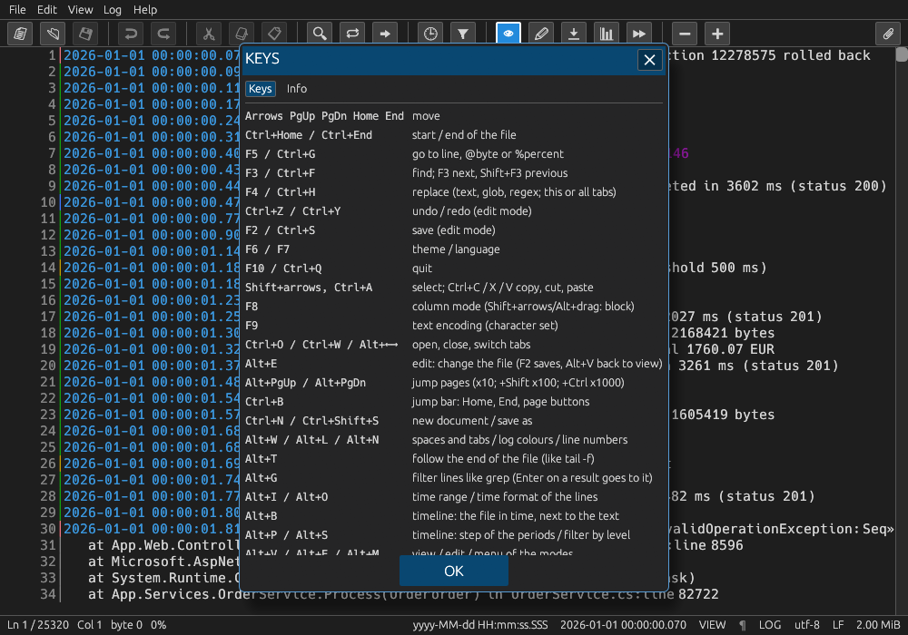
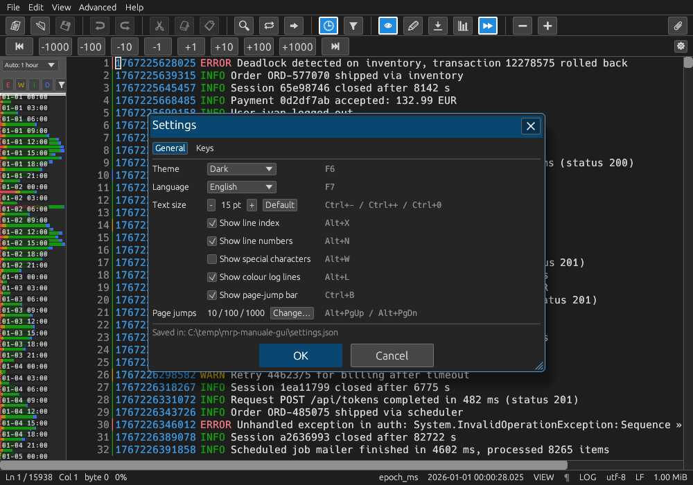

Le carte della parte prima valgono anche qui: stesso motore, stesse risposte, stessi limiti. Ogni carta che segue dice solo come si
raggiunge la funzione dalla finestra — menu', pulsante, dialogo — e cosa cambia rispetto al terminale.

### Apertura e navigazione

#### N-01 Aprire un file
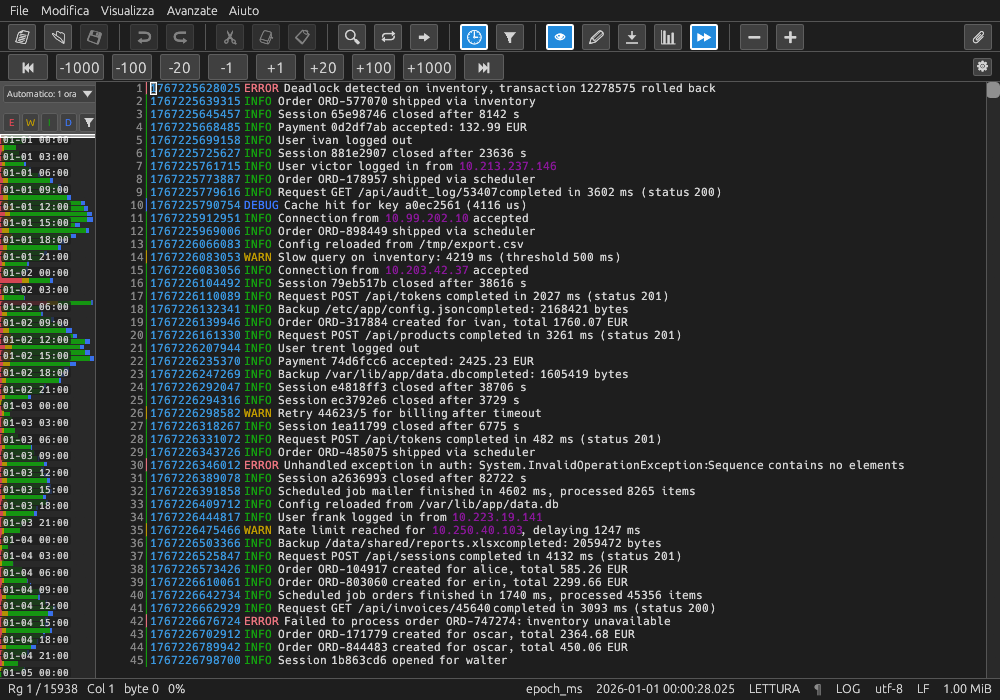
- **Dalla finestra:** File > Apri (il dialogo di sistema), oppure `mrp-gui FILE` dalla riga di comando.
- Come nel terminale: senza file torna l'ultima sessione, senza sessione un "Untitled 1" vuoto.

#### N-02 Aprire un altro file, documento nuovo
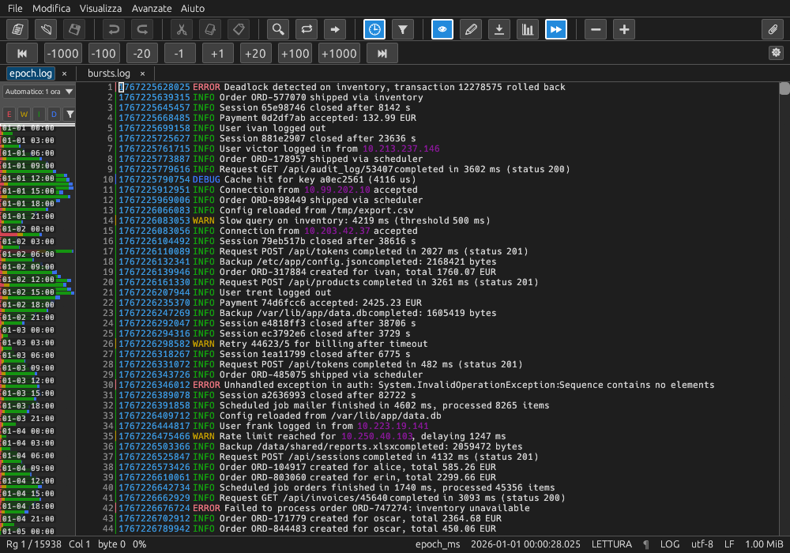
- **Dalla finestra:** File > Apri e File > Nuovo; `Ctrl+O` e `Ctrl+N` come nel terminale. Le schede si scelgono con un clic.

#### N-03 Muoversi
- **Dalla finestra:** rotella del mouse, trascinamento della scrollbar, clic sulla timeline. `Maiusc`+rotella scorre in orizzontale, otto celle a scatto.
- La barra orizzontale sotto il testo funziona come nel terminale: clic e trascinamento del pollice.

#### N-04 Vai a
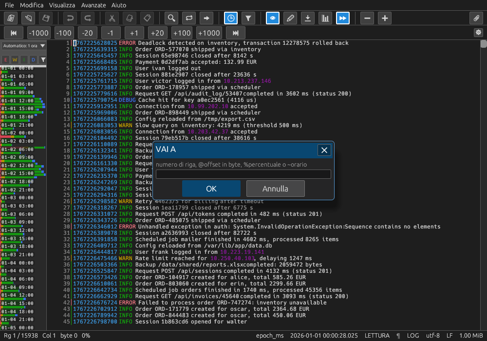
- **Dalla finestra:** Modifica > Vai a, o il pulsante nella barra. Accetta numero di riga, `@byte`, `%percentuale`, `~orario` come il prompt del terminale.

#### N-05 Salti di pagine e barra dei salti
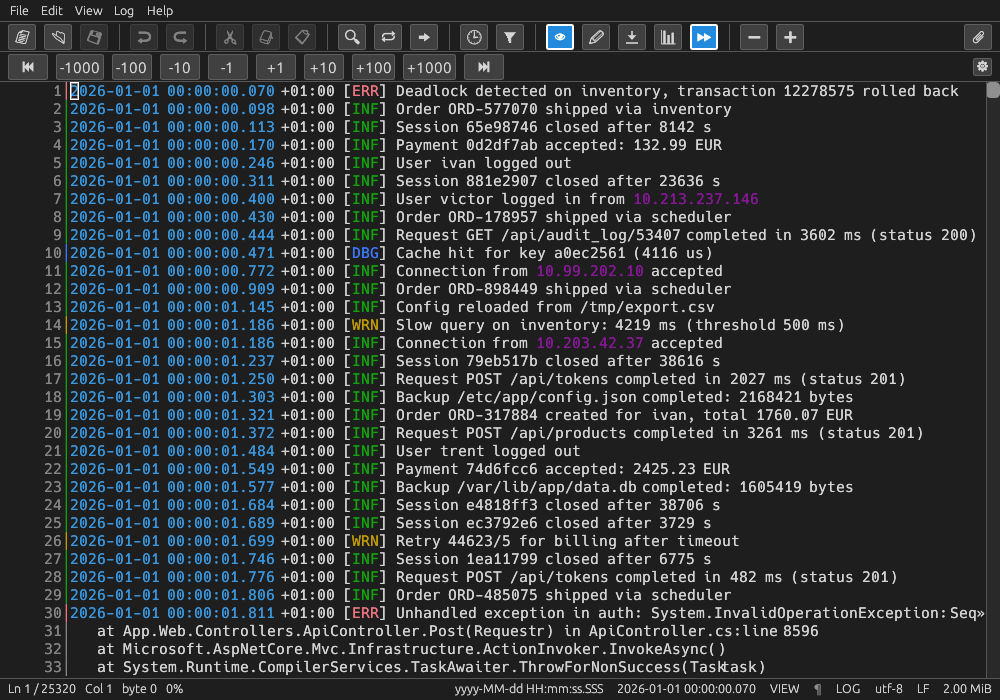
- **Dalla finestra:** la barra dei salti e' una striscia di pulsanti (*Home*, i passi di pagina, *Fine*); l'ingranaggio apre le impostazioni dei passi. `Alt+PgSu`/`Alt+PgGiu` e i modificatori (`Maiusc` x100, `Ctrl` x1000) sono gli stessi.

#### N-06 Numeri di riga e indice delle righe
- **Dalla finestra:** menu Visualizza > Mostra i numeri di riga / Mostra l'indice delle righe.

#### N-07 Schede
- **Dalla finestra:** un clic su una scheda la porta davanti; `Ctrl+W` chiude quella davanti; `Alt+1`..`9` e `Alt+freccia` come nel terminale.

#### N-08 Avanzamento dei lavori lunghi
- Automatico, come nel terminale: la riga di stato dice il lavoro in corso e quanto ne manca.

### Modi, modifica e salvataggio

#### M-01 I tre modi
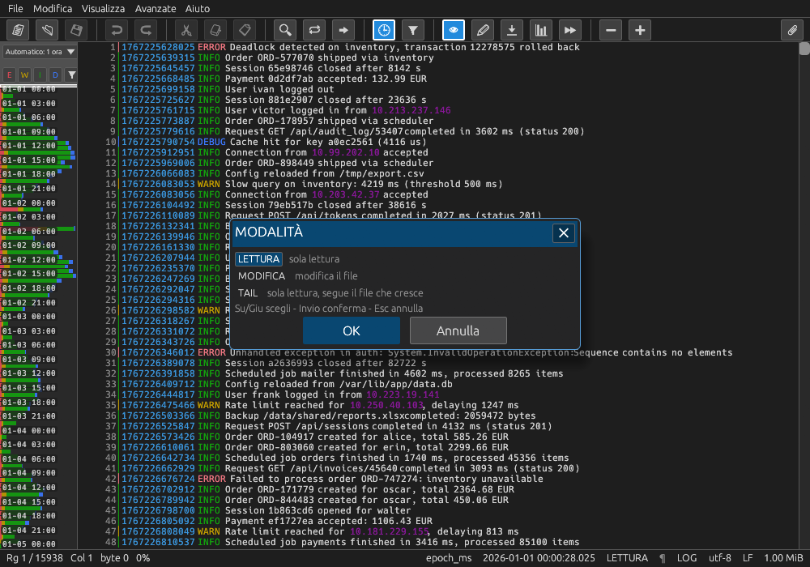
- **Dalla finestra:** tre pulsanti adiacenti nella barra degli strumenti, uno acceso; le voci col segno di spunta nel menu Modifica. I tasti `Alt+V`/`Alt+E`/`Alt+T` sono gli stessi.

#### M-02 Il menu dei modi
- **Dalla finestra:** il menu' dei modi sta nel menu Modifica e nei tre pulsanti della barra.

#### M-03 Digitare e modificare
- Come nel terminale: in EDIT caratteri, `Invio`, `Tab`, `Backspace`, `Canc`; selezione con `Maiusc`+frecce o il mouse; `Ctrl+C`/`X`/`V`.

#### M-04 Annulla e ripeti
- **Dalla finestra:** menu Modifica / i pulsanti Annulla e Ripeti nella barra. `Ctrl+Z` e `Ctrl+Y` come nel terminale.

#### M-05 Salva e Salva con nome
- **Dalla finestra:** File > Salva / File > Salva con nome; il percorso si sceglie col dialogo di sistema. Su un file grande il salvataggio mostra una barra di avanzamento e si puo' annullare.

#### M-06 Scarta le modifiche
- **Dalla finestra:** File > Ripristina. La domanda di conferma e' quella del terminale.

#### M-07 Uscire con modifiche non salvate
- **Dalla finestra:** chiudi la finestra; il dialogo "UNSAVED CHANGES" offre Salva ed esci, Scarta le modifiche, Annulla.

#### M-08 Tail
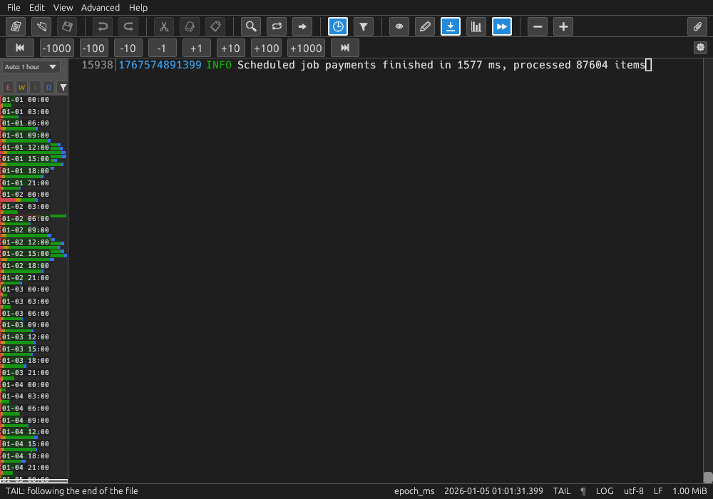
- **Dalla finestra:** il pulsante TAIL nella barra / menu Modifica. `Alt+T` come nel terminale.

### Tempo, timeline e filtri

#### T-01 Formato dell'orario
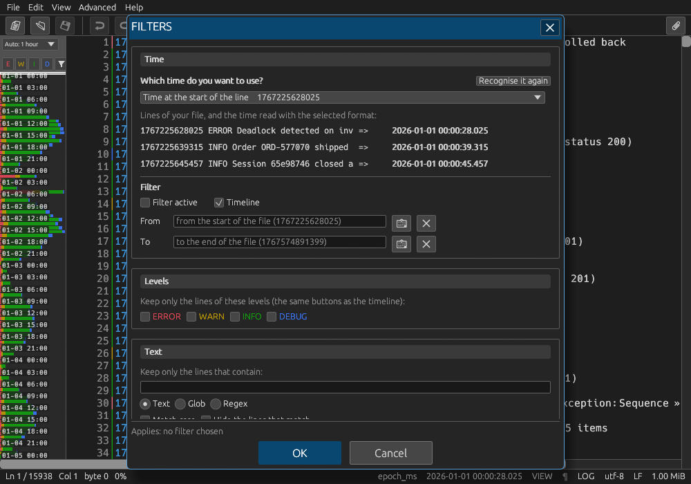
- **Dalla finestra:** menu Avanzate; la finestra Tempo ha il calendario per i campi e il riquadro "esempio" con l'anteprima delle prime righe.

#### T-02 Vai a un orario
- Come nel terminale: `F5` (o Modifica > Vai a) con `~orario` nel dialogo.

#### T-03 Intervallo di tempo
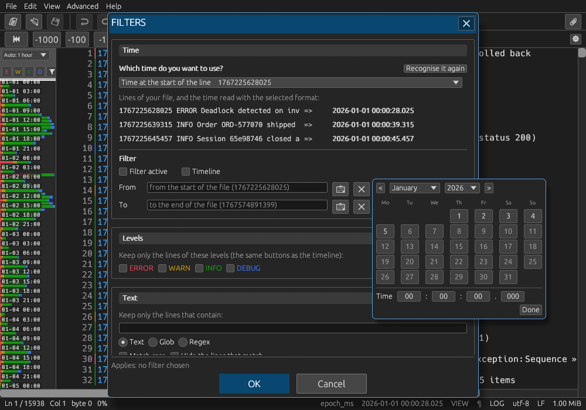
- **Dalla finestra:** Avanzate > Intervallo di tempo, o il pulsante dell'orologio nella barra (acceso mentre c'e' un intervallo). I campi Dal e Al hanno il calendario.

#### T-04 Timeline
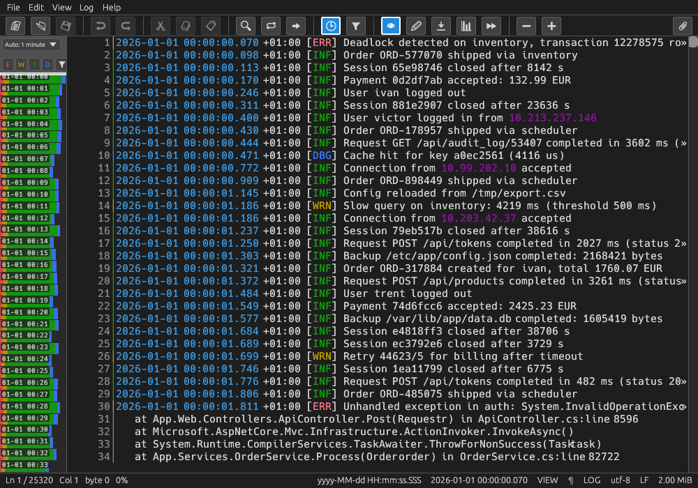
- **Dalla finestra:** Visualizza > Mostra la timeline, o il pulsante nella barra. Un clic sulla timeline porta li'.

#### T-05 Passo della timeline
- Come nel terminale: un clic sull'intestazione della timeline (solo mentre e' accesa) apre il menu' del passo.

#### T-06 Filtro dei livelli
- **Dalla finestra:** le bandierine dei livelli nella finestra Filtri; la scheda di sola lettura che ne esce e' la stessa del terminale.

#### T-07 Colori dei log
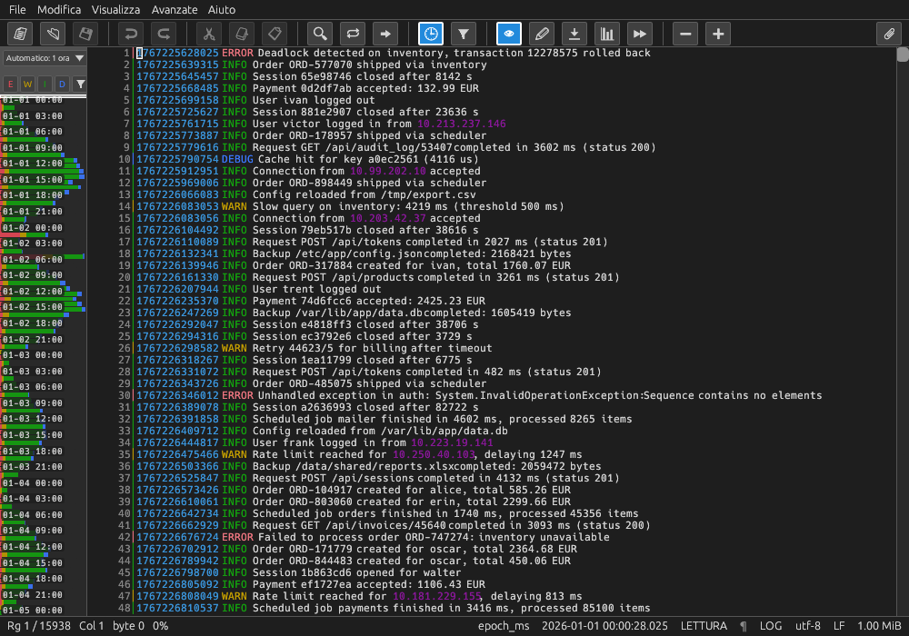
- **Dalla finestra:** Visualizza > Mostra i colori dei log. `Alt+L` come nel terminale.

#### F-01 Cerca
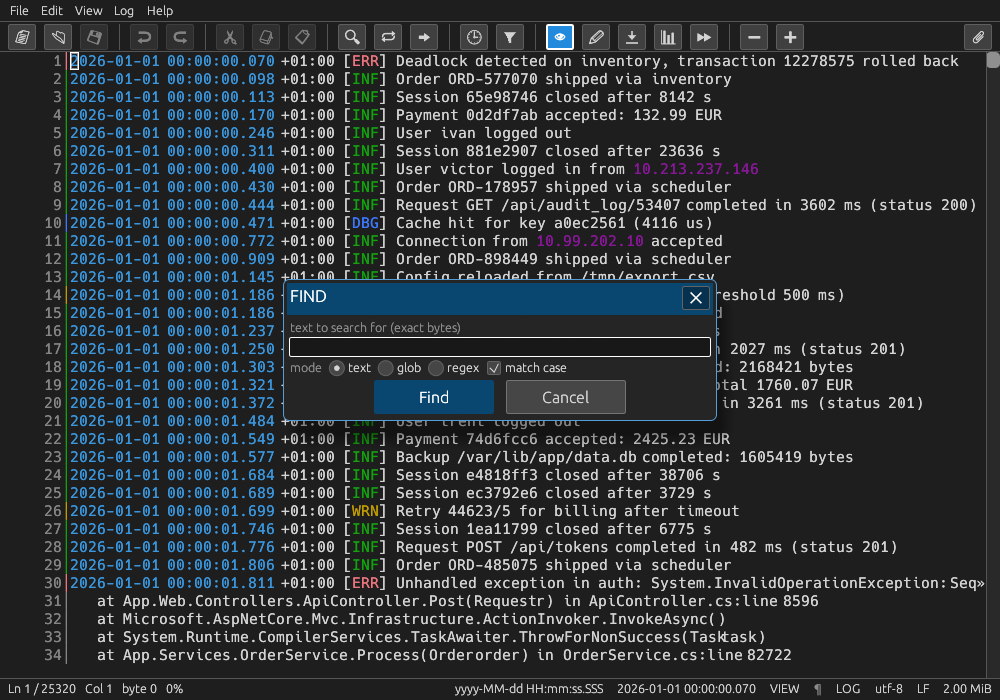
- **Dalla finestra:** Modifica > Trova o `Ctrl+F`; `F3` e `Maiusc+F3` iterano come nel terminale.

#### F-02 Sostituisci
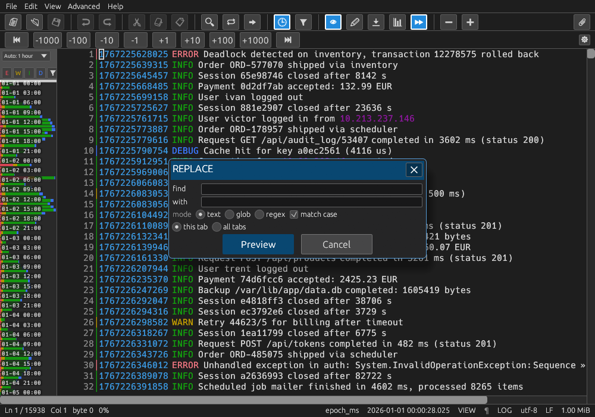
- **Dalla finestra:** Modifica > Sostituisci o il pulsante nella barra. L'anteprima e l'annullamento globale sono gli stessi.

#### F-03 Filtro per righe
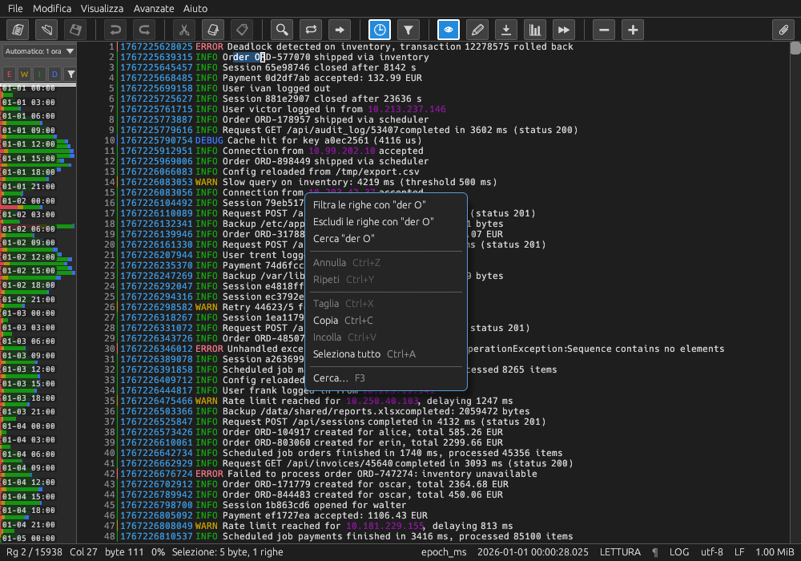
- **Dalla finestra:** la finestra Filtri (Avanzate > Filtri…); il menu contestuale su una selezione offre filtra, nascondi, cerca.

#### F-04 Check dei tracciati
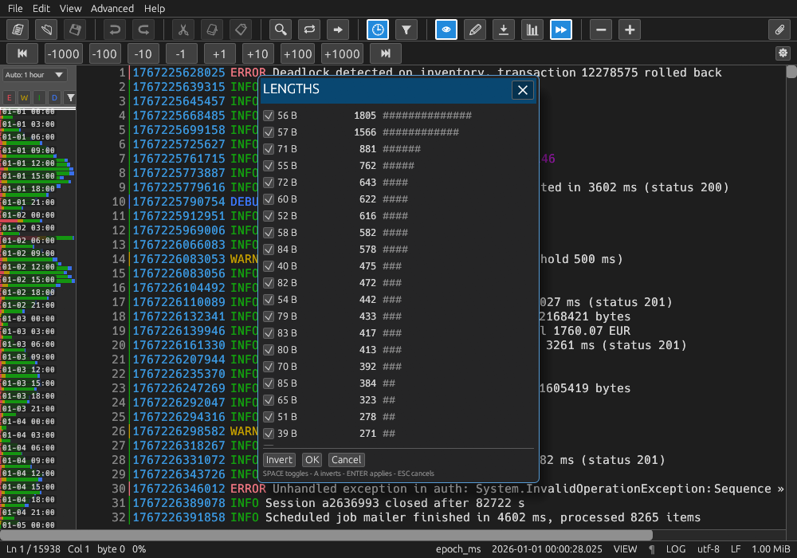
- **Dalla finestra:** Avanzate > Check dei tracciati. Le caselle dell'istogramma si spuntano col clic; la griglia mostra casella, conteggio, barra e percentuale per ogni lunghezza, e il totale in fondo.

### Codifiche e fine riga

#### E-01 Codifica
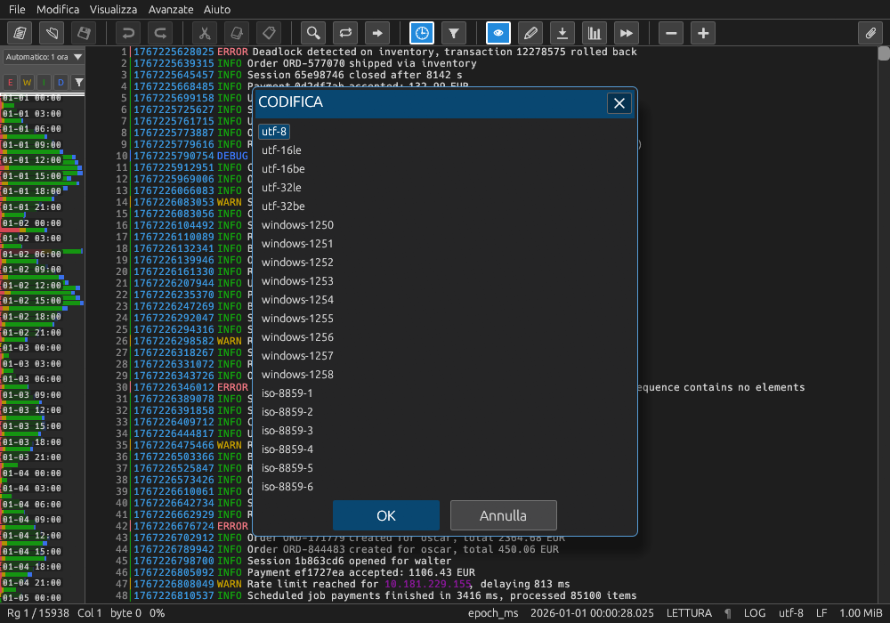
- **Dalla finestra:** Visualizza > Codifica… apre l'elenco delle 64 codifiche con quella corrente evidenziata.

#### E-02 Salva con nome in un'altra codifica
- Come nel terminale: `Ctrl+Maiusc+S`; il percorso si sceglie col dialogo di sistema, poi l'elenco delle codifiche (quella corrente evidenziata, la spunta per il BOM).

#### E-03 La modifica mantiene la codifica e il fine riga
- Automatico, uguale al terminale.

---

## Sotto il cofano

Questi capitoli spiegano come funzionano le parti, dove tengono i loro dati e cosa garantiscono. Le costanti vengono dal sorgente
e sono controllate dai test dove indicato.

### Salvataggio automatico e sessione: come sopravvive il lavoro non salvato

**Cos'e'.** Una piccola cartella di file che ricorda le schede aperte e, per ogni scheda con modifiche non salvate, quelle modifiche. E'
quello che ti lascia premere `F10` senza domande e ritrovare tutto alla prossima partenza.

**Cosa si custodisce, e cosa no.** Per scheda: il percorso del file, il cursore, il modo, il nome della codifica e — solo se modificato — le
modifiche stesse: il buffer dei byte inseriti e la lista dei pezzi che dice come si intrecciano con l'originale. **Il file originale non
viene mai copiato**: un log da 100 GB con tre modifiche ha una sessione di pochi kilobyte. La storia degli annullamenti non si custodisce.

**Dove.**

| Sistema | Cartella |
|---|---|
| Windows | `%APPDATA%\mrp\session\` |
| Linux / macOS | `~/.config/mrp/session/` |
| Portatile (una cartella `lang` accanto ai programmi) | `<cartella dei programmi>/session/` |

Il terminale e la finestra usano la stessa cartella (e lo stesso lock). Contenuto: `manifest.txt` (un elenco di testo: `mrp-session 1`,
`active N`, un `tab NOME` per scheda), `tab-0.mrps`, `tab-1.mrps`... (binario, little endian, magic `MRPS`, versione 1, chiuso da un
checksum FNV-1a a 64 bit), `lock`, `untitled/` (i file vuoti di lavoro che reggono i documenti "Untitled N"), `stale/` (cio' che non
si e' potuto ripristinare).

**Quando si scrive.** Mentre lavori, al piu' una volta ogni **5 secondi**, controllato una volta al secondo, e solo se qualcosa e' cambiato
(una modifica, un movimento del cursore, una scheda aperta o chiusa, un'altra scheda davanti). Ogni file passa per un nome temporaneo e
viene rinominato, quindi una scrittura interrotta lascia la sessione precedente intatta. Un crash duro puo' quindi perdere fino a ~6 secondi
di lavoro. All'uscita la sessione si scrive subito. Mentre un documento si salva, la scrittura della sessione salta e si riprova un attimo dopo.

**Quando torna.** Partendo senza file: ogni scheda torna, modifiche comprese, con la stessa scheda davanti. Partendo con
file: quelli si aprono prima e le vecchie schede *con modifiche non salvate* si aggiungono dietro (una scheda pulita dello stesso file viene
sostituita da quella ripristinata). La riga di stato dice "restored N tab(s) with unsaved changes".

**Cosa puo' andare storto.**

| Situazione | Cosa succede |
|---|---|
| Il file e' cambiato su disco | La scheda si ripristina lo stesso; al primo salvataggio il conflitto emerge (vedi *Modifica e salvataggio*). |
| Il file e' stato cancellato | La scheda si salta; con modifiche, la copia va in `stale/` e un avviso la nomina; una scheda pulita sparisce in silenzio. |
| Un file di scheda e' corrotto | Il checksum o la decodifica fallisce: quella scheda si salta, il suo file va in `stale/`, la riga di stato lo dice. |
| `manifest.txt` e' corrotto | Tutta la sessione si ignora e si apre "Untitled 1". Nessun crash. |
| Disco pieno / senza permessi | La scrittura periodica riprova piu' tardi; all'uscita, se la sessione non si puo' scrivere, l'editor chiede scheda per scheda. |
| Due istanze insieme | La seconda non prende il lock e gira senza sessione (le sue schede non sono protette). |

Solo il primo avviso arriva alla riga di stato; con piu' avvisi, il resto sta dentro `stale/`. `stale/` non viene mai svuotato dal programma.
Cancellare tutta la cartella dimentica solo schede, cursori e modifiche non salvate; i file dell'utente non si toccano mai.

**Da sapere.** Anche i documenti senza nome sopravvivono ai riavvii (stanno su file di lavoro in `untitled/`; salvarne uno con un nome vero
lo trasforma in una scheda normale e toglie il file di lavoro). Un file dell'utente che per caso sta in una cartella chiamata `untitled` non
viene mai scambiato per un file di lavoro. Le esecuzioni di sviluppo con `--dump`, o con `MRP_NO_PROFILE=1`, non tengono sessione.

### Modifica e salvataggio: piece table e scrittura sicura

**Modificare senza copiare.** Un documento e' una mappatura in sola lettura del file piu' una **piece table**: un elenco ordinato di pezzi, ognuno
dei quali punta nel file originale oppure in un piccolo buffer solo-aggiunto che raccoglie tutto quello che digiti. La memoria dipende dalla
dimensione delle modifiche, non del file. La tabella si tiene in blocchi di al piu' 512 pezzi, quindi una modifica tocca solo i blocchi che
attraversa. I pezzi vicini che diventano contigui si fondono.

**Annulla.** Ogni modifica effettiva si registra come una giunzione minima (quali pezzi sostituiti da quali). Annulla rilegge le giunzioni
all'indietro, ripeti in avanti; nessuna copia di testo viene fatta, quindi annullare costa quasi niente anche su un file enorme. Il flag
"modificato" e' un numero di versione che non si ripete mai: annullare fino allo stato salvato lo azzera.

**Salvare.** L'originale non si scrive mai sul posto. Un salvataggio:

1. rifiuta se il file su disco non ha piu' la lunghezza e la data di modifica registrate all'apertura (qualcun altro l'ha cambiato);
2. crea un file temporaneo **nella stessa cartella**, chiamato `.<nome>.mrp-tmp-<pid>-<n>`;
3. copia i pezzi in ordine, in blocchi da **4 MiB** (anche la granularita' della barra di avanzamento e dell'annullamento);
4. scarica il temporaneo su disco, copia i permessi dell'originale (non il proprietario);
5. lo rinomina sull'originale — l'unico passo atomico. Su Windows rinominare su un file mappato funziona mentre troncarlo no, ed e' per questo
   che il salvataggio e' un rename;
6. riapre il file nuovo, collassa la tabella in un pezzo solo, svuota la storia degli annullamenti e ricostruisce l'indice delle righe in background.

Il salvataggio gira in un thread che porta con se' il documento e **lo restituisce sempre**, anche in errore: un salvataggio fallito non
perde mai le modifiche. `Esc` nel dialogo alza un flag controllato prima di ogni blocco e prima del rename; dopo il rename il salvataggio
e' concluso.

**Cosa puo' andare storto.**

| Situazione | Cosa succede |
|---|---|
| Il file e' cambiato o sparito dall'apertura | "the file on disk changed after opening": niente scritto, le modifiche restano. |
| Cartella non scrivibile, disco pieno, rename rifiutato | Un errore col messaggio di sistema; il temporaneo si cancella; l'originale intatto; il documento resta modificato. |
| Annullato | Il temporaneo si cancella, "save cancelled", il documento com'era. |
| Il file viene accorciato da un altro *mentre* si copia | Il salvataggio fallisce con un errore di I/O; originale intatto. |
| L'antivirus tiene il temporaneo bloccato | Il temporaneo puo' restare; l'originale e' salvo. |
| Rename fatto ma la riapertura fallisce | I dati sono salvi su disco, ma la scheda diventa "chiusa" e riporta l'errore (raro). |

Un documento modificato non viene seguito in TAIL (mescolerebbe due contenuti). Salvare in una codifica diversa passa da un passo di
conversione col suo file temporaneo (`<nome>.<pid>.<n>.mrp-conv`) nella cartella di destinazione.

### Indice delle righe e navigazione senza leggere il file

**L'idea.** L'apertura e' immediata perche' nulla si legge in anticipo: il file e' memory-mappato e lo schermo chiede solo i byte che
mostra. I numeri di riga servono l'indice, che si costruisce in background.

**Un indice sparso.** Non custodisce ogni riga. Ricorda l'offset in byte di un inizio riga ogni **256 righe**, piu' uno per blocco da
**4 MiB**. Qualunque domanda — quante righe in tutto, quale riga tiene questo byte, dove comincia la riga N — parte dal punto ricordato
piu' vicino e conta gli a-capo solo nel breve resto che manca. Un log enorme costa megabyte di indice, non una voce per riga, e un file
che e' una riga sola riceve comunque risposta con lavoro limitato.

**Come si costruisce.** Un thread in background apre un suo handle in sola lettura sul file. Un gruppo di lavoratori (uno per thread di CPU)
prende i blocchi da 4 MiB in ordine, ognuno letto in segmenti da **256 KiB** in un buffer riusato — letture posizionate esplicite, non page
fault, quindi la memoria del processo non cresce col file — e una fusione sequenziale trasforma i conteggi per blocco in numeri di riga
globali. Su file di **64 MiB o piu'** un thread di precaricamento legge avanti a passi di 8 MiB, al piu' 256 MiB davanti ai lavoratori,
cosi' il disco vede richieste contigue.

**Si toglie di mezzo.** Quando salti (trascinamento della scrollbar, vai a, `Alt+PgSu/PgGiu`, `Ctrl+Home/Fine`) l'indicizzatore mette in
pausa le sue letture su disco e riprende da solo **400 ms** dopo l'ultimo salto; le frecce e la digitazione non lo mettono in pausa (un test
su un file da 8 GiB lo controlla). L'uscita, lo spegnimento dell'indice o un lavoro nuovo lo annullano fra un blocco e l'altro.

**Finche' non e' pronto.** I numeri di riga sono ignoti: il margine e' vuoto, la riga di stato mostra `Ln ?`, e vai a una *riga* dice di
aspettare; vai a per byte (`@`) o percentuale (`%`) funziona subito. Senza indice, il movimento cammina le **righe visive**: una riga visiva
e' una riga vera o un pezzo da 128 KiB di una riga troppo lunga, quindi una riga unica da 1 GB non blocca mai lo schermo.

**Quando riparte.** Dopo ogni salvataggio riuscito (il file e' cambiato), quando cambia la forma dell'a-capo (per esempio una codifica nuova)
e quando riaccendi l'indice. In TAIL un file cresciuto *estende* l'indice sui byte nuovi invece di ricostruirlo.
La forma dell'a-capo (un byte, `CR`, o un'unita' allineata da 2 o 4 byte per UTF-16/32) si rileva dai primi 64 KiB.

**Cosa puo' andare storto.** (Su Windows la mappatura impedisce anche agli altri programmi di troncare il file mentre e' aperto qui; aggiungere,
rinominare e cancellare si puo'.) Un file che il lavoro in background non riesce ad aprire dà "index failed" con l'errore di sistema e nessun
numero, ma tutto il resto continua. Un file accorciato durante l'indicizzazione fa rifare il blocco toccato attraverso la mappatura. Un file
troncato da un altro processo sotto una mappatura viva puo' alzare un errore di accesso dal sistema: rischio noto e accettato del memory
mapping.

### Tempo: formati, salto a un orario, intervallo, timeline

**L'idea.** Un log e' quasi sempre ordinato per tempo e il tempo sta in testa a ogni riga. Quindi il programma non ha mai bisogno di un indice
dei tempi: trova qualunque orario con una ricerca binaria sui byte del file, leggendo solo i primi cento byte di una manciata di righe. E'
per questo che le funzioni del tempo funzionano su un file di qualunque dimensione e non lo leggono mai tutto.

**Maschera del tempo.** Una *maschera* e' un modello che dice dove sta l'orario in una riga (`yyyy-MM-dd HH:mm:ss.SSS`, `HH:mm:ss`,
`epoch_ms`, syslog, Apache...). Si confronta solo nei primi caratteri della riga (0 per la maggior parte dei formati, 40 per quello Apache,
regolabile). Il valore letto e' un numero di millisecondi dal 1970-01-01, negativo prima, calcolato con un calendario gregoriano scritto a
mano: nessun fuso orario e nessuna libreria di date, quindi le date prima del 1970 e gli anni bisestili funzionano. I valori epoch con 9–10
cifre sono secondi, con 12–13 millisecondi. Un secondo intercalare `:60` si legge 59,5 s; una maschera senza anno usa il 2000.

**Rilevamento.** Una volta per scheda, la prima volta che qualcosa lo chiede, il programma prende un campione — fino a 1000 righe non vuote dai
primi 64 KiB e fino a 1000 dagli ultimi — e prova i 19 formati noti. Vince quello che legge piu' righe, se abbastanza sono d'accordo: un formato
completo di data e ora vuole 3 righe che tornano (o tutte), uno debole (solo ora, solo data, epoch) vuole la meta' delle righe non vuote, quindi
un numero di 10 cifre sbagliato non passa per un epoch. Il formato scelto l'ultima volta si prova per primo. I documenti UTF-16/UTF-32 non
si riconoscono mai.

**Vai a un orario e intervallo.** Entrambi bisettano l'intervallo di byte: prendono il mezzo, vanno all'inizio della sua riga, guardano la prima riga con un orario da li' (al piu' 4096
righe visive avanti, leggendo al piu' 512 byte ciascuna), e restringono. Le righe senza orario (una intestazione, uno stack trace) si saltano.
Questo assume che gli orari non tornino mai indietro; con un log che lo fa, le ricerche possono fermarsi sulla riga sbagliata. L'intervallo non e'
altro che due offset in byte, quindi toglierlo e' immediato.

**Timeline.** Una barra con una riga per periodo. Invece di scansionare, il programma trova ogni confine di periodo saltando in avanti dal
precedente a passi che raddoppiano (galoppo, da 4096 byte) e poi bisettando l'intervallo trovato. Il costo e' proporzionale al numero di
periodi (al piu' 20.000), non al numero di righe. Il passo e' 1 minuto, 10 minuti, 1 ora o 1 giorno; *Auto* prende il piu' lungo che dà ancora
almeno 12 periodi (due settimane di log danno giorni, una giornata dà ore). Una seconda passata, nel suo thread e leggendo pezzi da 1 MiB, conta
per ogni periodo quante righe *cominciano* con ciascun livello; il livello di una riga e' la sua prima parola di livello, trovata dallo stesso
scanner che colora la riga. La passata aspetta (cicli da 20 ms) mentre il file si indicizza ancora, cosi' i due non si contendono il disco. Le 12
celle di ogni barra si dividono fra i livelli in proporzione, ma un livello presente non scende mai a zero.

**Thread e annullamento.** Le tacche si costruiscono in un thread che apre un handle *suo* sul file; lo schermo fa il sondaggio del
risultato. Cambiare il passo, l'intervallo o la lunghezza del file, o spegnere la timeline, annulla i lavori in corso e butta i risultati parziali
(nessuna barra a meta'). Vai a un orario e l'intervallo girano nel thread principale e non si possono interrompere, il che va bene perche' sono
poche decine di piccole letture.

**Cosa si ricorda.** Il formato scelto diventa il predefinito provato per primo sui prossimi file; fino a 8 regole imparate *da un
esempio* si custodiscono e si ripropongono dove leggono qualcosa; entrambe stanno nel file delle impostazioni. Ogni scheda ha la sua maschera e il
suo intervallo.

**Cosa puo' andare storto.** Orari che tornano indietro (vedi sopra); un log le cui ultime 4096 righe visive non hanno orario riporta ultimo = primo; un
documento modificato o senza nome non ha timeline ("unavailable"); un intervallo sbagliato e' rifiutato col primo e l'ultimo orario veri del
file; UTF-16/32 non ha funzioni del tempo.

### Codifiche, fine riga, modalita' colonna

**L'idea.** Un documento e' sempre una sequenza di byte; la codifica e' solo la lente che dice come quei byte si leggono come caratteri
(schermo, cursore, larghezze di colonna) e come un carattere digitato diventa byte. Posizione, conteggi di riga e ricerche restano allineati
all'unita': 1 byte per UTF-8, le code page e le codifiche asiatiche multibyte, 2 per UTF-16, 4 per UTF-32.

**64 codifiche.** UTF-8, UTF-16 LE/BE, UTF-32 LE/BE, 53 code page a byte singolo (windows-125x, ISO-8859, pagine IBM/DOS, KOI8, cinque pagine
Mac, ASCII) e 6 codifiche asiatiche multibyte (Shift_JIS, EUC-JP, GBK, GB18030, Big5, EUC-KR). I nomi non distinguono maiuscole, `_` vale `-`, con
alias (`cp1252`, `latin1`, `437`, `cp932`...); un `utf-16` nudo e' rifiutato perche' ambiguo. Le codifiche a stato (ISO-2022-JP, HZ) non sono supportate.

**Rilevamento.** Senza `--encoding`, i primi 64 KiB decidono, in quest'ordine: un BOM UTF-32, un BOM UTF-16, poi (con almeno 8 byte) quale meta' di ogni unita'
tiene gli zero, poi qualunque byte NUL significa "binario" e UTF-8, poi la validita' UTF-8, altrimenti windows-1252. UTF-32 senza BOM non si indovina mai.
Il rilevamento e' un'ipotesi: **F9** rilegge gli stessi byte con un'altra codifica sul posto, senza toccare il file. Un byte che non e' un
carattere valido compare come un carattere U+FFFD per byte, quindi niente si nasconde.

**Il BOM.** Resta nei byte e sopravvive ai salvataggi; l'editor gli gira intorno (digitare all'inizio va dopo di lui, Backspace si ferma
a lui, Canc lo scavalca).

**Fine riga.** LF, CRLF o CR solo si rileva dallo stesso campione (CR solo se a byte singolo e il campione ha CR ma nessun LF; CRLF
se i CRLF superano gli LF nudi). Invio scrive esattamente quello stile, quindi un file CRLF non diventa mai misto. `--eol` forza quello che
scrive Invio senza riscrivere le righe che ci sono. I documenti nuovi prendono lo stile del sistema (CRLF su Windows).

**Cambiare codifica.** F9 su un documento la cui forma dell'a-capo cambierebbe (UTF-16/32 contro il resto) e' rifiutato mentre il documento e'
modificato o ha una storia di annullamenti; altrimenti l'indice si ricostruisce in background e la selezione e il risalto della ricerca si perdono.

**Salva con nome con conversione.** *Salva con nome* chiede la codifica di destinazione e una casella BOM. Stessa codifica e stesso BOM e' un salvataggio
normale; qualunque altra cosa converte tutto il contenuto corrente, modifiche non salvate comprese, in un thread, in blocchi da 1 MiB, in un file
temporaneo (`<nome>.<pid>.<n>.mrp-conv`) che viene rinominato sul bersaglio. Se un carattere non si puo' scrivere nella codifica di destinazione, niente
viene rinominato: il temporaneo si cancella, il bersaglio non si tocca, il cursore salta su quel carattere e il messaggio lo nomina (U+XXXX) col suo offset.

**Modalita' colonna (F8).** `Maiusc`+frecce o `Alt`+trascinamento disegnano un rettangolo sulle righe visive. Digitare, Tab, Backspace e Canc agiscono su ogni riga del blocco che
raggiunge la colonna; copia unisce le righe con l'a-capo del documento; incolla va riga per riga; Invio butta il blocco. Un carattere appartiene al
blocco se *comincia* dentro le colonne; il `\r` nascosto e il `\n` mai. Ogni azione di colonna e' un passo di annulla solo. Limiti: 200.000 righe,
64 MiB di testo copiato, un tetto di colonna virtuale a 4096. Un incolla che chiedesse piu' righe di quante ne ha il documento e' rifiutato per intero.

### Ricerca, sostituzione e filtro per righe

**Cercare sul documento modificato.** Una ricerca non gira sul file: prende una *fotografia* del documento modificato (una lettura condivisa
del file mappato piu' una copia della piece table) e gira in un thread, in blocchi da 1 MiB con sovrapposizione, controllando il flag di annullamento prima di ogni blocco.
La fotografia resta valida anche se modifichi o salvi mentre gira. Il testo semplice distinguendo le maiuscole si cerca come byte esatti nella codifica del documento,
quindi funziona in ogni codifica; glob, regex e senza-maiuscole si compilano con la crate `regex` (che non ha backtracking, quindi nessun modello puo' impallare la ricerca,
e un limite di 8 MiB sulla dimensione compilata) e funzionano solo su documenti UTF-8. I modelli confrontano per riga, come `grep`. Le righe piu' lunghe di 16 MiB si leggono a pezzi
(una corrispondenza attraverso un taglio puo' sfuggire). Le corrispondenze vuote si scartano.

**Mentre un lavoro gira** il programma ignora ogni tasto tranne `Esc`, che lo annulla.

**Sostituisci** e' in due fasi: il primo Invio conta (anteprima), il secondo applica. Tutti i cambi di una corsa sono un passo di annulla solo. Oltre le 2.000.000
di occorrenze si rifiuta ("too many"). In modalita' tutte-le-schede il workspace fa un lavoro per scheda e totalizza i conteggi, le schede con corrispondenze e quelle saltate.

**Il filtro per righe** scrive le righe che corrispondono, byte per byte, in un file temporaneo nella cartella temporanea di sistema (`mrp-filter-<pid>-<n>.log`),
lo apre come scheda di sola lettura e tiene, accanto, l'offset vero di ogni riga nell'originale (8 byte per riga, al piu' 20.000.000 di righe). E'
per questo che `Invio` su una riga arriva esattamente su quella riga dell'originale anche se l'originale e' stato chiuso nel frattempo. Il file temporaneo si cancella quando la sua
scheda si chiude o il programma esce; un filtro che non trova niente, fallisce o viene annullato non lascia file.

**Le stesse impostazioni di ricerca** (testo, modo, maiuscole) sono condivise da Cerca, Filtro e Sostituisci, e i prompt sono precompilati col testo dell'ultima volta.

### Cache: cosa si ricorda, e quando si butta

**Il principio.** Niente si rende persistente: ogni cache vive in RAM dentro il processo e sparisce quando esce (le uniche cose
scritte su disco sono il documento salvato, le impostazioni e la sessione). La piu' grande non e' nostra: il file e' memory-mappato, quindi le sue
pagine sono la cache del file del sistema operativo, condivisa e cacciabile. Le passate sequenziali lunghe (l'indice delle righe, il salvataggio) usano letture
posizionate esplicite invece di page fault perche', su un disco che gira, una lettura sequenziale grande misurata correva a 149 MB/s contro 28–39 MB/s
dei fault.

**Perche' le modifiche restano economiche.** La tabella delle modifiche e' divisa in blocchi di al piu' 512 pezzi, e ogni blocco porta un'*etichetta* da un
contatore di processo che cambia ogni volta che i suoi pezzi cambiano e non si riusa mai: etichette uguali significano sempre contenuto uguale. E' quello che
lascia al programma ricordare i conteggi di riga dei blocchi gia' visti, e ricontare solo i blocchi toccati davvero. Un test
controlla che i numeri restino giusti modificando a mano i pezzi di un blocco, e nessuna conta mentre niente cambia.

**L'indice delle righe e' del file originale.** Resta valido attraverso le modifiche: la piece table fa da ponte sulla differenza. Quindi puoi digitare in
un log da 100 GB e i numeri di riga restano giusti senza reindicizzare.

| Cache | Contiene | Buttata quando | Peso |
|---|---|---|---|
| Indice delle righe | inizi sparsi delle righe del file originale (uno ogni 256 righe, piu' uno ogni 4 MiB) | un salvataggio, un cambio di codifica che cambia la forma dell'a-capo, l'indice spento, un indice nuovo installato; *esteso* sul posto in TAIL | 16 B ogni 256 righe + 16 B ogni 4 MiB: circa 60 MB per un miliardo di righe da 100 byte |
| Conteggio a-capo per pezzo | gli `\n` in ogni pezzo intero | con l'indice; svuotata oltre 2 × pezzi + 1024 | ~32 B per voce |
| Conteggio a-capo per blocco | gli `\n` in un blocco intero, per etichetta | con l'indice; potata alle etichette vive oltre 2 × blocchi + 1024 | 16 B per voce |
| Tabella dei prefissi | offset di inizio e a-capo prima di ogni blocco | **qualunque modifica, annulla o ripeti**; ricostruita al primo uso, in tempo proporzionale ai blocchi toccati | 16 B per blocco |
| Periodi della timeline | i confini dei periodi (orario, offset in byte) | cambio di lunghezza, intervallo o passo; timeline spenta; documento modificato | al piu' 20.000 × 16 B = 320 KB |
| Livelli della timeline | i conteggi dei quattro livelli per periodo | arrivano periodi nuovi; timeline spenta | al piu' ~640 KB |
| Formato del tempo | il formato riconosciuto, per scheda | riconosciuto una volta; sostituito da una scelta a mano (che spegne anche l'intervallo) | un modello |
| Aiuti del dialogo del tempo | conteggi delle corrispondenze, suggerimenti, il primo e l'ultimo orario del file | ogni volta che il dialogo si apre | poche centinaia di byte |
| Anteprima | fino a 3 coppie (riga, orario) | quando modello, distanza o lunghezza del documento cambiano | 3 righe |
| Righe disegnate | l'ultima schermata di testo e i suoi offset | sostituita a ogni disegno; riusata mentre un salvataggio tiene il documento | uno schermo |
| Campioni di avanzamento | (istante, byte) del lavoro in corso | il lavoro cambia o riparte; solo gli ultimi 3 s tenuti | pochi campioni |

**Come si legge la tabella.** Tutto quello che dipende dal testo *modificato* (la tabella dei prefissi) si ricostruisce dopo ogni modifica, ma solo per i
blocchi cambiati. Tutto quello che dipende dal *file originale* (l'indice e le cache dei conteggi) si butta solo quando il file stesso
cambia: un salvataggio, una forma dell'a-capo nuova, o l'indice spento. La potatura e' solo per dimensione: se la cache dei pezzi si svuota, la
prossima ricostruzione riconta tutto una volta.

**Da sapere.** Spegnere la timeline butta i suoi periodi; riaccenderla ricalcola gli stessi periodi. Un log con una
intestazione lunga senza orari riceve comunque il formato riconosciuto, perche' il campione comprende la coda. La preferenza della timeline e'
l'unica cosa "ricordata" di questo capitolo che arriva nel file delle impostazioni.

