# Manto.RustPad — Manual

**English** · [Italiano](MANUAL.it.md)

## How to read this document

| Field | Meaning |
|---|---|
| **Entry** | How you reach it: key, menu, click. *Terminal* and *Window* when they differ. |
| **Expected response** | What the interface must show or do. This is what a tester checks. |
| **Must not** | What must never happen (data loss, freezes, a wrong mode...). |
| **Limits and edge cases** | Big files, missing permissions, unsaved changes, narrow screens. |
| **Auto tests** | The automated tests that already cover it, or *none*. |

Keys are written for Windows, Linux and macOS alike (`Ctrl`, `Alt`). In the terminal, `Alt+letter` needs a terminal that sends
Alt as an escape prefix (most do).

---

> **Two faces on the same engine:** [the terminal (mrp-tui)](img/tui/n01-apre.png) · [the window (mrp-gui)](img/manual/n01-apre.png) — screenshots of both are in every card.

## The product in one page

**Three ways to use a file.** They exclude each other: exactly one is on.

| Mode | Keys | What it is |
|---|---|---|
| **VIEW** | `Alt+V` | Read only. The default. |
| **EDIT** | `Alt+E` | Change the file. Nothing touches the disk until you save. |
| **TAIL** | `Alt+T` | Read only, and the view follows the end of the file as it grows (`tail -f`). |

The current mode is always the last word of the status row (`VIEW`, `EDIT`, `TAIL`, with `COL` after it in column mode) and is
lit in the footer. Clicking the word, or `Alt+M`, opens a small menu of the three modes. In the window the toolbar has three
adjacent buttons, one lit.

**The terminal screen**, top to bottom:

1. *(only with more than one tab)* the tab bar;
2. the text, with a gutter of line numbers on the left;
3. the **status row**: position (`Ln 12  Col 3  byte 1234  7%`) or a message on the left; on the right the running job
   (`indexing 45%`), the file name (` *` after it when modified), the size, the encoding if it is not UTF-8, the line ending if it
   is not LF, and the mode;
4. the **footer**: `Alt+V View  Alt+E Edit  Alt+T Tail  F1 Help  F2 Save  F3 Find  F4 Repl  F5 Go ...  F10 Quit`. On a narrow
   terminal the less used F keys give way first (F6, F7, F8, F9, then F5); the three modes never do.

**Standard keys, the same in the terminal and in the window:** `F1` help, `F2` save, `F3` find (`Shift+F3` previous), `F4`
replace, `F5` go to, `F6` theme, `F7` language, `F8` column mode, `F9` encoding, `F10` quit, `Esc` closes a window.
`Ctrl+Z`/`Ctrl+Y` undo/redo, `Ctrl+C`/`X`/`V` clipboard, `Ctrl+A` select all, `Ctrl+O` open, `Ctrl+N` new, `Ctrl+W` close tab.
The help has two tabs in the window (Keys, and *Info* with the version, the license and the GitHub address as a real link) and, in
the terminal, the same three lines close the key table: version, AGPL-3.0, code.

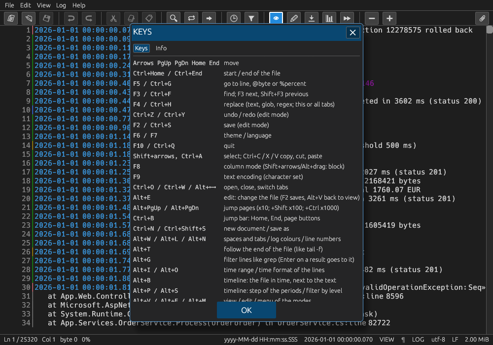
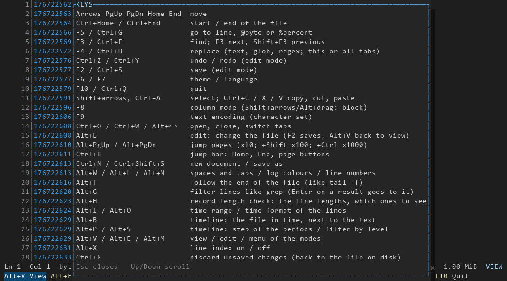

**The window** has a menu (File, Edit, View, Log, Help), a toolbar (New, Open, Save | Undo, Redo | Cut, Copy, Paste |
Find, Replace, Go to | Timeline, Time filter | VIEW, EDIT, TAIL, Column mode, Jump bar | Zoom), tabs, a scrollbar and the same

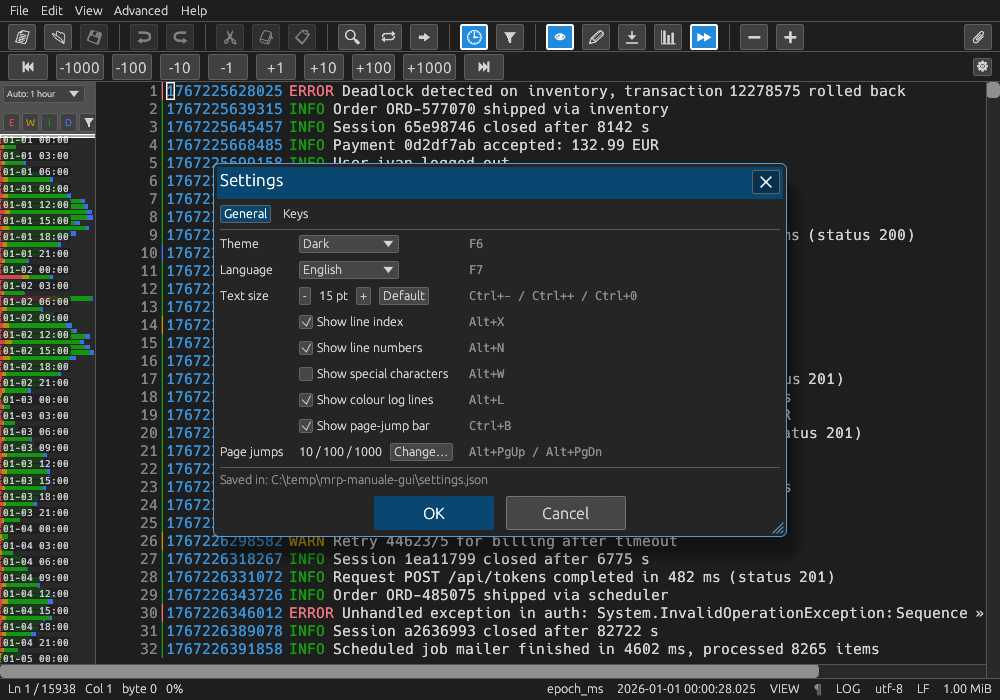
status row as the terminal.

---

## Feature cards

### Opening and navigating

#### N-01 Open a file from the command line

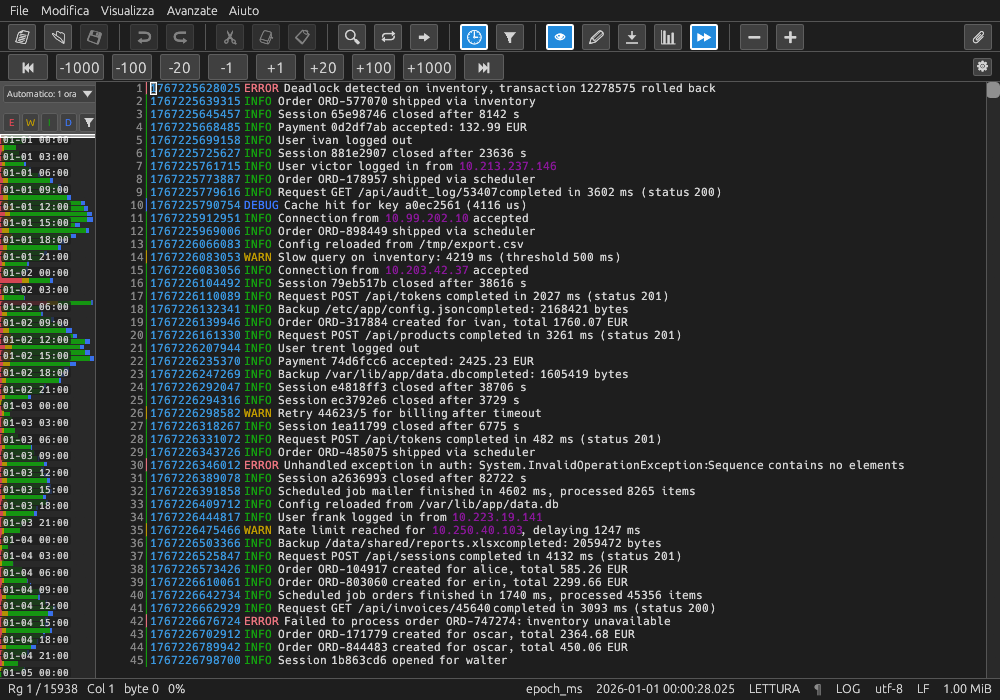
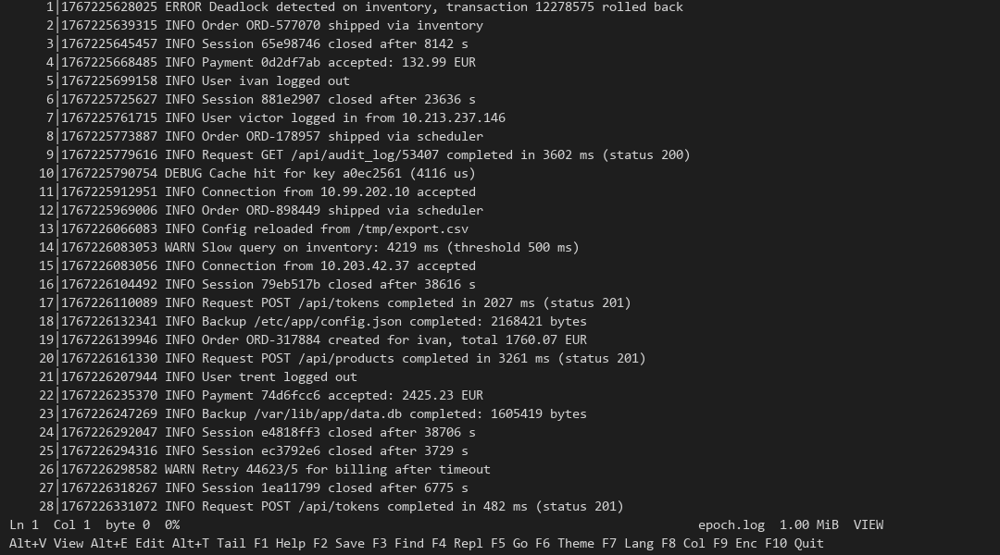
- **Entry:** `mrp-tui FILE` / `mrp-gui FILE`. With no file, the last session comes back (see [*Autosave and session*](../ARCHITECTURE.md#autosave-and-session-how-unsaved-work-survives)); with none, an empty "Untitled 1".
- **Expected response:** first screen immediately, mode `VIEW`, position `Ln 1  Col 1  byte 0  0%`, file name and size on the right.
  While the index is being built: `indexing N%` on the right, `Ln ?` on the left, and a blank line-number gutter *(observed on a 6 GB file)*.
- **Must not:** load the whole file; freeze the screen while indexing; ask anything.
- **Limits and edge cases:** **on Windows, while a file is open here, other programs can append to it, rename it or delete it, but cannot truncate it** (opening it for writing with truncation, or shrinking it, fails with a system error: the file is memory-mapped). A service that restarts its log from zero will get that error while someone is viewing the log; appending, rotating by rename and deleting are fine (tested). A missing file gives an error and no window; an empty file opens with 0 lines; a file that is one single
  huge line still scrolls (rows are cut at 128 KiB); a file of 64 MiB or more shows a progress bar after 2 s (N-08).
- **Auto tests:** yes (`app_view`, `cli`, `pausa_indice`, `utf16_core`...).

#### N-02 Open another file, new document

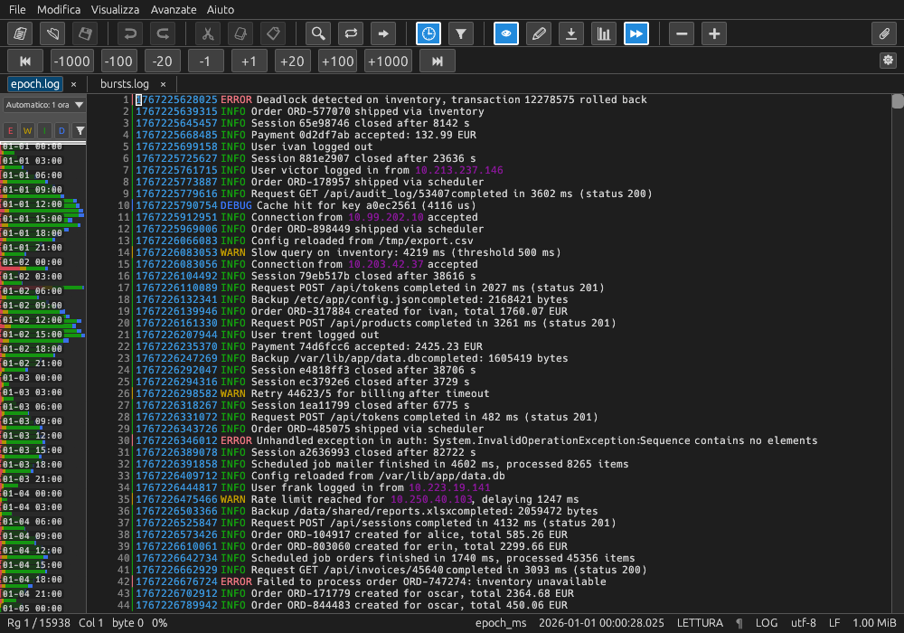
- **Entry:** `Ctrl+O` (window: File > Open, system dialog; terminal: a prompt "path of the file to open", Enter OK, Esc cancels).
  `Ctrl+N` opens an empty document in a new tab, in EDIT mode.
- **Expected response:** a new tab appears and is active; opening an already open file does not duplicate it.
- **Must not:** replace a tab that has unsaved changes.
- **Limits and edge cases:** opening while the active tab has unsaved changes keeps those changes (a new tab is used).
- **Auto tests:** yes (`workspace`, `untitled`, `menu`).

#### N-03 Move around
- **Entry:** arrows, `PgUp`/`PgDn`, `Home`/`End`, `Ctrl+Home`/`Ctrl+End`, mouse wheel, scrollbar (window).
- **Expected response:** the position in the status row follows; the view scrolls when the cursor leaves the screen.
- **Must not:** read the whole file to move; stall on a very long line.
- **The horizontal scrollbar (added 2026-11-11):** a line wider than the window shows a bar under the text (one row,
  only when needed: a line wider than the window, or already scrolled) with a thumb that says where the window sits on
  the widest visible line — before, the only way to scroll was walking the cursor through the line. Click or drag the
  thumb (it follows the pointer as grabbed; a click on the track centers it there): the window moves and the cursor
  stays where it is (the next cursor move recentres the view on it). In the window, `Shift`+wheel scrolls too, eight
  cells per notch. `«` and `»` still mark the cut sides of a line; for a line beyond the reading limit the world of the
  bar is an honest lower bound that grows as you scroll.
- **Limits and edge cases:** on a file still being indexed, jumps work by byte and percentage, not by line (N-04); jumping pauses
  the indexer's disk reads for 400 ms ([*Line index*](../ARCHITECTURE.md#line-index-and-navigation-without-loading-the-file)).
- **Auto tests:** yes (`app_view`, `app_jump`, `app_mouse`, `hbar`; in the window: `barre`).

#### N-04 Go to (`F5` / `Ctrl+G`)

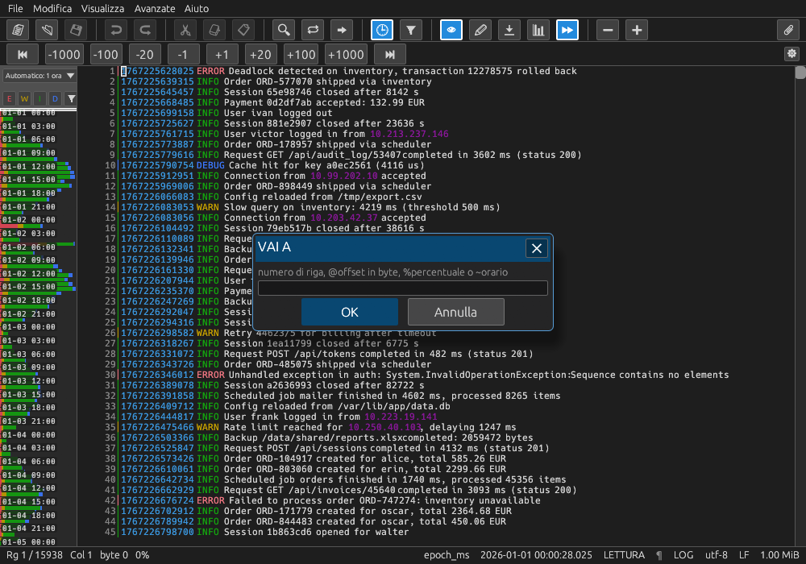
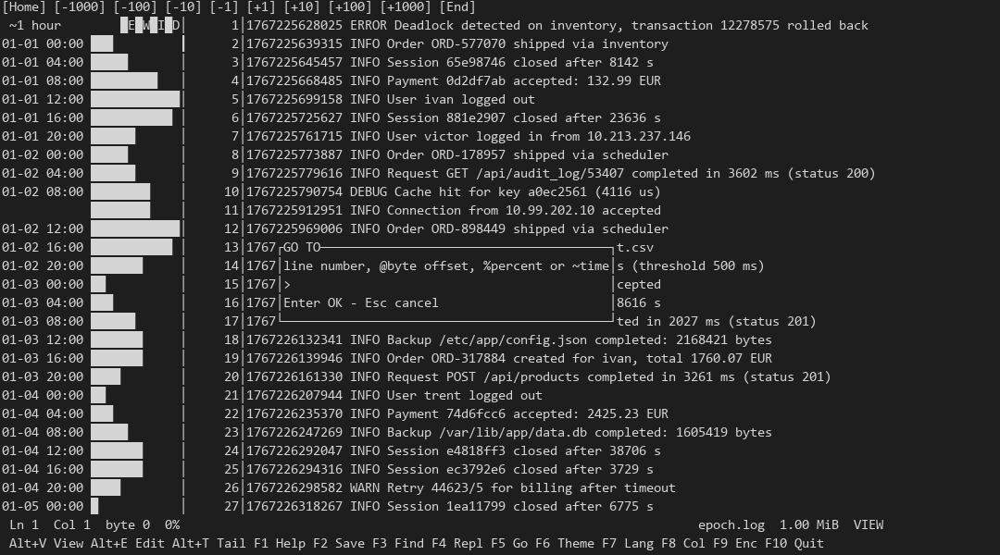
- **Entry:** `F5` or `Ctrl+G`; window: Edit > Go to, or the toolbar button. A prompt: "line number, @byte offset, %percent or ~time".
- **Expected response:** the cursor goes there and the target is shown near the middle of the screen *(observed: `500` -> `Ln 500`,
  `%50` -> `49%`, `@1000000` -> `byte 1000000`)*. `0` -> "not a valid position: 0"; a line past the end -> "line N is beyond the end (M lines)".
- **Must not:** move the cursor on an invalid target; land inside a multi-byte character (it snaps back to its start).
- **Limits and edge cases:** The `@` of `@byte` is typed with AltGr on many keyboards (Italian, German, Spanish, French...): it works in the terminal on Windows too (see M-03). By line needs the index (while it is still being built you get a "wait" message and nothing moves);
  `@` and `%` need no index; `~time` needs a recognised time format (see [*Time*](../ARCHITECTURE.md#time-formats-jump-to-a-time-range-timeline)).
- **Auto tests:** yes (`app_jump`, `time_dialogs`).

#### N-05 Jump pages and the jump bar

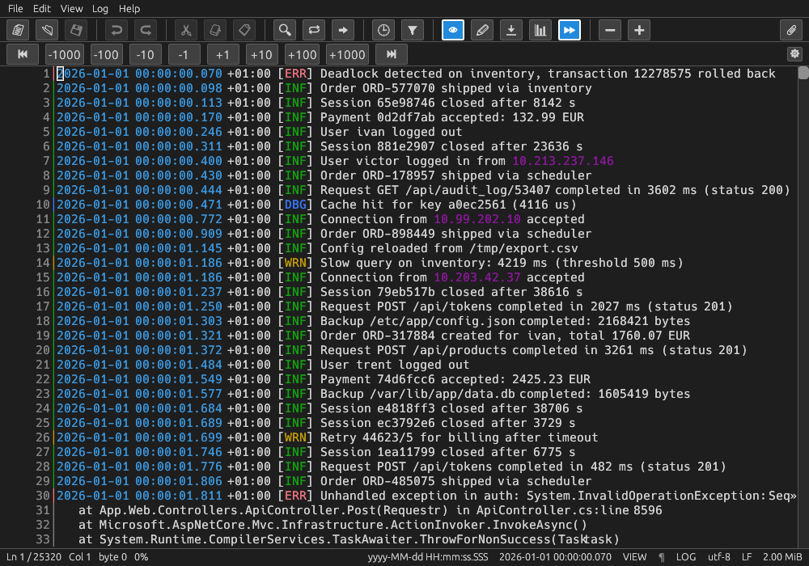

- **Entry:** `Alt+PgUp`/`Alt+PgDn` jump 10 pages (`Shift` x100, `Ctrl` x1000); `Ctrl+B` shows a bar with *Home*, *End* and page-step
  buttons (the window draws it as a strip of buttons with a gear that opens the settings of the steps).
- **Expected response:** the view lands where the step says; the status row shows the new position.
- **Must not:** freeze on a huge file.
- **Auto tests:** yes (`jump_config`, `app_jump`, `pausa_indice`).

#### N-06 Line numbers and the line index
- **Entry:** `Alt+N` shows/hides line numbers; `Alt+X` turns the line index on/off (window: View menu).
- **Expected response:** turning the index **off** first asks "TURN OFF THE LINE INDEX?", listing what is lost (line numbers, go to a line, the total of lines, fast page jumps, the line count of a selection) and what keeps working; Enter confirms and the numbers disappear (`Ln ?`), Esc cancels. Turning it on again restarts the count from zero without asking.
- **Must not:** change the file.
- **Auto tests:** yes (`line_numbers`, `pausa_indice`).

#### N-07 Tabs
- **Entry:** `Ctrl+PgDn`/`Ctrl+PgUp`, `Alt+←`/`Alt+→`, `Alt+1`..`9`, `Ctrl+W` closes; window: click on a tab.
- **Expected response:** the active tab changes at once; closing a tab with unsaved changes asks first.
- **Must not:** close a modified tab silently when there is no session (with a session the changes are kept, see [*Autosave and session*](../ARCHITECTURE.md#autosave-and-session-how-unsaved-work-survives)).
- **Auto tests:** yes (`workspace`, `chrome`).

#### N-08 Progress of long jobs on big files
- **Entry:** automatic, for indexing, search and saving.
- **Expected response:** from 60 columns `indexing 61% #######.....`; from 90 also `0:01 left`; from 140 also
  `3.45 GiB / 5.59 GiB  1.67 GiB/s`. Below 2 s, or under 64 MiB, only the percentage. The bar is a rainbow
  (themes with colours) *(observed in the escape codes)*.
- **Must not:** block the screen; show an absurd estimate (it stays silent when the job is paused or has no speed yet).
- **Limits and edge cases:** the ETA is hidden above 99 hours.
- **Auto tests:** yes (`avanzamento`).

### Modes, editing and saving

#### M-01 The three modes
- **Entry:** `Alt+V` VIEW, `Alt+E` EDIT, `Alt+T` TAIL; `F4` is *not* a mode (it is Replace). Window: three toolbar buttons and the
  Edit menu entries with a tick.
- **Expected response:** the last word of the status row changes; the footer lights the current one; a message explains the change
  ("edit mode: the file is not touched until you save", "TAIL: following the end of the file", "view mode").
- **Must not:** be in two modes at once; start TAIL on a modified document (see M-08).
- **Auto tests:** yes (`modi`, `follow`, `commands`, `strumenti`).

#### M-02 The mode menu

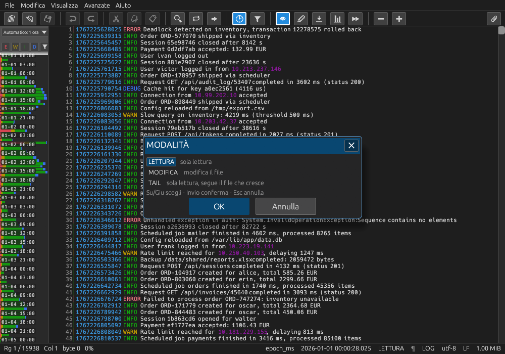
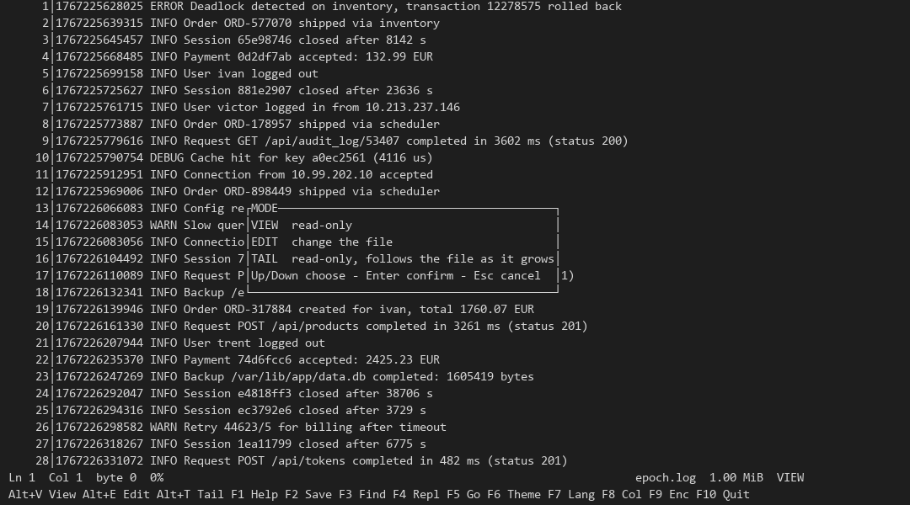
- **Entry:** `Alt+M`, or a click on the mode word in the status row.
- **Expected response:** Up/Down move, Enter chooses, Esc closes.
- **Must not:** change the mode without Enter.
- **Auto tests:** yes (`modi`, `dialog_views`); the click in a real terminal is only tested at the app level *(to verify by hand)*.

#### M-03 Typing and editing
- **Entry:** in EDIT: characters, `Enter`, `Tab`, `Backspace`, `Delete`; selection with `Shift`+arrows or the mouse; `Ctrl+C`/`X`/`V`.
- **Expected response:** the status row shows ` *` after the file name; the text changes at once.
- **AltGr (Windows, fixed 2026-11-08):** on keyboards that use AltGr (Italian, German, Spanish, French, Portuguese...) the characters `@ [ ] { } ~ # ` \ |` and `€` reach the terminal as Ctrl+Alt+character; the program turns them back into plain text (Ctrl+Alt+letter or digit, Alt+key and Ctrl+key stay shortcuts). It works in every text field (edit, Find, Replace, Filter, Go to `@byte`). Before the fix they were dropped: `a@b{c}[d]` gave `abcd`.
- **Must not:** touch the file on disk before a save. In VIEW, typing is refused with the hint **"read-only: press Alt+E to edit"**.
- **Auto tests:** yes (`app_edit`, `app_select`, `app_multibyte`).

#### M-04 Undo and redo
- **Entry:** `Ctrl+Z`, `Ctrl+Y` (`Ctrl+Shift+Z`); window: Edit menu, toolbar.
- **Expected response:** the text goes back/forward by whole steps.
- **Must not:** work in VIEW (refused with the same hint as typing, "read-only: press Alt+E to edit"); survive a save (after a save the history is empty).
- **Limits and edge cases:** the history is not kept in the session: a restored tab can be saved but not undone ([*Autosave and session*](../ARCHITECTURE.md#autosave-and-session-how-unsaved-work-survives)).
- **Auto tests:** yes (`app_edit`, `commands`).

#### M-05 Save and Save as
- **Entry:** `F2` / `Ctrl+S`; `Ctrl+Shift+S` Save as (asks the name, then the encoding). Both work in VIEW too when there are changes.
- **Expected response:** the message "saved: NAME" and no ` *`. On a big file a dialog with a progress bar, Esc cancels *(observed: `saved: ux_copy.log`)*.
- **Must not:** leave a half-written file, ever, whatever the interruption; overwrite a file another program has changed since you opened it.
- **Limits and edge cases:** nothing to save -> the message "nothing to save"; file changed on disk -> refused with the reason, edits stay;
  read-only folder or full disk -> an error, original intact, no temp file left.
- **Auto tests:** yes (`app_edit`, `save_encoding`, `session`).

#### M-06 Discard changes (`Ctrl+R`)
- **Entry:** `Ctrl+R` (or `Alt+R`); window: File > Revert.
- **Expected response:** a question naming the file; Enter/S/Y confirms and the tab reopens in VIEW near the old position; Esc/N keeps the edits.
- **Must not:** touch the file on disk. With nothing to discard: the message **"no unsaved changes to discard"** and no dialog.
- **Auto tests:** yes (`revert`).

#### M-07 Quit with unsaved changes
- **Entry:** `F10` / `Ctrl+Q`; window: close the window.
- **Expected response (no session):** a window "UNSAVED CHANGES": `S` Save and quit, `D` Discard changes, `C` Cancel.
  "Save and quit" exits only if the save succeeded.
- **Must not:** lose changes silently.
- **Auto tests:** yes (`session`, `app_edit`).

#### M-08 Tail (follow the end)

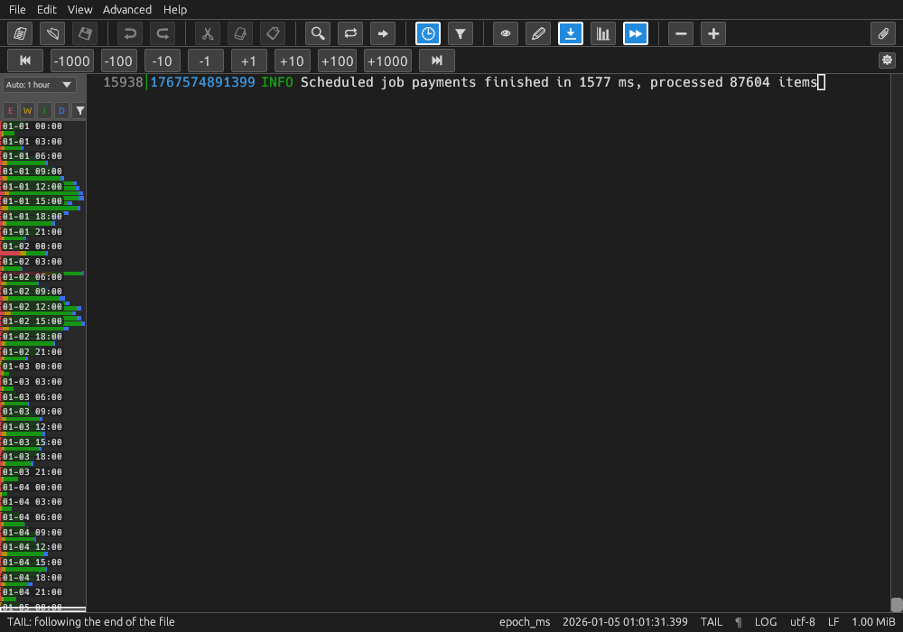
- **Entry:** `Alt+T`; window: toolbar button / Edit menu.
- **Expected response:** `TAIL` in the status row and "TAIL: following the end of the file".
- **Must not:** start on a document with unsaved changes: it stays where it is and says **"save or discard the changes (F2, Ctrl+R) before TAIL"**.
- **Limits and edge cases:** from EDIT without changes it switches straight to TAIL; a file that shrinks stops following with a message.
- **Auto tests:** yes (`follow`, `modi`).

### Time, timeline and filters

#### T-01 Time format of the lines (`Alt+O`)

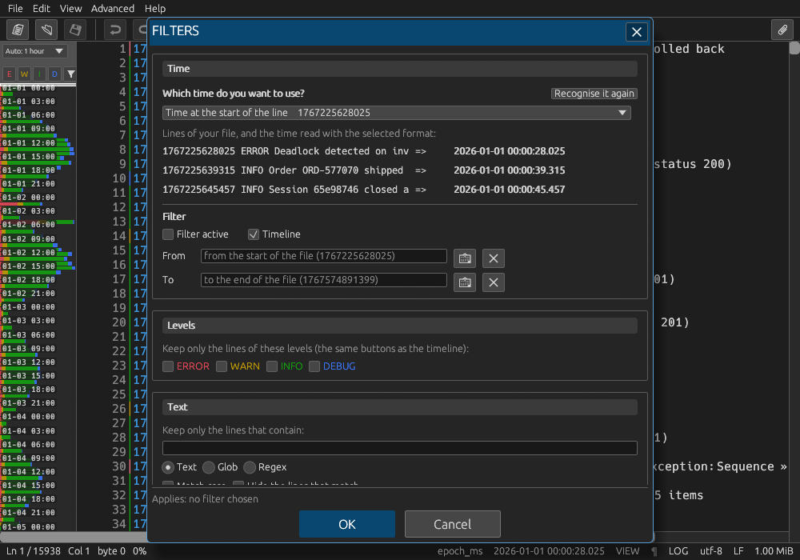
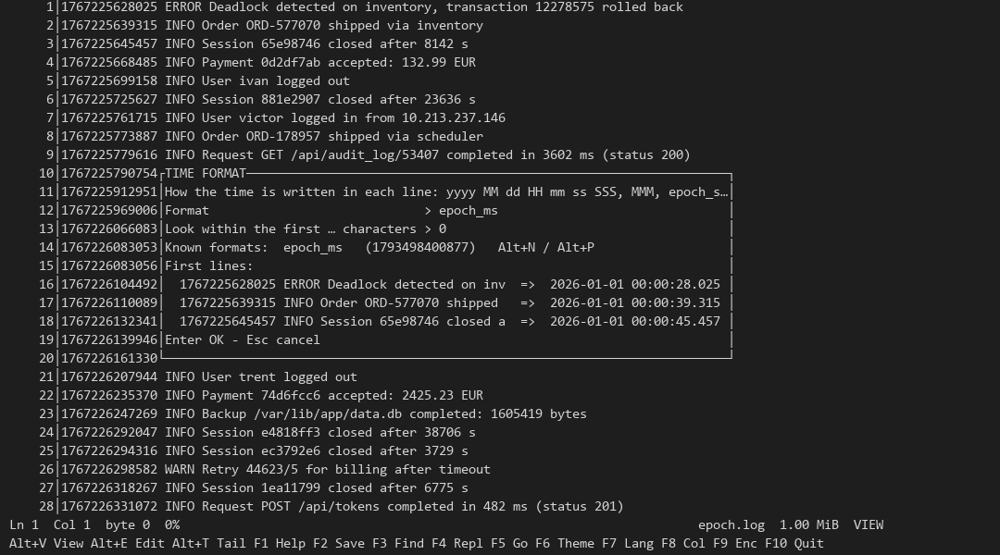
- **Entry:** `Alt+O`; automatic on first use. Window: Advanced menu / the Time window with calendar and "example" box *(to verify by hand)*.
- **Expected response:** a window "TIME FORMAT" with the format, how many characters from the start to look within, the known
  formats with a sample, and a preview of the first lines as `text => 2026-01-01 00:00:28`. Everything that depends on
  time (status-row time, timeline, go to a time, time range, colours) follows the chosen format.
- **Must not:** read the whole file (detection uses at most 64 KiB from the head and 64 KiB from the tail); change the file.
  A wrong token (`yyyyy`) gives a "bad token" error and leaves the format unchanged.
- **Limits and edge cases:** UTF-16/UTF-32 files are never recognised, so they have no time features. Masks without a year (syslog)
  use the year 2000. Timestamps that go backwards break the assumption behind the searches (see [*Time*](../ARCHITECTURE.md#time-formats-jump-to-a-time-range-timeline)).
- **Auto tests:** yes (`time_range`, `time_dialogs`, core `timemask*`).

#### T-02 Go to a time (`F5`, then `~time`)
- **Entry:** the go-to prompt with a `~` before the time: `~03:20`, `~2026-10-31 05:00:00`.
- **Expected response:** the cursor and the view land there *(observed: `~03:20` on a log with times from 00:00 lands on the 03:22:55 line, `Ln 283`)*.
  A target before everything stays on the first line.
- **Must not:** read the file linearly; land on a line with a smaller time.
- **Limits and edge cases:** needs a recognised format and times that never go backwards; lines without a time are skipped.
- **Auto tests:** yes (`goto_time`).

#### T-03 Time range (`Alt+I`)

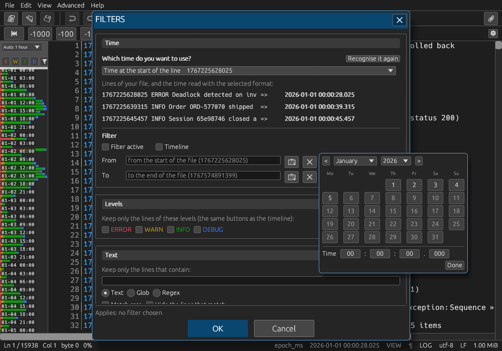
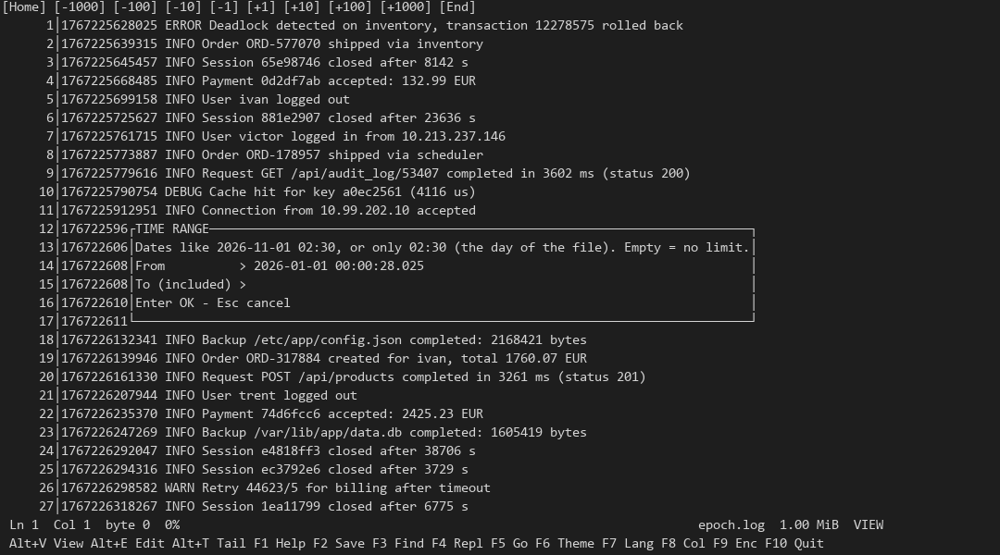
- **Entry:** `Alt+I`; window: Advanced > Time range / toolbar clock button (lit while a range is on).
- **Expected response:** a prompt "Dates like 2026-11-01 02:30, or only 02:30 (the day of the file). Empty = no limit.", with the
  first time of the file prefilled in "From". After Enter the view shows only that interval and the status row says
  `Time range: 2026-01-01 00:00:28 to 2026-01-01 00:10:00`.
- **Must not:** accept "from" later than "to" (an error that also tells the real first and last times of the file; nothing changes).
- **Limits and edge cases:** search finds only matches inside the range; a match outside counts as not found. The last time of a log is
  looked for at most 4096 rows back from the end.
- **Auto tests:** yes (`time_range`).

#### T-04 Timeline (`Alt+B`)

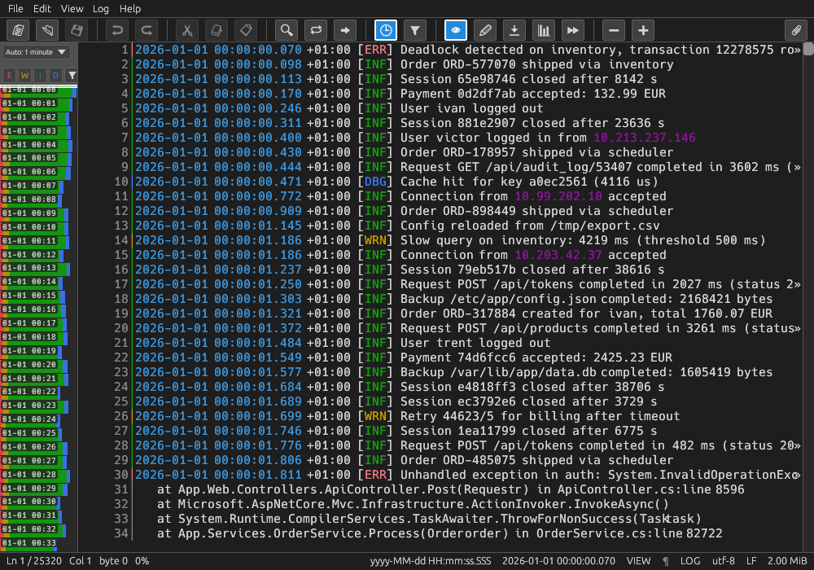

- **Entry:** `Alt+B`; window: toolbar clock button / View > Show timeline. In the window it turns itself on when a file with a recognised time is
  opened (once per tab, file up to 2 GiB, unmodified); in the terminal it never does.
- **Expected response:** a 25-column panel with a header (`~1 hour`, the `~` meaning the step is automatic, then the legend `E W I D`)
  and one row per period like `01-01 04:00 █████`: the bar is all solid blocks, the colour tells the level (ERROR red,
  WARN yellow, INFO green, DEBUG grey); the cells not yet counted stay faint. A level that is present always gets at least one cell,
  so a single ERROR among thousands of INFO lines is still visible.
- **Must not:** read the whole file for each period (it gallops forward and bisects); block the screen (it is built in a background thread
  that opens its own copy of the file); work on a modified document (it says "unavailable").
- **Limits and edge cases:** needs at least 40 text columns; at most 20,000 periods (forcing 1 minute on a multi-day log gives
  "too many buckets" with the count, in red and bold); UTF-16/32 documents have no timeline. On a file with no times the timeline
  turns itself off and the status line says why, with its advice (pick a time format by hand): the preference is not touched, the next
  file with times reopens it as it was left.
- **Auto tests:** yes (`timeline_*`, core `timeline*`).

#### T-05 Timeline step (`Alt+P`)
- **Entry:** `Alt+P`, or a click on the timeline header (only while it is on).
- **Expected response:** a menu "TIMELINE: PERIOD": *Auto (chosen from the length of the log)*, 1 minute, 10 minutes, 1 hour, 1 day.
  Auto picks the longest of day / hour / 10 minutes that still gives at least 12 periods, else the minute.
- **The choice is of the tab, not an habit:** it is not remembered between files — every file starts from Auto, and changing the time
  format resets to Auto too (the ends of the file change with it). A fine step that stayed saved used to break longer files.
- **Must not:** change the file or the range.
- **Auto tests:** yes (`timeline_tasti`, `timeline_pref`).

#### T-06 Level filter (`Alt+S`)
- **Entry:** `Alt+S` (timeline on); also the level flags in the Filters window.
- **Expected response:** a menu "TIMELINE: SHOW ONLY": *All the lines*, *Errors only*, *Errors and warnings*, *Errors, warnings and info*.
  The choice opens a new read-only tab named with the levels.
- **Must not:** change the original file or tab. The match is the whole level word, exact case.
- **Limits and edge cases:** refused for non-UTF-8 documents, with a message.
- **Auto tests:** yes (`timeline_levels_app`).

#### T-07 Log colours (`Alt+L`)

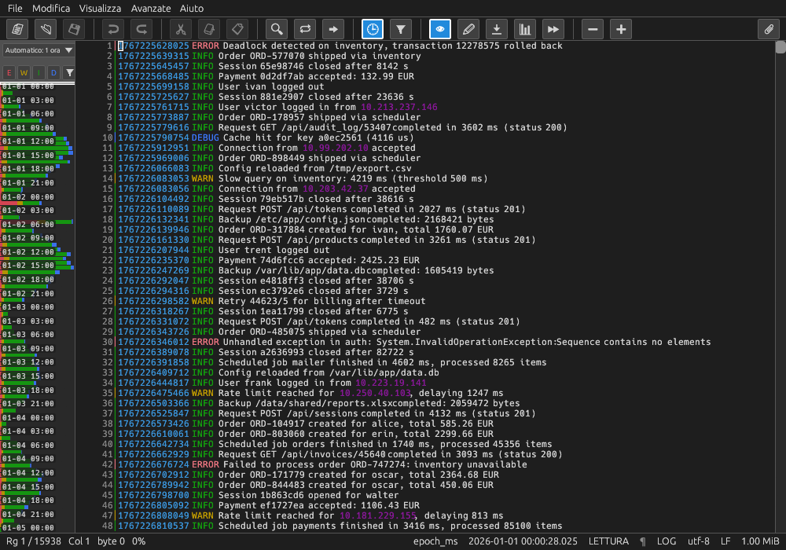

- **Entry:** `Alt+L`; window: View > Show colour log lines.
- **Expected response:** the colours appear at once and follow the theme; times are coloured only where the current format can read them.
- **Must not:** slow scrolling; colour inside a word (the level must be a whole word).
- **Auto tests:** yes (`logcolors`, core `loghl*`).

#### F-01 Find (`F3` / `Ctrl+F`)

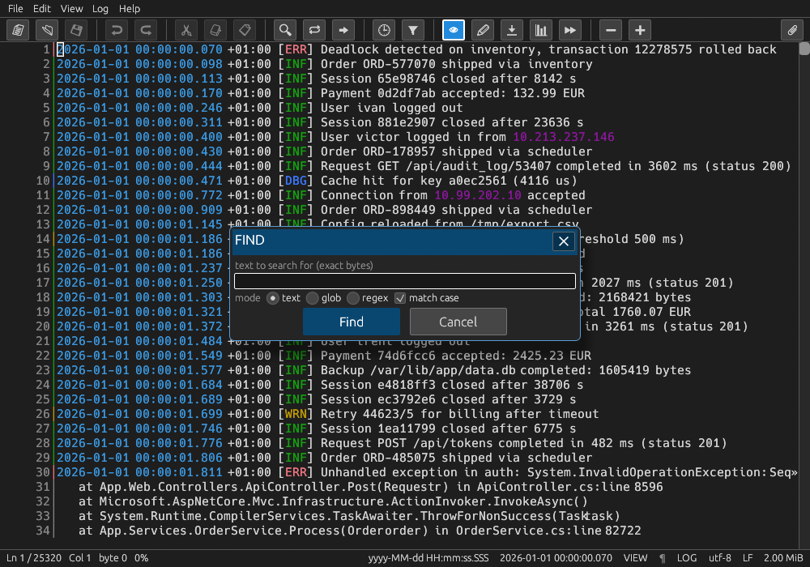
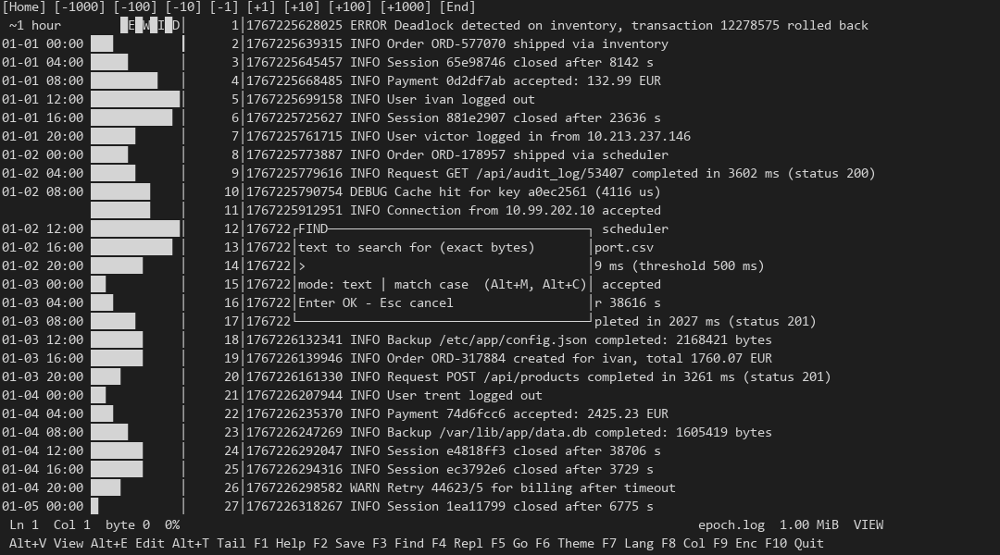
- **Entry:** `Ctrl+F` opens the prompt (prefilled with the last text); `F3` repeats forwards, `Shift+F3` backwards (or opens the prompt if there is no search yet).
  With a selection, `F3` searches the selection itself, literal and match case, without any prompt; the selection that is the match just found
  does not count — `F3` continues the previous search (a regex, a case-insensitive one) as before.
- **Expected response:** a prompt "text to search for (exact bytes)" with `mode: text | match case  (Alt+M, Alt+C)`; the cursor
  goes to the next match; past the end it wraps with a notice. On a big file a progress bar after 2 s and `Esc` cancels ("cancelled", cursor unmoved).
- **Must not:** freeze on a huge file; hang on any regular expression (the engine has no backtracking and a size limit of 8 MiB).
- **Limits and edge cases:** patterns match per line (never across a newline); glob, regex and ignore-case need a UTF-8 document
  (otherwise a message says so); plain text in a code page whose needle cannot be encoded is simply "not found"; matches in multibyte
  Asian encodings count only at the start of a character.
- **Auto tests:** yes (`dialog_search`, core `pattern`).

#### F-02 Replace (`F4` / `Ctrl+H`)

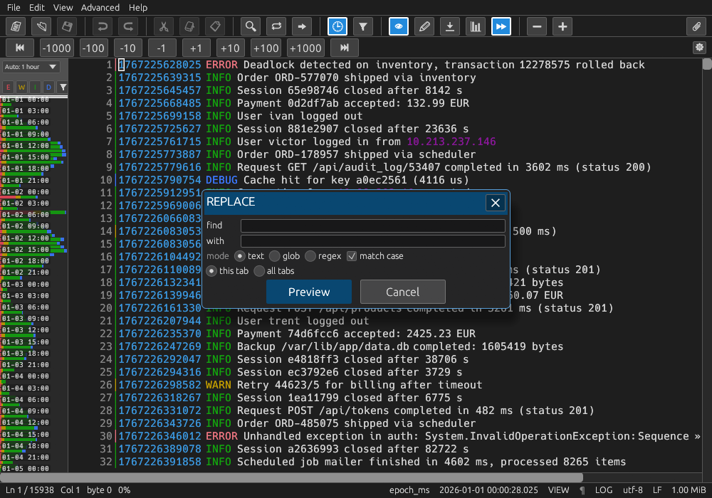
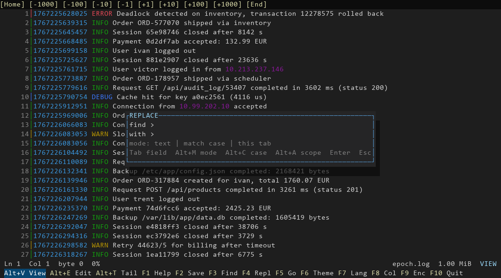
- **Entry:** `F4` or `Ctrl+H`; window: Edit > Replace / toolbar.
- **Expected response:** typing anything resets the preview; after applying, the tab is marked modified and **one** `Ctrl+Z` undoes the whole run.
- **Must not:** touch the files on disk; apply anything when cancelled with `Esc`, or when over 2,000,000 occurrences ("too many").
- **Limits and edge cases:** all-tabs skips the tabs that cannot take it (non-UTF-8 with a regex, for example) and says how many; tabs cannot be opened or closed while it runs.
- **Auto tests:** yes (`replace`).

#### F-03 Line filter (`Alt+G`)

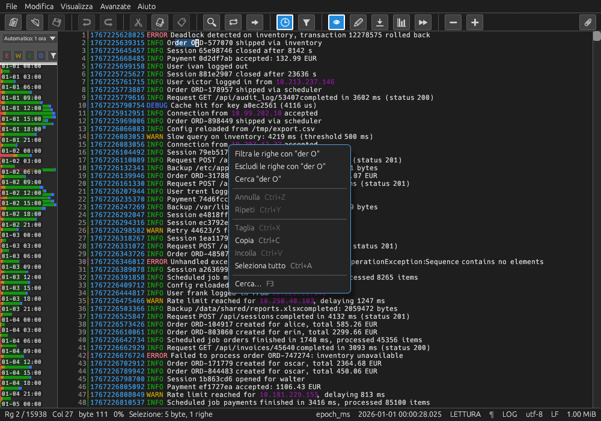
- **Entry:** `Alt+G`; window: Filters window. In the prompt, `Alt+I` inverts (hide the lines that match).
- **Expected response:** the new tab with the matching lines and a message like `297 lines: Enter on a line goes to it in the file`;
  `Enter` on a line brings forward the original file (reopening it if closed) with the cursor on that exact line.
- **Must not:** modify the original. Editing in the view is refused ("a filtered view is read-only: edit the original file"). With no match:
  "no line matches", no tab and no temporary file left.
- **Limits and edge cases:** at most 20,000,000 lines per view (it stops and says it was cut); the temporary file `mrp-filter-<pid>-<n>.log` is in the
  system temporary folder and is deleted when the tab closes or the program exits.
- **Auto tests:** yes (`filter_view`, `filters_app`).

#### F-04 Record length check (`Alt+H`)

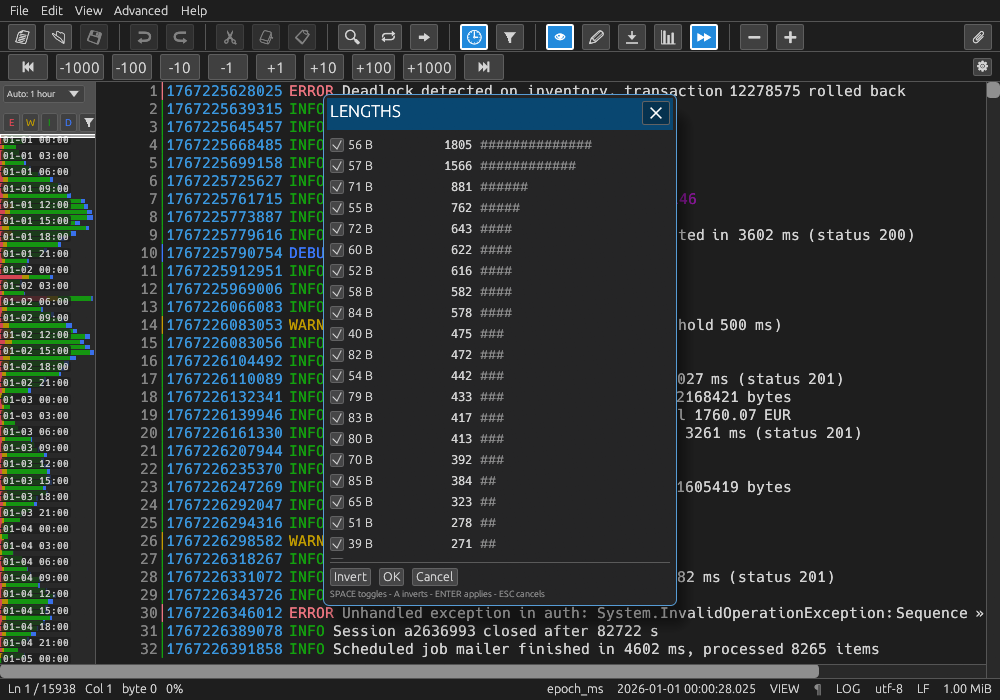
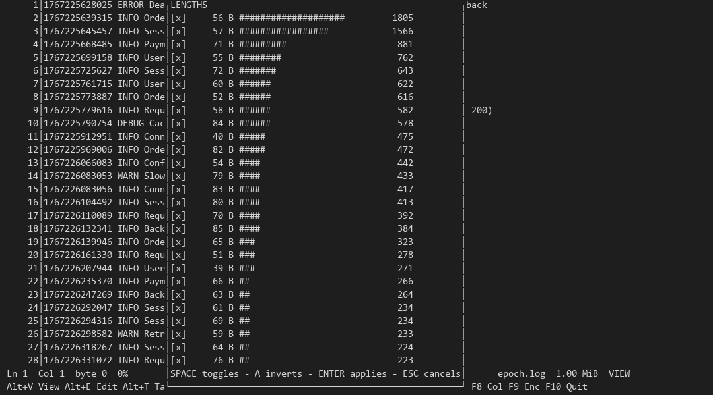
- **Entry:** `Alt+H`; window: Advanced > Record length check. In the histogram `SPACE` ticks the length under the cursor, `A` inverts the whole selection, `Enter` applies, `Esc` cancels.
- **Expected response:** while the pass counts the dialog says the percentage; then the list, scrollable, answers `SPACE`/`A` at once: each row says its count, bar and percentage of the total, and at the bottom the total (`2,202 records · 3 lengths`); `Enter` opens the view with a message like `2 lines: Enter on a line goes to it in the file` (and `Enter` on a line of the view goes to it in the original, as in F-03).
- **Must not:** modify the original. With nothing ticked: "no line matches", no tab. With no lines at all: "nothing to count". `Esc` leaves everything as it was, and the aborted selection is not remembered.
- **Limits and edge cases:** the lengths are content bytes: CRLF lines count without the `\r`, the last line without a newline is a line, an empty line has length 0. The pass sees unsaved edits (it reads the snapshot) and is cancelled by closing (it restarts at the next opening). In the window the boxes are clickable and Invert / OK / Cancel are buttons.
- **Auto tests:** yes (`lengths` in the core, `lengths_app`, `lengths_view`).

### Encodings and line endings

#### E-01 Encoding: detection and change (`F9`)

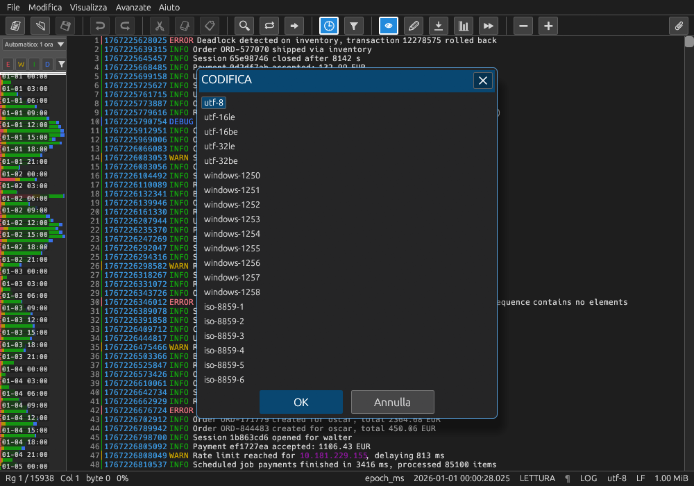
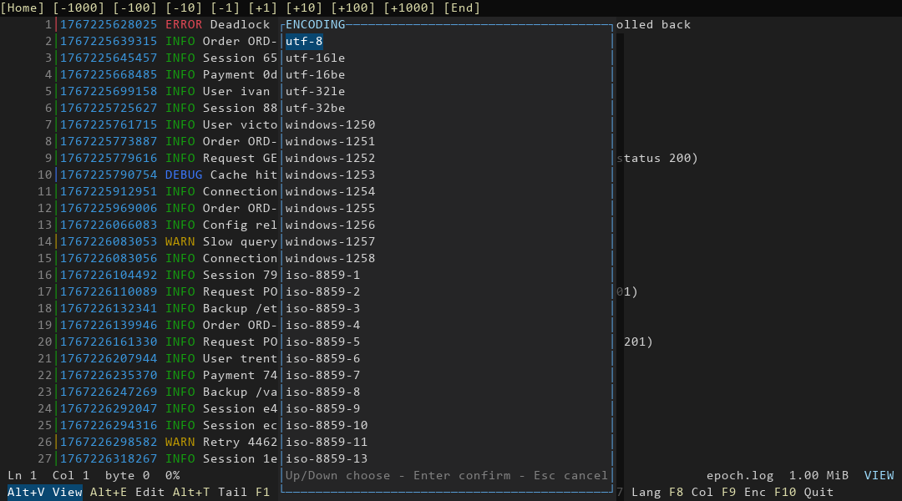
- **Entry:** automatic on open; `F9` (window: View > Encoding…) opens the list of 64 encodings with the current one highlighted; on the command line `--encoding NAME`.
- **Expected response:** the text re-reads in place and the status row names the encoding (nothing is shown for plain UTF-8). Observed on 28 test files (UTF-8 with and without BOM, UTF-16/32 both byte orders, 14 single-byte code pages, 7 DOS and Mac pages, Shift-JIS, EUC-JP, GBK, GB18030, Big5, EUC-KR): with `--encoding` all 28 read exactly; with detection, the Unicode ones with BOM, UTF-8, UTF-16 without BOM and windows-1252/ISO-8859-1 are right, and every other 8-bit or Asian file opens as windows-1252 (garbled but intact), and **choosing the right encoding in `F9` fixes the text in all 21 cases tried**.
- **Must not:** change the file; lose or hide a byte that is not valid (it shows as one replacement character per byte and is written back unchanged).
- **Limits and edge cases:** switching between UTF-16/32 and the other encodings is refused while the document is modified ("save before switching to/from UTF-16/32"). The status row does not say that the encoding was *guessed*.
- **Auto tests:** yes (`app_encoding`, `app_utf16`, `app_utf32`, `app_multibyte`, core encoding tests).

#### E-02 Save as with another encoding (`Ctrl+Shift+S`)
- **Entry:** `Ctrl+Shift+S`: first the path, then a list of encodings (the current one highlighted, `Tab` = write a BOM, `Enter` saves).
- **Expected response:** "Saved NAME as ENCODING"; the document becomes the new file. Observed: 17 conversions from UTF-8 (UTF-16/32 both orders with and without BOM, ISO and Windows code pages, KOI8-R, CP866, Shift-JIS, EUC-JP, GBK, Big5, EUC-KR) gave **byte-exact files** with the right BOM and read back correctly; cp1251 → UTF-8 → cp1251 gave the identical file. A character the target cannot hold stops the save with a precise message ("Cannot write U+1F600 in windows-1252 (at byte 5): nothing was saved") and no file is created.
- **Must not:** write a partial file; touch the source.
- **Limits and edge cases:** the path field is pre-filled with the folder of the file: type only the new name (typing a full path appends to it and fails with the raw system error 123).
- **Auto tests:** yes (`save_encoding`).

#### E-03 Editing keeps the encoding and the line ending
- **Entry:** automatic.
- **Expected response:** observed: typing `é`, `ж`, `あ`, `好`, `가` in windows-1252, windows-1251, UTF-16, Shift-JIS, GBK and EUC-KR files and saving gave exactly the right bytes; a BOM and invalid UTF-8 bytes are kept; typing a character the encoding cannot hold is refused at once ("cannot write '日' in windows-1252") and nothing is inserted.
- **Must not:** break a line ending.
- **CRLF (fixed 2026-11-08):** in a CRLF file (UTF-8, UTF-16 LE/BE, UTF-32) the `\r\n` is one line end: `End` and `Shift+End` stop before the `\r`, typing and `Enter` at the end of a line go before it, `Right`/`Left`/`Backspace`/`Delete` step over the pair as one character, and `Down` from the end of a line lands at the end of the next. Before the fix the cursor could sit between `\r` and `\n` and typing there saved `ab\rX\ncd\r\n`.
- **Auto tests:** yes (`app_lineending`, `eol_option`, `app_bom`, `app_crlf` for editing at the end of a CRLF line in UTF-8 and UTF-16, `altgr`).

---

## Under the hood

How it works inside — the session, the piece table, the line index, time, encodings, search, the caches — lives on its own page: **[ARCHITECTURE.md](../ARCHITECTURE.md)**, written for those who want to understand the engine (or contribute to it).

---

## UX test sheet

One row per card. `Terminal` is the result of the terminal passes of 2026-11-07 (about 130 scenarios driven on the installed program with simulated keys, then about 45 with a real console, keyboard and mouse); `Window` is the result of the window passes of the same day: screenshots produced by the developer hooks of `mrp-gui`, then the real window driven with keyboard and mouse. A defect that applies to the whole window: with `--theme light` and a file with recognised times, the timeline panel stays dark.

| ID | Feature | Terminal | Window | Auto tests |
|---|---|---|---|---|
| N-01 | Open from the command line | NOTE: cut footer under 40 columns; mixed-language error; `--help` lists 4 of 6 themes | OK | yes |
| N-02 | Open another file, new document | OK | NOTE: the native Open / Save as dialogs start in the working folder | yes |
| N-03 | Move around | OK (also with the real mouse: wheel, drag, jump-bar buttons) | OK (wheel, scrollbar drag, timeline click, mouse selection) | yes |
| N-04 | Go to (line, @byte, %percent, ~time) | NOTE: errors do not say what is valid | OK | yes |
| N-05 | Jump pages, jump bar | OK | OK | yes |
| N-06 | Line numbers, line index | DEFECT: dialog button says "Replace"; long note cut | DEFECT: `Alt+X`, shown in the menu, does nothing in the window | yes |
| N-07 | Tabs | DEFECT: closing a tab says "Save and quit"; clicking a tab works | OK | yes |
| N-08 | Progress of long jobs | OK (6 GB) | OK (5.6 GB: bar, bytes, speed, ETA) | yes |
| M-01 | The three modes | OK | OK | yes |
| M-02 | The mode menu | NOTE: the click opens the menu but the entries cannot be clicked | OK (click on the mode word) | yes |
| M-03 | Typing and editing | NOTE: `Ctrl+V` pastes only text copied inside the program ("clipboard is empty") | OK | yes |
| M-04 | Undo and redo | OK | OK (Ctrl+Z removes the whole typed word) | yes |
| M-05 | Save and Save as | DEFECT: Save as shows the internal Windows path prefix and a ~20-char field | OK: "saved: NAME", the title loses the `*`; NOTE: the dialog starts in the working folder | yes |
| M-06 | Discard changes | DEFECT: "This cannot be undone" is cut off | OK (full text, wrapped) | yes |
| M-07 | Quit with unsaved changes | OK | NOTE: closing a tab says "Save and quit" | yes |
| M-08 | Tail | OK | OK (live: appended lines are followed) | yes |
| T-01 | Time format of the lines | OK | NOTE: `Alt+O` does nothing in the window (the Filters window works) | yes |
| T-02 | Go to a time | NOTE: "no line with that time" on a file without times | not tested | yes |
| T-03 | Time range | DEFECT: typing appends to the prefilled "From"; garbage accepted | DEFECT: `Alt+I`, shown in the menu, does nothing; the window itself is fine | yes |
| T-04 | Timeline | NOTE: silent when too narrow; mentions a menu the terminal lacks; click on the panel works | DEFECT: `Alt+B`, shown in the menu, does nothing; click and drag work | yes |
| T-05 | Timeline step | NOTE: silent when the timeline is off | NOTE: `Alt+P` does nothing in the window | yes |
| T-06 | Level filter | NOTE: silent when the timeline is off | NOTE: `Alt+S` does nothing in the window | yes |
| T-07 | Log colours | NOTE: no feedback; colours not visible in the dump | OK | yes |
| F-01 | Find | NOTE: raw regex error text | NOTE: label says "(exact bytes)" | yes |
| F-02 | Replace | NOTE: switches to EDIT silently; hint cut | DEFECT: after the preview, Enter does not apply; only the button does | yes |
| F-03 | Line filter | NOTE: raw regex error text | OK | yes |
| F-04 | Record length check | OK | not tested | yes |
| E-01 | Encoding: detection and change | OK: 28/28 explicit, 21/21 fixed with F9; NOTE: a guess is not flagged | not tested | yes |
| E-02 | Save as with another encoding | OK: 17/17 byte-exact; NOTE: pre-filled path with `\\?\` | not tested | yes |
| E-03 | Editing keeps encoding and line ending | OK (CRLF defect fixed) | not tested | yes |
